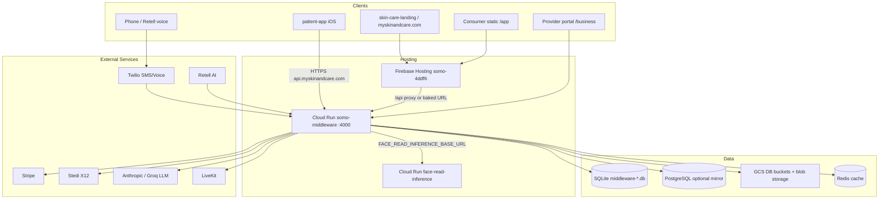
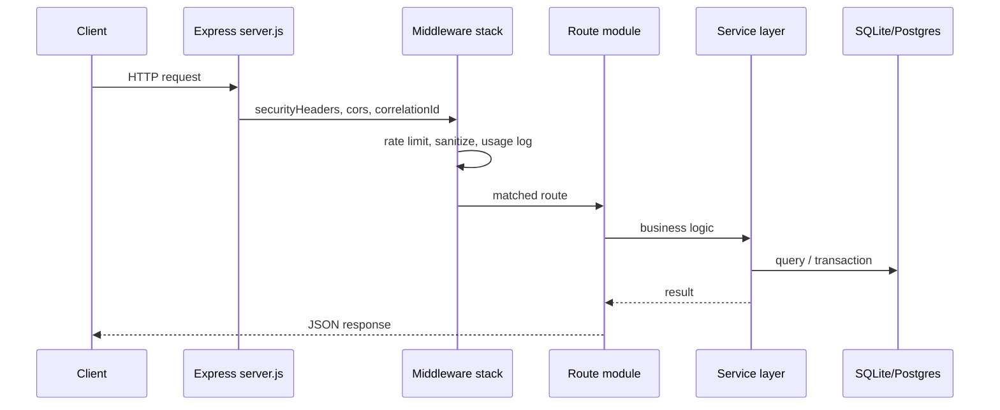
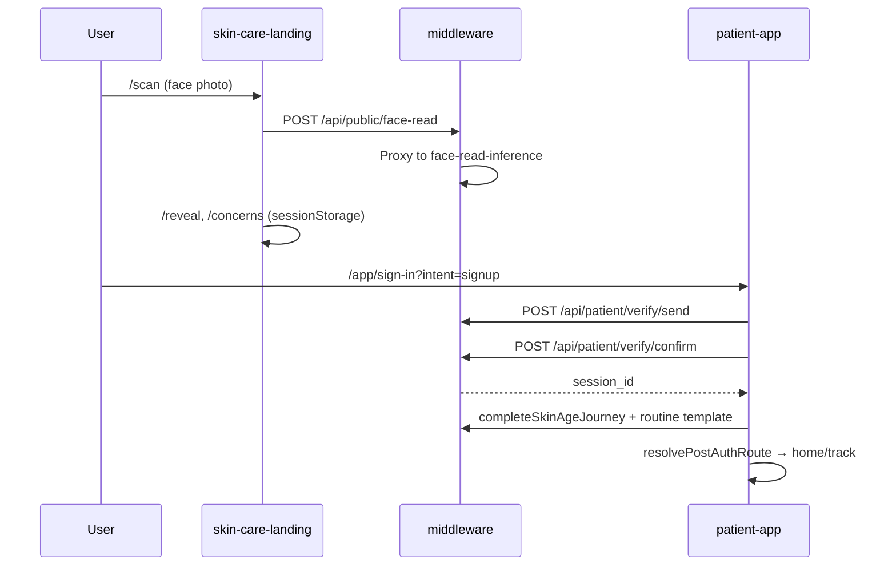
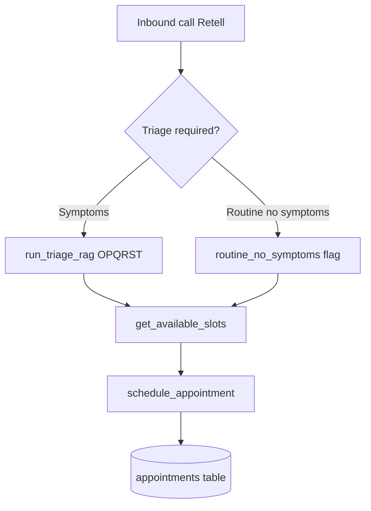

# Architecture Report — Skin & Care (`skin-and-care`)

> Comprehensive solution architecture report for the Skin & Care codebase.
> Generated from full repository analysis (~2,000 files).

---

## Confirmation & Summary

| Item | Value |
|------|-------|
| **What the project is** | Consumer skincare tracking platform: Expo iOS app + web funnel on shared Somo middleware API (Cloud Run). Daily photos, spot tracking, routine/conflict engine, barcode shelf scan, optional `care_program` subscription. |
| **Files analyzed** | **~1,999 tracked files** (glob cap; repo is ~2,000 files including docs, Knowledge ICD data, scripts, tests) |
| **Unclear / incomplete areas** | Production middleware deploy runs from `somo-platform` only; some legacy Azure/Railway references in OpenAPI; large `database.js` (~20k lines) has tables not fully enumerated here; Kelly/LangGraph rollout is flag-driven and environment-specific |

---

## 1. Executive Summary / Project Overview

**Skin & Care** is a standalone workspace (not a branch mirror of `somo-platform`) for a consumer skincare product:

- **Primary product:** iOS app (`com.skinandcare.app`) for daily photo journaling, concern-based routines (acne, anti-aging, hyperpigmentation, barrier repair, rosacea), spot watching, product barcode scanning, and ingredient conflict analysis.
- **Consumer web:** Marketing + acquisition funnel at [myskinandcare.com](https://myskinandcare.com) (Firebase Hosting, site `myskinandcare`).
- **API:** Shared middleware at `api.myskinandcare.com` / `api.callsomo.com` (same Cloud Run service `somo-middleware`).
- **Platform heritage:** The repo contains the full Somo platform stack — voice agent Kelly (Retell/Twilio), provider/business portals, RCM (Stedi), payor registry, medical coding, FHIR — because middleware is shared. Skin & Care uses the **consumer/patient** slice; provider/voice/RCM remain for platform continuity and cherry-pick porting from `somo-platform`.

**Positioning:** "The #1 Skincare Journal" — face check as hook, daily photo log as core product, optional care program subscription via Stripe.

---

## 2. Tech Stack & Dependencies

### Root (`package.json`)
- **Runtime:** Node.js (≥16), npm workspaces-style scripts (no workspaces field; sub-packages have own `package.json`)
- **Dev tools:** Playwright, Lighthouse, Firebase CLI, Expo ngrok
- **Role:** Orchestration scripts for brand checks, consumer hosting builds, GCP deploy, CI gates, face-read smoke tests

### `middleware-platform/` — Backend API
| Layer | Technology |
|-------|------------|
| HTTP | Express 4.x |
| DB primary | SQLite (`better-sqlite3`), WAL mode |
| DB optional | PostgreSQL (`postgres`, Drizzle ORM for consumer v3 tables) |
| Auth | JWT, bcryptjs, session cookies, API keys |
| AI/LLM | Anthropic SDK, Groq, LangChain, LangGraph (+ Postgres checkpoint) |
| Payments | Stripe, Circle USDC wallets, Mastercard/Visa services |
| Voice | Twilio, Retell AI, LiveKit server SDK |
| Healthcare | Stedi (X12), FHIR R4 adapters, Epic adapter |
| Storage | GCS, Azure Blob (legacy) |
| Cache/Queue | ioredis (Redis) |
| Image | sharp, heic-convert |
| Email | nodemailer |
| Observability | Application Insights, LangSmith |
| Testing | Jest, Playwright, Cypress, Supertest |

### `patient-app/` — Mobile (Expo)
| Layer | Technology |
|-------|------------|
| Framework | Expo ~54, React Native 0.81, React 19 |
| Routing | expo-router 6 |
| Data fetching | SWR |
| Camera/scan | expo-camera, @zxing/browser |
| Fonts | Gloock + DM Sans |
| Icons | @tabler/icons-react-native |
| Build | EAS (TestFlight / App Store) |
| Tests | Vitest, TypeScript |

### `unified-dashboard/skin-care-landing/` — Marketing SPA
| Layer | Technology |
|-------|------------|
| Build | Vite 5, React 18 |
| Routing | react-router-dom |
| Vision | @mediapipe/tasks-vision (face detect on web funnel) |

### `inference/face-read/` — GPU/CPU inference
- FastAPI + OpenCV DNN
- Deployed to Cloud Run as `face-read-inference`
- Contract: `GET /health`, `POST /v1/face-read`

### `livekit-agents/`
- Python agents (`transcription_agent.py`, `vc_yolo_probe.py`) for LiveKit voice/video experiments

---

## 3. Directory Structure

```
/Users/ojrichard/Voice Agent/skin-and-care/
├── patient-app/              # Expo React Native iOS app (Skin & Care consumer)
├── middleware-platform/      # Monolithic Express API + services (~10k line server.js)
├── unified-dashboard/        # Static HTML portals + skin-care-landing Vite SPA
├── inference/face-read/      # Face-age inference microservice
├── livekit-agents/           # Python LiveKit agents
├── Knowledge/                # Medical coding rules, ICD/HCPCS data, RAG corpus, eval datasets
├── docs/                     # Extensive runbooks, architecture, API, brand, compliance
├── scripts/                  # Repo-level deploy, brand, hosting, smoke scripts (~100+)
├── todos/                    # Pending/archive task tracking
├── local/                    # Local dev credentials templates (gitignored patterns)
├── config/                   # Shared config (e.g. escrow-timeout.js)
├── infra/                    # Azure bicep (legacy)
├── perf/                     # Lighthouse performance runs
├── .github/workflows/        # CI/CD (ci.yml, mobile, staging deploy)
├── package.json              # Root orchestration scripts
└── README.md                 # Entry point + quick start
```

### Major folders — detailed

#### `patient-app/`
| Path | Purpose |
|------|---------|
| `app/` | expo-router screens: tabs (home, track, scan, progress, account), onboarding, capture flows, verdict, routine |
| `components/` | UI: v3 cards, conflict engine (BFI ring, ConflictCard), journal, progress |
| `lib/` | API clients (`patient-api.ts`, `journal-api.ts`, `conflict-api.ts`), session, onboarding storage, skin-age journey |
| `constants/` | Design tokens, routes, billing theme |
| `hooks/` | Theme, onboarding gate |
| `scripts/` | TestFlight verify, face-read smoke, Expo device checks |
| `eas.json` | EAS build profiles (development, preview, testflight, production) |

#### `middleware-platform/`
| Path | Purpose |
|------|---------|
| `server.js` | Express entry (~10,400 lines): boot, middleware, static hosting, route mounts, inline legacy handlers |
| `database.js` | SQLite schema + migrations inline (~20,700 lines), Postgres pool optional |
| `routes/` | 108 route modules (patient, public funnel, voice, RCM, admin, commerce) |
| `services/` | 371+ service modules (Kelly rails, consumer graphs, payor, vision, payments) |
| `middleware/` | Auth, rate limits, FHIR JWT, patient session, webhook security, tenant context |
| `migrations/` | 60 numbered migration files (001–059) |
| `bootstrap/` | `register-api-routes.js`, `register-patient-routes.js`, `static-hosting.js` |
| `db/` | Drizzle schema fragments + SQL migrations for consumer v3 Postgres |
| `lib/` | Patient routine DB, journal DB, billing calendar, static hosting paths |
| `repositories/` | Data access (spots, routines) |
| `adapters/` | FHIR, universal channel adapter |
| `taxonomy/` | Product category routing JSON configs |
| `scripts/` | 400+ operational scripts (payor ingest, catalog, Kelly eval, deploy helpers) |
| `e2e/` | Playwright specs (staging, consumer journey, provider portal, RCM) |
| `__tests__/` | Jest unit/integration tests |
| `openapi.yaml` | OpenAPI 3.0 spec (ACP/AP2/Voice/Patient/FHIR) |
| `.env.example` | Comprehensive env documentation |

#### `unified-dashboard/`
| Path | Purpose |
|------|---------|
| `skin-care-landing/` | Vite React marketing funnel (/scan, /reveal, /concerns) |
| `business/` | Provider portal HTML (today, calendar, billing, RCM, patients) |
| `patients/` | Patient web portal HTML (dashboard, checkout-chat, appointments) |
| `admin/` | Admin CRM, leads, pipeline |
| `assets/` | Shared CSS/JS, brand (panda logo, fonts), provider shell chrome |
| `firebase.json` / `firebase.consumer.json` | Firebase Hosting configs (callsomo vs myskinandcare sites) |
| `hosting-dist-consumer/` | Built consumer bundle (gitignored) |

#### `Knowledge/`
| Path | Purpose |
|------|---------|
| `rules/` | Triage, ICD-10 excludes, prior-auth, coding rules JSON |
| `ontology/` | Medical entities, severity indicators, abbreviations |
| `ICD-10 Files/` | Official ICD-10 reference data (large XML/CSV) |
| `RAG/` | Terminology lookups, concept corrections, Flask deploy notes |
| `eval/` | Golden datasets, baseline accuracy reports |
| `corpus/` | Derm education manifest |

#### `docs/`
Consolidated documentation hub (~50 README/index files). Key anchors:
- `LOCAL.md`, `CLOUD.md`, `MOBILE.md` — environment topology
- `architecture/SERVER_DECOMPOSITION.md` — monolith refactor plan
- `Database/ENV_AND_DB_SSOT.md` — DB file matrix
- `patient-app/README.md` — patient API routes + tables
- `integrations/README.md` — Stedi, Stripe Issuing, UHC FHIR
- `voice-agent/README.md` — Kelly/Retell configuration

#### `scripts/`
Repo-level automation: consumer hosting build, GCP bootstrap/deploy, brand string guards, retention cleanup, face-read deploy, callsomo cutover, doc parity checks.

---

## 4. System Architecture



### Core components

| Component | Location | Responsibility |
|-----------|----------|----------------|
| **Express server** | `middleware-platform/server.js` | HTTP termination, static assets, route mounting, workers |
| **Patient portal** | `routes/patient-*.js`, `services/patient-portal-service.js` | OTP auth, sessions, routine, journal, shelf, goals |
| **Consumer funnel** | `routes/public-funnel-*.js`, `public-face-read.js` | Web acquisition, skin-age journey, face-read proxy |
| **Conflict / eval engine** | `services/consumer-analysis-graph.js`, `consumer-insight-graph.js` | LangGraph ingredient conflict + insights |
| **Kelly voice agent** | `services/kelly-rails/`, `routes/kelly.js`, `routes/voice.js` | Retell function calls, appointment booking, triage |
| **Payment orchestrator** | `services/payment-orchestrator.js`, `routes/payment.js` | Stripe, Circle, commerce checkout |
| **RCM** | `routes/rcm.js`, `services/adjudication-service.js` | Claims, eligibility via Stedi |
| **Payor registry** | `services/payor-*` | NPPES ingest, canonical payor resolution |
| **Reasoning pipeline** | `services/reasoning-job-queue-service.js` | Async product/category reasoning jobs |
| **Background workers** | Started from server.js | Postgres sync, tool-call DLQ, EHR sync, notification queue |

---

## 5. Data Models & Database Schema

### Storage strategy
- **Primary:** SQLite (`middleware-dev.db` local, `middleware-staging.db` / `middleware-prod.db` on Cloud Run)
- **Durability:** GCS bucket sync for Cloud Run DB files
- **Optional mirror:** `POSTGRES_URL` for consumer v3 tables + LangGraph checkpoints
- **Migrations:** Numbered files in `middleware-platform/migrations/` + inline DDL in `database.js`

### Schema domains (representative tables)

#### Commerce & payments
`merchants`, `products`, `checkout_sessions`, `transactions`, `voice_checkouts`, `payment_receipts`, `wallet_transactions`, `fraud_*`, `stripe_cardholders`, `circle_accounts`, `ledger_*`, `financial_events`

#### Healthcare / FHIR
`fhir_patients`, `fhir_encounters`, `fhir_observations`, `fhir_document_references`, `fhir_audit_log`, `ehr_connections`, `ehr_*`

#### Clinical / triage
`triage_sessions`, `appointments`, `patient_sessions`, `cpt_codes`, `icd10_codes`, `hcpcs_codes`

#### Insurance / RCM
`insurance_payers`, `patient_insurance`, `eligibility_checks`, `insurance_claims`, `payor_source_records`, `prior_auth_requests`

#### Patient portal (Skin & Care core)
| Table | Purpose |
|-------|---------|
| `patient_portal_sessions` | OTP/session auth (`x-session-id`) |
| `patient_routine_templates` / `_items` | Active skincare routine |
| `patient_routine_daily_entries` / `_item_logs` / `_media` | Daily routine completion + photos |
| `patient_onboarding_step3_products` | Shelf products |
| `patient_journal` (migration 059) | Journal entries |
| `patient_consumer_profiles` | Journey modes, onboarding flags (v3) |
| `patient_spots` / `patient_spot_snapshots` | Spot watcher journey |
| `patient_goals` | User goals (watch_spot, improve_routine, etc.) |
| `patient_portal_events` | Analytics whitelist events |
| `customer_products` / `claim_audit` | Landing session → account product claim |

#### Catalog / reasoning
`products_catalog`, OBF/OFF index tables, `ingredient_*`, `reasoning_jobs`, `session_result_snapshots`, `semantic_reject_audit_log`, taxonomy graph tables

#### Consumer v3 Drizzle (Postgres)
`middleware-platform/db/schema/` — `patientConsumerProfiles`, `patientSpots`, `patientSpotSnapshots`

---

## 6. API Endpoints & Routes

Full spec: `middleware-platform/openapi.yaml`. Route registration split across `server.js`, `bootstrap/register-api-routes.js`, `bootstrap/register-patient-routes.js`.

### Mount prefixes (from `server.js`)

| Prefix | Module(s) | Auth |
|--------|-----------|------|
| `/health` | `routes/health.js` | Public |
| `/webhooks/stripe` | `stripe-webhook-handler.js` | Stripe signature |
| `/webhooks/stedi` | `stedi-webhooks.js` | Webhook secret |
| `/voice` | `voice.js`, appointments | Retell/Twilio, tenant context |
| `/api/kelly` | `kelly.js` | Session/API |
| `/api/retell` | `retell-functions.js` | Retell |
| `/api/payment` | `payment.js` | Bot guard + limits |
| `/api/rcm` | `rcm.js` | Provider auth |
| `/api/public/*` | public products, geo, checkout, commerce | Rate limited |
| `/api/patient/*` | patient-* routes | `requirePatientSession` |
| `/api/customer/*` | customer auth, billing, wallet | Customer session |
| `/api/admin/*` | admin routes | `requireAdminAuth` |
| `/fhir` | `fhir.js` | JWT (required in prod) |
| `/api/livekit` | `livekit.js` | Token auth |

### Skin & Care patient API (high-signal)

| Method | Path | Notes |
|--------|------|-------|
| POST | `/api/patient/verify/send` | OTP email |
| POST | `/api/patient/verify/confirm` | Confirm OTP → session |
| POST | `/api/patient/auth/handoff/exchange` | Web→app ticket exchange |
| GET | `/api/patient/routine/template` | Active routine |
| POST | `/api/patient/routine/template` | Create routine |
| GET/POST | `/api/patient/routine/daily` | Daily log |
| GET | `/api/patient/home/progress-summary` | Home BFI metrics |
| GET | `/api/patient/home/next-actions` | Journey agent cards |
| GET | `/api/patient/shelf/products` | Product shelf |
| POST | `/api/patient/shelf/scan` | Barcode scan |
| GET | `/api/patient/shelf/products/:id/insight` | LLM insight (flagged) |
| GET/POST | `/api/patient/journal/*` | Photo journal |
| GET/POST | `/api/patient/goals` | User goals |
| GET/PATCH | `/api/patient/consumer-profile` | Journey modes, onboarding |
| GET/POST | `/api/patient/spots/*` | Spot tracking |
| POST | `/api/public/face-read` | Face-age proxy to inference service |
| POST | `/api/public/product-scan` | Public barcode (funnel) |
| POST | `/api/public/routine/evaluate` | Conflict evaluation |

### Voice agent (Kelly)
| Method | Path | Purpose |
|--------|------|---------|
| POST | `/voice/appointments/schedule` | Book appointment |
| POST | `/voice/appointments/available-slots` | Slot lookup |
| POST | `/voice/insurance/collect` | Insurance intake |

---

## 7. Frontend Architecture

### 7.1 Mobile app (`patient-app/`)

**Router:** expo-router with tab navigator at `(tabs)/`.

**Tab IA (v3):**
- **Home** — BFI ring, routine steps, daily photo CTA
- **Track** — Spot watcher (journey A)
- **Scan** — Barcode + shelf (journey B)
- **Progress** — Photo grid, history
- **Profile (account)** — Goals, journey toggle, Stripe subscribe

**Post-auth routing** (`resolvePostAuthRoute`, `useOnboardingGate`):
1. No journey → `/onboarding/journey-choose`
2. Watch mode, no spots → track tab
3. Routine, no template → `/routine/pick`
4. Incomplete bio → `/onboarding/bio-calibration`
5. Empty shelf → scan tab
6. Default → home

**Session:** `expo-secure-store` + `x-session-id` header on all API calls (`lib/patient-session.ts`, `lib/patient-api.ts`).

**Deep links:** `auth?ticket=`, `subscription/success|cancel`, `routine/setup?concern=`.

### 7.2 Web consumer funnel (`unified-dashboard/skin-care-landing/`)

Vite SPA served at `/` on myskinandcare.com:
- `/scan` → face capture (MediaPipe)
- `/reveal` → skin age reveal
- `/concerns` → concern selection
- Signup redirects to `/app/sign-in?intent=signup`

State in `sessionStorage` (`sc_onboarding_*`); on OTP completion calls backend to set routine template + `journey_modes: ['routine']`.

### 7.3 Hosted patient web app

Static export at `myskinandcare.com/app` — same v3 IA as mobile, uses `localStorage` + `x-session-id`.

Build pipeline: `npm run build:consumer-hosting` → `unified-dashboard/hosting-dist-consumer/`.

### 7.4 Provider / admin portals

Static HTML in `unified-dashboard/business/`, `patients/`, `admin/` served by middleware at `/business`, `/patients`, `/admin` with shared assets in `unified-dashboard/assets/`.

---

## 8. Backend Architecture

### Request lifecycle



### Service layer patterns
- **Route registration functions:** `registerPatientXRoutes(app, deps)` — dependency injection from `server.js` / `build-patient-route-deps.js`
- **Graph orchestrators:** LangGraph for consumer eval, insights, Kelly rails v2
- **Sync fallbacks:** Graph failures fall back to deterministic pipelines (`runEvaluatePipelineSync`, `ruleBasedActions`)
- **Feature flags:** Env-driven rollout (`FEATURE_V3_INSIGHTS`, `KELLY_RAILS_V2`, etc.)

### Background processing
- `PostgresSyncWorker` — SQLite → Postgres mirror
- `ToolCallDlqWorker` — failed Kelly tool calls
- `EhrSyncJobWorker` — EHR sync jobs
- `ReminderScheduler` — appointment reminders
- Reasoning job reclaim scripts (scheduled)

### Monolith decomposition status
Per `docs/architecture/SERVER_DECOMPOSITION.md`:
- Phase 1–2 complete: static hosting extract, patient route registration, health routes
- Phase 3 deferred: large admin/RCM inline handlers remain
- **Rule:** new endpoints go in `routes/*.js`, not `server.js`

---

## 9. Authentication & Authorization

| Actor | Mechanism | Key files |
|-------|-----------|-----------|
| **Patient (app/web)** | Email OTP → `patient_portal_sessions`; header `x-session-id` or cookie `patient_session_id`; CSRF for cookie auth | `middleware/patient-session.js`, `routes/patient-auth.js` |
| **Customer (landing claim)** | `customer_session` cookie | `middleware/customer-auth.js` |
| **Provider** | Login session + provider auth middleware | `middleware/auth.js`, `/login` |
| **Admin** | Admin session cookie | `middleware/admin-auth.js` |
| **API integrators** | `X-API-Key` / Bearer | `utils/api-keys.js` |
| **FHIR** | JWT (`REQUIRE_JWT_FOR_FHIR=1` in prod) | `middleware/jwt-fhir-auth.js` |
| **Webhooks** | Twilio signature, Stripe raw body, Retell secret | `middleware/webhook-security.js` |
| **Internal ops** | Service auth | `middleware/service-auth.js` |

**Session TTL:** Configurable absolute (24h default) and inactivity (60m) + rotation every 6h for cookie sessions.

**Rate limits:** General API 100/15min, auth 5/15min, payment 10/hr, voice 20/min (per `docs/api/README.md`).

---

## 10. External Integrations

| Integration | Use case | Config keys |
|-------------|----------|-------------|
| **Stripe** | Care program subscription, checkout, webhooks, Issuing cards | `STRIPE_SECRET_KEY`, `STRIPE_WEBHOOK_SECRET` |
| **Retell AI** | Kelly voice agent runtime | `RETELL_API_KEY`, `RETELL_AGENT_ID` |
| **Twilio** | Inbound/outbound voice, SMS OTP | `TWILIO_ACCOUNT_SID`, `TWILIO_AUTH_TOKEN` |
| **Stedi** | Eligibility (270/271), claims (837), status (276/277) | `STEDI_API_KEY`, `STEDI_API_BASE` |
| **Anthropic / Groq** | Kelly LLM, consumer insights | `ANTHROPIC_API_KEY`, `GROQ_API_KEY` |
| **LangSmith** | LLM tracing | `LANGCHAIN_*` |
| **LiveKit** | Video consult tokens | LiveKit server SDK |
| **Circle** | USDC wallet payouts post-Stripe | `CIRCLE_API_KEY` |
| **GCS** | DB backup, OBF catalog, blobs | GCP ADC |
| **Firebase Hosting** | Static consumer + provider sites | `firebase.consumer.json` |
| **Cloud Run** | API + face-read inference | GCP deploy scripts |
| **Redis** | Consumer eval/insight cache | `REDIS_URL` |
| **Pinecone** (optional) | Reasoning vector index | Reasoning verify scripts |
| **Epic / EHR** | EHR sync (provider platform) | `ehr_connections` |

---

## 11. Environment Variables & Configuration

**SSOT docs:**
- `middleware-platform/.env.example` (~270 lines, comprehensive)
- `docs/setup/ENV.md`
- `docs/Database/ENV_AND_DB_SSOT.md`

### Critical groups

| Group | Variables |
|-------|-----------|
| **Core** | `NODE_ENV`, `PORT`, `DB_PATH`, `DB_NAME`, `POSTGRES_URL` |
| **Public URLs** | `API_BASE_URL`, `PUBLIC_BASE_URL`, `NGROK_URL` |
| **Patient session** | `PATIENT_SESSION_*_TTL_*` |
| **Consumer v3 flags** | `FEATURE_V3_INSIGHTS`, `LANGGRAPH_CONSUMER_EVAL_ROLLOUT_PCT`, `NEXT_GEN_PIPELINE` |
| **Kelly** | `KELLY_RAILS_V2`, `KELLY_PRIMARY_PROVIDER`, `REQUIRE_TRIAGE_FOR_VOICE` |
| **Face read** | `FACE_READ_INFERENCE_BASE_URL` |
| **Security prod gates** | `REQUIRE_JWT_FOR_FHIR`, `JWT_SECRET` (≥32 chars) |
| **Mobile** | `EXPO_PUBLIC_API_BASE_URL`, `EXPO_PUBLIC_WEB_SIGNUP_URL` |

### Environment matrix

| Layer | Local | Staging | Production |
|-------|-------|---------|------------|
| API | `:4000` | `api.callsomo.com` (`STAGING=1`) | `api.callsomo.com` / `api.myskinandcare.com` |
| SQLite | `middleware-dev.db` | `middleware-staging.db` | `middleware-prod.db` |
| Consumer UI | `hosting-dist-consumer-local` | `hosting-dist-consumer` | same |
| Patient web | `127.0.0.1:5194/app` | myskinandcare.com/app | same |

---

## 12. Build, Test & Deployment Pipeline

### Local development

```bash
# API
cd middleware-platform && npm ci && npm start # :4000

# Mobile
cd patient-app && cp .env.example .env && npx expo start

# Landing hot reload
npm run dev:skin-care-landing # Vite :5180, proxies to :4000

# Full consumer local stack
npm run dev:consumer-local
```

### CI (`.github/workflows/ci.yml`)
On push/PR to main/develop:
- Brand string guards, legacy host checks
- Middleware Jest (full suite, Kelly rails golden, voice smoke)
- Patient-app typecheck + Vitest
- Consumer hosting build + verify
- Reasoning regression + eval harness
- Security gate (redaction + forbidden data scan)
- Playwright provider portal + RCM
- Cypress (if present)
- Staging routing smoke on main

### Mobile CI (`.github/workflows/skin-care-mobile.yml`)
Push to `main` when `patient-app/` changes → typecheck, tests, EAS preview.

### Deploy commands

| Surface | Command |
|---------|---------|
| Consumer web | `npm run deploy:consumer-hosting` |
| Provider/staging web | `npm run deploy:staging-hosting` |
| API | `npm run callsomo:deploy-api` / `./scripts/deploy-to-gcp-production.sh` |
| Face-read GPU | `npm run deploy:face-read-inference` |
| iOS TestFlight | `cd patient-app && npm run build:testflight` |

**Important:** README states **do not deploy middleware from this repo for production** — deploy runs on `somo-platform` `main`; this repo ports fixes via cherry-pick.

### Verification scripts
`npm run ci:local`, `npm run verify:prod-ready`, `npm run smoke:consumer-journey`, `npm run gcp:skin-care:check`

---

## 13. Key Workflows & Data Flows

### 13.1 New user: web funnel → app



### 13.2 Daily routine photo loop

```mermaid
flowchart LR
 A[Home daily CTA] --> B[/routine/capture]
 B --> C[Upload photo]
 C --> D[POST /api/patient/routine/daily]
 D --> E[Compute BFI / barrier scores]
 E --> F[Home progress-summary refresh]
```

### 13.3 Barcode scan → conflict verdict

```mermaid
flowchart LR
 S[Scan tab] --> B[Barcode detect]
 B --> P[POST shelf/scan]
 P --> C[Upsert shelf product]
 C --> V[/verdict/productId]
 V --> E[GET insight or evaluate graph]
 E --> R[ConflictCard UI]
```

### 13.4 Kelly voice booking



### 13.5 Care program subscription

User taps subscribe in Profile → Stripe Checkout session → webhook `payment_intent.succeeded` → entitlement in billing tables → app reflects subscription state via billing API.

---

## 14. Security Considerations

| Area | Implementation |
|------|----------------|
| **Startup validation** | `utils/env-validator.js` — refuses prod start without JWT/FHIR gates |
| **Headers** | Helmet via `middleware/security.js` |
| **Input** | Sanitization middleware, Zod validation in places |
| **Rate limiting** | `express-rate-limit` per route class |
| **Webhooks** | Raw body for Stripe; Twilio signature verification |
| **PHI / FHIR** | JWT required in production; audit log tables |
| **CSRF** | Cookie-based patient sessions require `x-csrf-token` |
| **Secrets** | `.env` gitignored; governance migration 043 |
| **Anti-sybil** | `anti-sybil-service.js` for funnel abuse |
| **Data retention** | `scripts/retention-cleanup.cjs` |
| **Security CI** | `release:security-gate`, redaction tests |
| **HIPAA notes** | `docs/security/HIPAA_CONSUMER.md` — consumer vs clinical boundaries |

---

## 15. Notable Patterns & Conventions

1. **Monolith with route extraction** — prefer `routes/*.js` + `register*Routes(app, deps)` over growing `server.js`.
2. **SQLite-first, Postgres optional** — consumer v3 and LangGraph use Postgres when `POSTGRES_URL` set; SQLite remains write primary locally.
3. **Feature flags everywhere** — prod rollout via env percentages, not branch deploys.
4. **Deterministic fallback** — LLM/graph paths always have sync rule-based fallback for reliability.
5. **Brand guards in CI** — `check-brand-strings.cjs`, consumer copy strict mode.
6. **Idempotent webhooks** — Stripe handler reconciles orders before side effects.
7. **Session header contract** — `x-session-id` is the mobile/web patient auth SSOT.
8. **Upstream porting** — platform fixes cherry-picked from `somo-platform`; document in commit messages.
9. **Taxonomy as JSON** — product category routing uses versioned JSON in `middleware-platform/taxonomy/`.
10. **Extensive script library** — operational tasks are npm scripts + `.cjs` files, not ad-hoc SQL.

---

## 16. Significant File Reference (by area)

### Entry & config
| File | Role |
|------|------|
| `README.md` | Project overview, quick start |
| `middleware-platform/server.js` | HTTP server entry |
| `middleware-platform/database.js` | DB schema + accessors |
| `middleware-platform/openapi.yaml` | API specification |
| `package.json` | Root scripts |

### Patient app key files
| File | Role |
|------|------|
| `patient-app/app/_layout.tsx` | Root layout, deep links, session expiry |
| `patient-app/lib/patient-api.ts` | HTTP client with session header |
| `patient-app/lib/patient-auth.ts` | OTP sign-in flow |
| `patient-app/lib/conflict-api.ts` | Shelf evaluate/insight API |
| `patient-app/eas.json` | iOS build profiles |

### Middleware consumer core
| File | Role |
|------|------|
| `services/consumer-analysis-graph.js` | 5-node conflict eval graph |
| `services/consumer-insight-graph.js` | LLM product insight composer |
| `services/consumer-journey-agent.js` | Home next-actions agent |
| `services/concern-routine-service.js` | Concern → routine templates |
| `routes/patient-routine.js` | Routine CRUD API |
| `routes/patient-journal.js` | Journal API |
| `routes/public-face-read.js` | Face-age public endpoint |
| `migrations/056_consumer_v3.js` | v3 SQLite tables |

### Voice / platform (shared)
| File | Role |
|------|------|
| `services/kelly-rails/main-graph.js` | Kelly LangGraph orchestrator |
| `routes/voice.js` | Voice webhook handlers |
| `routes/retell-functions.js` | Retell function endpoints |
| `services/retell-service.js` | Retell API client |

### Deploy / infra
| File | Role |
|------|------|
| `scripts/build-consumer-hosting.cjs` | Consumer static bundle |
| `scripts/deploy-to-gcp-production.sh` | Prod Cloud Run deploy |
| `unified-dashboard/firebase.consumer.json` | myskinandcare Firebase site |
| `.github/workflows/ci.yml` | Main CI pipeline |

---

## Areas Unclear or Incomplete

1. **Production middleware deploy ownership** — This repo contains full middleware source but README explicitly says prod API deploy is on `somo-platform` only; drift risk between repos is possible.
2. **`database.js` scale** — ~100+ CREATE TABLE statements inline; not all columns/indexes documented here; use migrations + Drizzle for v3 subset only.
3. **OpenAPI server URL** — Still references Railway legacy URL; actual prod is Cloud Run.
4. **LangGraph/Kelly rollout** — Behavior depends on live env flags; staging vs prod may differ significantly.
5. **www.myskinandcare.com** — Documented as legacy Somo binding (fix runbook exists).
6. **Knowledge ICD files** — Large static medical datasets; not runtime-critical for consumer app but bloat repo size.
7. **Azure artifacts** — `infra/bicep/`, archive docs suggest partial legacy Azure paths; GCP is current SSOT per `docs/CLOUD.md`.
