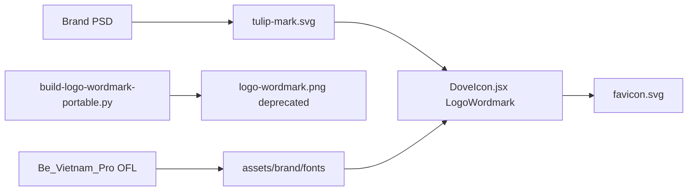

# Brand intellectual property and licenses

> **Last reviewed:** 2026-06-08

This document records **Skin & Care** ownership of proprietary brand marks, **third-party font license compliance**, and the **design archive** for the consumer wordmark. For visual specs and file paths, see [LOGO_AND_ICON_SSOT.md](./LOGO_AND_ICON_SSOT.md).

---

## Skin & Care proprietary marks

The following assets are **exclusive property of Skin & Care**. They are not licensed for third-party use without written permission.

| Mark | Description | Canonical files |
|------|-------------|-----------------|
| **Tulip icon** | Pixel-traced mark from brand PSD; solid black fill | [`unified-dashboard/assets/brand/tulip-mark.svg`](../../unified-dashboard/assets/brand/tulip-mark.svg), [`tulip-mark.png`](../../unified-dashboard/assets/brand/tulip-mark.png) |
| **Wordmark lockup** | Lowercase `skin` + tulip + `care` — live text + inline SVG composition (not a standalone typeface) | [`DoveIcon.jsx`](../../unified-dashboard/skin-care-landing/src/components/DoveIcon.jsx) — `LogoWordmark`, `TULIP_PATH` |
| **Favicon set** | Tulip on white rounded square | [`skin-care-landing/public/favicon.svg`](../../unified-dashboard/skin-care-landing/public/favicon.svg), PNG fallbacks in `skin-care-landing/public/` |

### Trademark notice

Use on marketing sites, app stores, and legal footers where appropriate:

> Skin & Care™, the Skin & Care tulip mark, and the skin + tulip + care wordmark are trademarks of Skin & Care. Unauthorized use is prohibited.

### Permitted use

- Skin & Care product surfaces (landing, patient app, checkout, email) per [SKIN_AND_CARE_GUIDELINES.md](./SKIN_AND_CARE_GUIDELINES.md)
- Internal design, engineering, and partner materials with brand approval
- Press and marketing with unmodified marks

### Prohibited use

- Resale, sublicensing, or redistribution of mark files as standalone assets
- Modifying the tulip shape, wordmark spacing lockup, or colors outside brand guidelines
- Use in a manner that implies endorsement by Skin & Care without authorization
- Confusingly similar marks or lockups for competing products

---

## Be Vietnam Pro — license compliance (not ownership)

Skin & Care **does not own or trademark** the Be Vietnam Pro typeface. We bundle and embed it under the **SIL Open Font License 1.1 (OFL)** for the consumer wordmark only.

| Item | Detail |
|------|--------|
| **Copyright** | Copyright 2021 The Be Vietnam Pro Project Authors |
| **Upstream** | [github.com/bettergui/BeVietnamPro](https://github.com/bettergui/BeVietnamPro) |
| **Design source package** | Original font files from `Be_Vietnam_Pro` distribution (OFL.txt included) |
| **License** | SIL Open Font License 1.1 — full text: [`unified-dashboard/assets/brand/fonts/OFL-BeVietnamPro.txt`](../../unified-dashboard/assets/brand/fonts/OFL-BeVietnamPro.txt) |
| **Reserved Font Name** | “Be Vietnam Pro” — modified derivatives must not use this reserved name per OFL |

### Bundled font files

Hosted under [`unified-dashboard/assets/brand/fonts/`](../../unified-dashboard/assets/brand/fonts/):

| File | Weight / style | Wordmark role |
|------|----------------|---------------|
| `BeVietnamPro-BoldItalic.ttf` | 700 italic | `skin` |
| `BeVietnamPro-Bold.ttf` | 700 normal | `care` |
| `BeVietnamPro-Italic.ttf` | 400 italic | Loaded; not used in current lockup |

`@font-face` declarations: [`skin-care-landing/src/styles/landing.css`](../../unified-dashboard/skin-care-landing/src/styles/landing.css).

### OFL compliance checklist

- [x] Ship `OFL-BeVietnamPro.txt` alongside bundled `.ttf` files in `assets/brand/fonts/`
- [x] Do not sell or distribute font files standalone
- [x] Do not rename or republish modified Be Vietnam Pro builds under the reserved name
- Documents, screenshots, and marketing PDFs that merely **use** the font are not bound by OFL (per license preamble)

---

## `build-logo-wordmark.py` — design archive and lineage

During logo iteration, wordmarks were exported as **baked PNGs** via a Pillow compositor. Production now uses the **live SVG wordmark** in `DoveIcon.jsx`. The scripts below are **deprecated for production** — archival reference only.

### Scripts

| Script | Path | Role |
|--------|------|------|
| **Portable reference** | [`unified-dashboard/assets/brand/scripts/build-logo-wordmark-portable.py`](../../unified-dashboard/assets/brand/scripts/build-logo-wordmark-portable.py) | Original design-time compositor with local paths (`BeVietnamPro-Bold.ttf` beside script, dove PNG export) |
| **Monorepo adapter** | [`unified-dashboard/skin-care-landing/scripts/build-logo-wordmark.py`](../../unified-dashboard/skin-care-landing/scripts/build-logo-wordmark.py) | Same logic with repo-relative paths to `assets/brand/fonts/` and `dove-mark.png` |

### What the compositor does

- **Inputs:** serif italic font for `skin`, Be Vietnam Pro Bold for `care`, white dove/tulip PNG on black background
- **Process:** composites text + inverted dove mark centered above the gap; supersamples and downsamples for crisp PNG edges
- **Outputs:** `logo-wordmark.png` (1×) and `logo-wordmark@2x.png` (2×) — **deprecated** baked assets
- **Dependencies:** `pip install pillow numpy`

### When to run

- **Design archive / reference** — reproducing historical PNG exports
- **Never** for header, footer, or favicon in production — use `LogoWordmark` and `tulip-mark.svg` instead

### Lineage

---

## Related docs

- [LOGO_AND_ICON_SSOT.md](./LOGO_AND_ICON_SSOT.md) — paths, spacing tokens, favicon composition
- [SKIN_AND_CARE_GUIDELINES.md](./SKIN_AND_CARE_GUIDELINES.md) — palette, typography, usage
- [POLICIES.md](../legal/POLICIES.md) — legal entity and service terms
