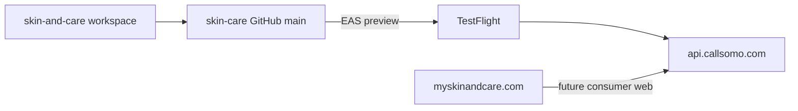

# Skin & Care — standalone workspace

**Last updated:** 2026-06-07

Skin & Care is a **consumer brand** on the shared Somo platform API. This repo is the only engineering home for Skin & Care product work.

## Repos and domains

| Item | Value |
|------|--------|
| GitHub | [richiejeremiah/skin-care](https://github.com/richiejeremiah/skin-care) |
| Branch | `main` only |
| Consumer domain | **myskinandcare.com** — marketing site, web funnel, privacy/terms URLs |
| Shared API | **api.callsomo.com** — production middleware (deployed from **somo-platform**) |
| App brand | **Skin & Care** (UI copy; not "MySkinAndCare") |
| Bundle ID | `com.skinandcare.app` |



## Day-to-day workflow

```bash
git checkout main
# ... edit patient-app, commit ...
git push origin main
```

No second remote, no brand branch, no push-to-mirror script.

## Porting platform fixes from somo

This tree will drift from [somo-platform](https://github.com/richiejeremiah/somo-platform) over time. When you need a middleware or patient API change:

```bash
git remote add somo-platform https://github.com/richiejeremiah/somo-platform.git  # one-time
git fetch somo-platform
git cherry-pick <sha>                    # single fix
# or
git merge somo-platform/main             # larger sync (resolve conflicts carefully)
```

**Recommended:** before each TestFlight or App Store release, review `somo-platform` `main` for patient-billing, auth, and routine API changes.

**Do not** deploy Cloud Run / Firebase from this repo. `deploy-staging.yml` is manual-dispatch only.

## CI

| Workflow | Trigger | Purpose |
|----------|---------|---------|
| `skin-care-mobile.yml` | push to `main` (patient-app paths) | Typecheck, care_program tests, EAS preview |
| `ci.yml` | push/PR to `main` | Full platform CI (`BRAND_PROFILE=skin-and-care`) |
| `deploy-staging.yml` | manual only | Not used for routine deploys |

Add `EXPO_TOKEN` in repo Settings → Secrets for automated EAS builds.

## Local development

```bash
cd patient-app
cp .env.example .env
npx expo start
```

## Domains (operator)

| Host | Role |
|------|------|
| myskinandcare.com | Consumer marketing + `/start` funnel (configure DNS when ready) |
| api.callsomo.com | Shared API — all Skin & Care app builds point here |
| callsomo.com | Somo platform (B2B) — separate brand |

Privacy policy and terms URLs for App Store should live on **myskinandcare.com**.

## EAS / TestFlight

```bash
cd patient-app
npx eas login
npx eas init
npx eas build --platform ios --profile preview --non-interactive
```

See [`todos/pending/IOS_SKINCARE_TRACKER_LAUNCH_TODOS.md`](../../todos/pending/IOS_SKINCARE_TRACKER_LAUNCH_TODOS.md).

## Multi-brand note

Somo may power other consumer brands from separate repos. Each brand gets its own GitHub repo, bundle ID, Stripe product, and domain — all sharing **one** `api.callsomo.com` deployment.
