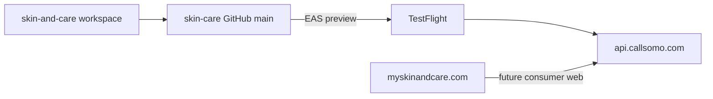

# Skin & Care — standalone workspace

**Last updated:** 2026-06-07

Skin & Care is a **unified brand** (consumer + provider) on the shared platform API. This repo is the engineering home for Skin & Care product work.

## Repos and domains

| Item | Value |
|------|--------|
| GitHub | [richiejeremiah/skin-care](https://github.com/richiejeremiah/skin-care) |
| Branch | `main` only |
| Consumer domain | **myskinandcare.com** — marketing site, web funnel, privacy/terms URLs |
| Shared API | **api.callsomo.com** — production middleware (deployed from **somo-platform**) |
| App brand | **Skin & Care** (UI copy; not "MySkinAndCare") |
| Bundle ID | `com.skinandcare.app` |



## Day-to-day workflow

```bash
git checkout main
# ... edit patient-app, commit ...
git push origin main
```

No second remote, no brand branch, no push-to-mirror script.

## Porting platform fixes from somo

This tree will drift from [somo-platform](https://github.com/richiejeremiah/somo-platform) over time. When you need a middleware or patient API change:

```bash
git remote add somo-platform https://github.com/richiejeremiah/somo-platform.git  # one-time
git fetch somo-platform
git cherry-pick <sha>                    # single fix
# or
git merge somo-platform/main             # larger sync (resolve conflicts carefully)
```

**Recommended:** before each TestFlight or App Store release, review `somo-platform` `main` for patient-billing, auth, and routine API changes.

**Do not** deploy Cloud Run / Firebase from this repo. `deploy-staging.yml` is manual-dispatch only.

## CI

| Workflow | Trigger | Purpose |
|----------|---------|---------|
| `skin-care-mobile.yml` | push to `main` (patient-app paths) | Typecheck, care_program tests, EAS preview |
| `ci.yml` | push/PR to `main` | Full platform CI (`BRAND_PROFILE=skin-and-care`) |
| `deploy-staging.yml` | manual only | Not used for routine deploys |

Add `EXPO_TOKEN` in repo Settings → Secrets for automated EAS builds.

## Local development

```bash
cd patient-app
cp .env.example .env
npx expo start
```

## Domains (operator)

| Host | Role |
|------|------|
| myskinandcare.com | Consumer marketing + web funnel (DNS cutover target) |
| callsomo.com | Provider portal + shared web shell (Skin & Care UI) |
| api.callsomo.com | Shared API — all app and web builds point here |

Privacy policy and terms URLs for App Store should live on **myskinandcare.com**.

## EAS / TestFlight

Full runbook: **[docs/runbooks/TESTFLIGHT.md](../runbooks/TESTFLIGHT.md)**

```bash
cd patient-app
npm ci
npx eas login
npx eas init          # one-time — links Expo project
npm run verify:testflight
npm run build:testflight
npm run submit:testflight
```

Install via Apple **TestFlight** app after adding your Apple ID as an internal tester in App Store Connect.

## DNS cutover checklist (myskinandcare.com)

**Status:** Prep only — no DNS change until operator sign-off. Infra IDs (`somo-4ddf6`, `somo-callsomo`) stay as-is.

### Preconditions

- [x] `npm run build:skin-care-landing` + `node scripts/verify-hosting-dist-landing.cjs` (local bundle verifier)
- [ ] `npm run build:staging-hosting` succeeds in CI (Node 20.x hosting-dist job)
- [ ] `npm run test:e2e-skin-care-landing --prefix middleware-platform` green on `main`
- [ ] App Store / TestFlight privacy and terms URLs updated to `https://myskinandcare.com/patients/legal/*` (after DNS live)
- [x] `EXPO_PUBLIC_API_BASE_URL=https://api.callsomo.com` in EAS production profile (unchanged)

### DNS (registrar / Firebase Hosting)

- [ ] Add custom domain **myskinandcare.com** (+ `www`) to Firebase project `somo-4ddf6` (or successor hosting project)
- [ ] Publish A/AAAA or CNAME records per Firebase console
- [ ] Verify TLS certificate active for apex and `www`
- [ ] Optional: 301 `callsomo.com/` → `myskinandcare.com/` only for consumer paths after launch (provider `/signup`, `/business/*` may stay on callsomo.com)

### Post-cutover smoke

```bash
curl -sS -I https://myskinandcare.com/
curl -sS -I https://myskinandcare.com/patients/patient-login.html
node scripts/verify-hosting-dist-landing.cjs --live https://myskinandcare.com
```

- [ ] Landing hero shows Skin & Care copy (not Somo B2B)
- [ ] Signup/login CTAs resolve on same host
- [ ] Mobile app still reaches `api.callsomo.com/health/live`

### Rollback

- [ ] Revert DNS to previous target; redeploy last known-good `hosting-dist` if needed
- [ ] App builds unaffected (API host unchanged)

## Multi-brand note

The shared API (`api.callsomo.com`) may serve other consumer brands from separate repos. Each brand gets its own GitHub repo, bundle ID, Stripe product, and domain — all sharing **one** middleware deployment.
