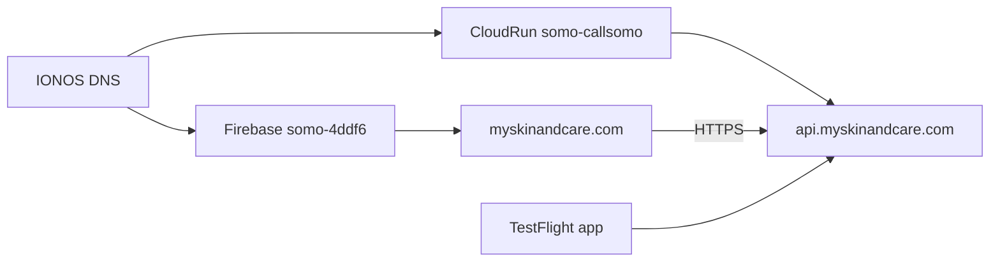

# Skin & Care — standalone workspace

**Last updated:** 2026-06-06

Skin & Care is a **unified brand** (consumer + provider) on the platform API. This repo is the engineering home for Skin & Care product work.

## Repos and domains

| Item | Value |
|------|--------|
| GitHub | [richiejeremiah/skin-care](https://github.com/richiejeremiah/skin-care) |
| Branch | `main` only |
| Consumer domain | **myskinandcare.com** — marketing site, web funnel, privacy/terms URLs |
| Consumer API | **api.myskinandcare.com** — middleware on Cloud Run |
| GCP account (consumer) | **richard@callsomo.com** |
| Firebase Hosting | **`somo-4ddf6`** — consumer site **`myskinandcare`** (default site keeps `callsomo.com`) |
| Cloud Run API | **`somo-callsomo`** / service **`somo-middleware`** |
| Legacy Somo URLs | `callsomo.com` / `api.callsomo.com` — same stack, shared API |
| Future migration | **`skin-and-care-prod`** under `doctorjay254@gmail.com` — optional; URLs stay the same |
| App brand | **Skin & Care** (UI copy; not "MySkinAndCare") |
| Bundle ID | `com.skinandcare.app` |



## Consumer deploy (myskinandcare.com)

```bash
# One-time: Cloud Run domain mapping + DNS cheat sheet
npm run setup:myskinandcare:somo

# Consumer landing bundle + Firebase (somo-4ddf6)
npm run build:consumer-hosting
npm run deploy:consumer-hosting

# Live smoke (after IONOS DNS cutover)
npm run gcp:skin-care:check
node scripts/verify-consumer-hosting.cjs --live https://myskinandcare.com
```

IONOS DNS steps: **[docs/runbooks/MYSKINANDCARE_IONOS_DNS.md](../runbooks/MYSKINANDCARE_IONOS_DNS.md)**

API deploy (shared Somo middleware): `npm run callsomo:deploy-api` or `./scripts/deploy-to-gcp.sh` with [`scripts/lib/cloudrun-deploy-env.sh`](../../scripts/lib/cloudrun-deploy-env.sh).

## Day-to-day workflow

```bash
git checkout main
# ... edit patient-app, landing, commit ...
git push origin main
```

## Porting platform fixes from somo

When you need a middleware or patient API change from [somo-platform](https://github.com/richiejeremiah/somo-platform):

```bash
git remote add somo-platform https://github.com/richiejeremiah/somo-platform.git  # one-time
git fetch somo-platform
git cherry-pick <sha>
```

## CI

| Workflow | Trigger | Purpose |
|----------|---------|---------|
| `skin-care-mobile.yml` | push to `main` (patient-app paths) | Typecheck, care_program tests, EAS preview |
| `ci.yml` | push/PR to `main` | Full platform CI (`BRAND_PROFILE=skin-and-care`) |
| `deploy-staging.yml` | manual only | Legacy Somo staging deploy |

## Local development

```bash
cd patient-app
cp .env.example .env
npx expo start

# Landing (Vite, relative /api → middleware :4000)
npm run dev:skin-care-landing
```

## Domains

| Host | Role |
|------|------|
| **myskinandcare.com** | Consumer marketing + web funnel (Firebase `hosting-dist-consumer` on `somo-4ddf6`) |
| **api.myskinandcare.com** | Skin & Care API alias → same `somo-middleware` as `api.callsomo.com` |
| callsomo.com | Provider portal (same Firebase project) |
| api.callsomo.com | Shared middleware API |

## EAS / TestFlight

Full runbook: **[docs/runbooks/TESTFLIGHT.md](../runbooks/TESTFLIGHT.md)**

Builds use `EXPO_PUBLIC_API_BASE_URL=https://api.myskinandcare.com`.

## Live domain status (2026-06-08)

| Host | Brand | Notes |
|------|-------|-------|
| `myskinandcare.com` | Skin & Care | Firebase site `myskinandcare` |
| `callsomo.com` | Skin & Care landing | Default Firebase site redeployed |
| `www.myskinandcare.com` | Legacy Somo | Old Firebase binding — [fix runbook](../runbooks/WWW_MYSKINANDCARE_FIX.md) |
| `api.myskinandcare.com` | Pending | Needs Google domain verify + Cloud Run mapping |

```bash
npm run check:live-consumer-hosts
LIVE_BASE_URL=https://myskinandcare.com npm run test:e2e:live-consumer
```

## DNS cutover checklist (myskinandcare.com)

**Status:** Repo ready — operator runs Firebase custom domains + IONOS (see runbook).

### Repo preconditions

- [x] `npm run build:consumer-hosting` + `npm run verify:consumer-hosting`
- [x] Landing SPA uses `VITE_API_BASE=https://api.myskinandcare.com` in consumer build
- [x] `api-base.js` / CORS / CSP updated for myskinandcare hosts
- [x] EAS profiles point at `api.myskinandcare.com`
- [x] `deploy:consumer-hosting` targets **`somo-4ddf6`**
- [ ] Firebase: `myskinandcare.com` + `www` custom domains on `somo-4ddf6` (operator)
- [ ] Cloud Run: `api.myskinandcare.com` domain mapping on `somo-callsomo` (operator: `npm run setup:myskinandcare:somo`)
- [ ] IONOS DNS: apex A + TXT + www CNAME + api CNAME (operator)

### Post-cutover smoke

```bash
npm run gcp:skin-care:check
node scripts/verify-consumer-hosting.cjs --live https://myskinandcare.com
```

### Rollback

Revert IONOS DNS; `callsomo.com` / `api.callsomo.com` remain available.

## Multi-brand note

`api.callsomo.com` and `api.myskinandcare.com` map to the **same** Cloud Run service today. Consumer traffic should use **api.myskinandcare.com** for stable URLs through a future GCP account migration.

## Alternate path: new GCP project

Full account migration under `doctorjay254@gmail.com`:

```bash
export BILLING_ACCOUNT_ID=<from gcloud billing accounts list>
./scripts/bootstrap-skin-care-gcp.sh
```

See [`scripts/lib/skin-care-deploy-env.sh`](../../scripts/lib/skin-care-deploy-env.sh) and `deploy:skin-care-api` — not required for Option B (Somo + IONOS).
