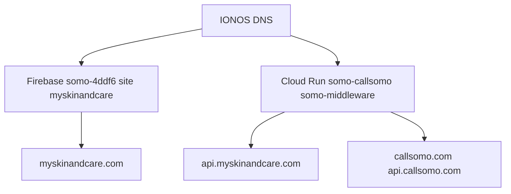

# Cloud architecture (Option B)

**Last reviewed:** 2026-06-06

Consumer Skin & Care runs on the **existing Somo GCP stack** (Option B). Public URLs are stable for a future account migration.

## Topology



## Infrastructure table

| Item | Value |
|------|--------|
| GCP account | **richard@callsomo.com** |
| Consumer web | Firebase **`somo-4ddf6`** — site **`myskinandcare`** |
| Provider/staging web | Same project — default site → **callsomo.com** |
| API | Cloud Run **`somo-callsomo`** / service **`somo-middleware`** |
| Consumer domain | **myskinandcare.com** |
| Consumer API | **api.myskinandcare.com** (alias to same middleware) |
| Legacy URLs | **callsomo.com** / **api.callsomo.com** — shared stack |

Full SSOT: [docs/Brand/SKIN_AND_CARE_REPO.md](Brand/SKIN_AND_CARE_REPO.md).

## Deploy matrix

| Surface | Command | Target |
|---------|---------|--------|
| **Consumer web** | `npm run deploy:consumer-hosting` | myskinandcare.com |
| Provider/staging web | `npm run deploy:staging-hosting` | callsomo.com |
| API (shared) | `npm run callsomo:deploy-api` | api.myskinandcare.com / api.callsomo.com |

**Do not** use `deploy:staging-hosting` for myskinandcare.com — it deploys the default Firebase site.

## One-time setup

```bash
npm run setup:myskinandcare:somo
```

Creates Firebase site `myskinandcare`, prints Cloud Run domain mapping steps, and IONOS DNS cheat sheet.

DNS runbook: [docs/runbooks/MYSKINANDCARE_IONOS_DNS.md](runbooks/MYSKINANDCARE_IONOS_DNS.md).

## Consumer deploy flow

```bash
npm run build:consumer-hosting
npm run verify:consumer-hosting
npm run deploy:consumer-hosting
```

Build script: [scripts/build-consumer-hosting.cjs](../scripts/build-consumer-hosting.cjs)  
Firebase config: [unified-dashboard/firebase.consumer.json](../unified-dashboard/firebase.consumer.json)

## Post-deploy verification

```bash
npm run gcp:skin-care:check
node scripts/verify-consumer-hosting.cjs --live https://myskinandcare.com
npm run check:live-consumer-hosts
```

## Known live gaps (2026-06-06)

| Host | Status | Fix |
|------|--------|-----|
| `myskinandcare.com` | Skin & Care live | — |
| `www.myskinandcare.com` | Legacy Somo binding | [WWW_MYSKINANDCARE_FIX.md](runbooks/WWW_MYSKINANDCARE_FIX.md) |
| `api.myskinandcare.com` | Pending domain verify | `gcloud domains verify myskinandcare.com` + re-run setup |

## Rollback

Revert IONOS DNS to prior records. `callsomo.com` / `api.callsomo.com` remain available on the same stack.

## Related docs

| Topic | Doc |
|-------|-----|
| Local dev | [docs/LOCAL.md](LOCAL.md) |
| Mobile / TestFlight | [docs/MOBILE.md](MOBILE.md) |
| GCP cutover depth | [docs/runbooks/OPERATIONS.md](runbooks/OPERATIONS.md) |
| Deployment ops | [docs/deployment/OPERATIONS.md](deployment/OPERATIONS.md) |
