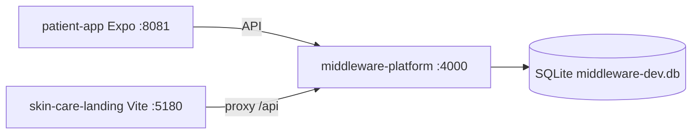

# Local development architecture

**Last reviewed:** 2026-06-06

Skin & Care local dev runs the shared middleware API on port **4000**, with optional Vite landing on **5180** and Expo on **8081**.

## Architecture



## Quick start

```bash
# Mobile app
cd patient-app
cp .env.example .env
npm ci
npx expo start

# Full stack (API + consumer landing on :4000)
cd middleware-platform
cp .env.example .env
npm ci
npm start

# Landing-only Vite (hot reload, proxies to :4000)
npm run dev:skin-care-landing
```

## URLs on port 4000

| URL | Purpose |
|-----|---------|
| `http://localhost:4000/` | Skin & Care consumer landing |
| `http://localhost:4000/login` | Provider portal sign-in |
| `http://localhost:4000/business/today.html` | Provider Today dashboard |
| `http://localhost:4000/health` | API health check |
| `http://localhost:4000/about.html` | Static about page (consumer build) |

**Provider-only:** set `LOCAL_DEV_ROOT=login` in `middleware-platform/.env` so `/` redirects to login.

**Faster API startup:** `npm run start:landing` in `middleware-platform/` (`DEV_LIGHT_START=1`).

## Consumer hosting build (local)

```bash
npm run build:consumer-hosting
npm run verify:consumer-hosting
```

Output: `unified-dashboard/hosting-dist-consumer/` (gitignored).

## Database

Dev SQLite SSOT: [docs/Database/ENV_AND_DB_SSOT.md](Database/ENV_AND_DB_SSOT.md).

From repo root: `export DB_PATH=./middleware-dev.db` in `middleware-platform/`. Confirm at boot via log line `📁 Database path: …` or `GET /health?show_db_path=1`.

## GCP CLI / ADC (deploy scripts)

For `somo-callsomo` deploy and setup scripts, use **`richard@callsomo.com`** for `gcloud` and Application Default Credentials. See [docs/runbooks/OPERATIONS.md](runbooks/OPERATIONS.md#callsomo-gcp-cutover).

## Provider sign-in

Credentials template: [local/README.md](../local/README.md).

```bash
cp local/provider-login.credentials.example local/provider-login.credentials
cd middleware-platform && npm run ensure:somo-owner
```

Sign in at `http://localhost:4000/login`.

## Related docs

| Topic | Doc |
|-------|-----|
| Environment variables | [docs/setup/ENV.md](setup/ENV.md) |
| Mobile local testing | [docs/MOBILE.md](MOBILE.md), [docs/runbooks/EXPO_DEVICE.md](runbooks/EXPO_DEVICE.md) |
| Cloud deploy | [docs/CLOUD.md](CLOUD.md) |
| Consumer brand SSOT | [docs/Brand/SKIN_AND_CARE_REPO.md](Brand/SKIN_AND_CARE_REPO.md) |
