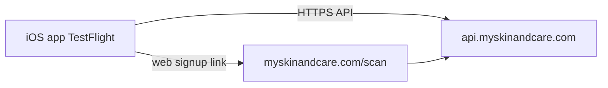

# Mobile app architecture

**Last reviewed:** 2026-06-10

Skin & Care iOS app (`com.skinandcare.app`) is an Expo/React Native app in [patient-app/](../patient-app/).

## Architecture



## Identifiers

| Item | Value |
|------|--------|
| Bundle ID | `com.skinandcare.app` |
| ASC App ID | `6778105762` |
| Apple Team | `33PP5ZAK59` |
| EAS project | `16b5d1d9-a703-4035-b41a-be2401f95c68` |
| Production API | `https://api.myskinandcare.com` |
| Web signup URL | `https://myskinandcare.com/scan` |

## Quick start

```bash
cd patient-app
cp .env.example .env
npm ci
npx expo start
```

Local API (simulator): set `EXPO_PUBLIC_API_BASE_URL=http://127.0.0.1:4000` in `.env`.

## EAS build profiles

Config: [patient-app/eas.json](../patient-app/eas.json)

| Profile | API URL | Distribution |
|---------|---------|--------------|
| `development` | local default | internal simulator |
| `preview` | `api.myskinandcare.com` | internal device |
| `testflight` | `api.myskinandcare.com` + web signup | App Store (TestFlight) |
| `production` | `api.myskinandcare.com` + web signup | App Store |

## TestFlight

Full runbook: [docs/runbooks/TESTFLIGHT.md](runbooks/TESTFLIGHT.md)

```bash
cd patient-app
npm run build:testflight    # EAS build
npm run submit:testflight:asc  # ASC API key submit
```

ASC API key path (gitignored): `docs/password/AuthKey_97D48L3W4N.p8`.

## Device testing (Expo Go)

[docs/runbooks/EXPO_DEVICE.md](runbooks/EXPO_DEVICE.md) — physical device on same Wi-Fi or ngrok tunnel.

Production device testing uses `EXPO_PUBLIC_API_BASE_URL=https://api.myskinandcare.com`.

## CI

Workflow: `.github/workflows/skin-care-mobile.yml`  
Triggers on push to `main` when `patient-app/` changes (typecheck, care_program tests, EAS preview).

## API dependency

The app requires a live API at `api.myskinandcare.com`. Until Cloud Run domain mapping completes, `api.callsomo.com` serves the same middleware as a fallback for debugging only.

## Related docs

| Topic | Doc |
|-------|-----|
| Local dev | [docs/LOCAL.md](LOCAL.md) |
| Cloud / DNS | [docs/CLOUD.md](CLOUD.md) |
| Patient app depth | [docs/patient-app/README.md](patient-app/README.md) |
| Consumer brand SSOT | [docs/Brand/SKIN_AND_CARE_REPO.md](Brand/SKIN_AND_CARE_REPO.md) |
