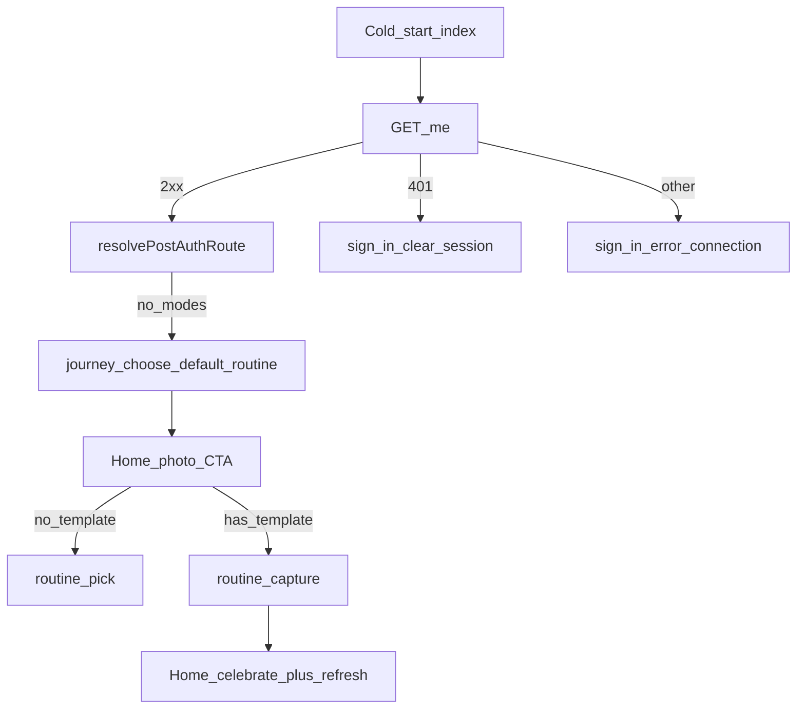

# PR1 + UI/UX — Soft-launch execution plan

**Last updated:** 2026-07-12  
**Brand line:** *We don’t just sell you a serum — we prove it’s working.*  
**Status:** Ready to implement (code not started in this doc)  
**SSOT status:** [`MYSKINANDCARE_SOFT_LAUNCH_MASTER_CHECKLIST.md`](MYSKINANDCARE_SOFT_LAUNCH_MASTER_CHECKLIST.md) + Cursor plan `pr1_soft-launch_safety_2208da17` (**143** one-by-one todos). This file keeps implementation detail for PR1a/PR1b only.  
**Sources:** codebase audit, UI/UX Playwright audit, soft-launch todos, ARCHITECTURE.md

---

## North star

Ship a TestFlight demo that cannot 503 on journal, defaults into a **routine** photo loop, refreshes Progress after a photo, and starts looking like a **proof journal** (not a BFI dashboard) — while touche labs shop stays Phase 3.

```
Firebase host live
    → PR1a path safety (this PR core)
        → PR1b proof UI (same release train if capacity)
            → TestFlight smoke
                → PR2 skin-age / storage confirm
                    → PR3 touche serum cards + footer
```

---

## Scope locks

### In scope now (PR1 train)

| Track | What |
|-------|------|
| **PR1a — Path safety** | Journal hide, routine default, SecureStore pending URI, `/me` connection error, post-auth catch, photo refresh, journal.js comment |
| **PR1b — Proof UI (no Shopify)** | Compare CTA, honest timeline, Home BFI/CTA cleanup, Progress/Track copy, streak chip, empty BFI state, calendar affordance |
| **Ops P0** | Deploy myskinandcare.com (Firebase 404) — blocking marketing, not blocked by code PR |

### Out of scope (do not mix into PR1a)

- Shopify / touche PDP links / UTMs / `touche-sku-map.json` → **PR3**
- `concern-routines.json` changes
- Middleware photo upload / skin-age empty-catch → **PR2**
- Stripe `care_program` changes
- Face-check `/scan` rewrite → Phase 4 (after host + iOS proven)
- Body supplement recs → Phase 5
- New screens beyond wiring existing `/compare`

**Dependency:** `expo-secure-store` already in [`patient-app/package.json`](../../patient-app/package.json). Do **not** add `expo-file-system`.

**Product decisions locked:**

- Hide watch→journal until `JOURNAL_MODE_STANDALONE=1` confirmed in prod  
- Journey default = **routine**  
- Do **not** flip `JOURNAL_MODE_STANDALONE` in this PR (ops later)

---

## Fix map (path safety)



---

# PR1a — Soft-launch path safety (implement first)

## A1. Hide journal capture — [`home.tsx`](../../patient-app/app/(tabs)/home.tsx)

```ts
/** Soft-launch: do not hit journal APIs until JOURNAL_MODE_STANDALONE=1 in prod. */
const JOURNAL_CAPTURE_ENABLED = false;
// TODO: JOURNAL_MODE_STANDALONE must be 1 in prod before enabling JOURNAL_CAPTURE_ENABLED
```

`openCapture` + `pickFromLibrary`:

1. If `JOURNAL_CAPTURE_ENABLED && journalMode && !hasTemplate` → `/journal/capture`  
2. Else if `!hasTemplate` → `ROUTINE_PICK_HREF`  
3. Else → `/routine/capture`

Gate journal UI (`JournalLogCta`, chips, `patchJournalDailyEntry`) behind `JOURNAL_CAPTURE_ENABLED`.  
If `journalMode && !JOURNAL_CAPTURE_ENABLED && !hasTemplate` → single CTA → routine pick.  
Keep Day-1 overlay / routine photo CTA when `hasTemplate`.

## A2. Default journey = routine — [`journey-choose.tsx`](../../patient-app/app/onboarding/journey-choose.tsx)

```ts
// Soft-launch default: routine. Revert when journal mode flag confirmed in prod.
useState<Set<JourneyMode>>(new Set(['routine']))
```

Watch/spot remain selectable.

## A3. Persist pending URI — [`pending-capture-uri.ts`](../../patient-app/lib/pending-capture-uri.ts)

Native: `SecureStore.setItemAsync` / get / delete for `{ uri, mimeType }` + memory mirror.  
Make `setPendingCaptureUri`, `consumePendingCaptureUri`, `peekPendingCaptureUri` **async**.  
On SecureStore failure → in-memory + `console.warn`. Web `sessionPersist*` unchanged.

Call sites:

- [`home.tsx`](../../patient-app/app/(tabs)/home.tsx) — `await setPendingCaptureUri`  
- [`routine/capture.tsx`](../../patient-app/app/routine/capture.tsx) — load pending in `useEffect`  
- [`journal/capture.tsx`](../../patient-app/app/journal/capture.tsx) — same pattern  

## A4. Non-401 `/me` → connection error

[`useOnboardingGate.ts`](../../patient-app/hooks/useOnboardingGate.ts):

- 401 → clear session → `SIGN_IN_HREF`  
- Else → `/sign-in?error=connection` **without** clearing session (no `resolvePostAuthRoute`)

[`sign-in.tsx`](../../patient-app/app/sign-in.tsx): show “Connection error — check your network and try again.” + Retry → `router.replace('/')`.

## A5. Refresh after photo

[`routine/capture.tsx`](../../patient-app/app/routine/capture.tsx) `finishSuccess` params: `celebrate=1`, `refresh=1`.  
[`home.tsx`](../../patient-app/app/(tabs)/home.tsx): `params.refresh === '1'` → `load()`.  
[`progress.tsx`](../../patient-app/app/(tabs)/progress.tsx): `useFocusEffect` → `load()`.  
Mirror `refresh=1` on journal capture success replace.

## A6. Post-auth outer catch — [`resolve-post-auth-route.ts`](../../patient-app/lib/resolve-post-auth-route.ts)

No local modes → `JOURNEY_CHOOSE_HREF`. Has local modes → `resolveWithModes`; on failure → `HOME_HREF`.

## A7. Comment only — [`patient-journal.js`](../../middleware-platform/routes/patient-journal.js)

Above `journalStandaloneEnabled`: soft-launch client hides journal capture until `JOURNAL_MODE_STANDALONE=1`. No behavior change.

## A8. Headers

`// PR1 soft-launch safety — 2026-07-12` on each modified patient-app file.

---

# PR1b — Proof UI tasks (same train, after A1–A8 or immediate follow-up PR)

Brand: prove it works. No Shopify in these tasks.

## B1. Progress — Compare hero (retention unlock)

**File:** [`progress.tsx`](../../patient-app/app/(tabs)/progress.tsx)  
**Task:** Primary CTA “See day 1 vs today” → `/compare` when streak ≥ 7 or ≥ 2 photo days.  
**Why:** Week-4 / early compare is the churn killer from strategy.

## B2. Home — Honest timeline banner

**File:** [`home.tsx`](../../patient-app/app/(tabs)/home.tsx)  
**Task:** Surface `phaseExpect` / week X of Y as a first-class banner (“Acne: expect change by weeks 8–12 — keep logging”).  
**Why:** Honest timeframe prevents quit-at-day-14.

## B3. Home — Deduplicate barrier copy

**File:** [`home.tsx`](../../patient-app/app/(tabs)/home.tsx)  
**Task:** Show **one** barrier status line (prefer `hero_title` OR `barrier_label`, not both + subtitle).  
**Audit:** triple “under stress” on screenshot.

## B4. Home — Pluralize conflicts chip

**File:** [`home.tsx`](../../patient-app/app/(tabs)/home.tsx) / [`MetricChipRow`](../../patient-app/components/v3/MetricChipRow.tsx)  
**Task:** `1 conflict` vs `N conflicts`.

## B5. Home — Single photo CTA

**File:** [`home.tsx`](../../patient-app/app/(tabs)/home.tsx)  
**Task:** If `DailyPhotoCta` shown, do not also show NextAction “Log today’s photo” for the same action (or merge).  
**Audit:** duplicate CTAs.

## B6. Progress — Honest subtitle

**File:** [`progress.tsx`](../../patient-app/app/(tabs)/progress.tsx)  
**Task:** Replace “Small changes. Real results.” with proof-honest copy, e.g. “Your photos. Your timeline. Your proof.”

## B7. Track — Soften “measure” overclaim

**File:** [`track.tsx`](../../patient-app/app/(tabs)/track.tsx)  
**Task:** Replace “We’ll measure and watch it” → “We’ll log it and help you compare over time.”  
**Why:** Analysis is heuristic, not CV measurement.

## B8. Home — Brand-safe streak (no emoji)

**File:** [`home.tsx`](../../patient-app/app/(tabs)/home.tsx) (+ Progress streak if needed)  
**Task:** Remove 🔥; use text/chip only.

## B9. Progress — Empty BFI grid state

**File:** [`progress.tsx`](../../patient-app/app/(tabs)/progress.tsx) / BarrierGrid8  
**Task:** When no history, show “Log photos to unlock barrier history” instead of empty dashes.

## B10. Progress — Calendar button

**File:** [`progress.tsx`](../../patient-app/app/(tabs)/progress.tsx)  
**Task:** Either open a real date range / Progress calendar, or remove misleading calendar icon that only goes Home.

## B11. Timeline thumb labels

**File:** [`progress.tsx`](../../patient-app/app/(tabs)/progress.tsx)  
**Task:** Consistent labels (e.g. relative day or `MM/DD`) — avoid “Day 1 / 10 / 11 / Today” confusion.

---

# Ops + later UI (not PR1 code, tracked here)

## P0 — Hosting

| ID | Task | Owner |
|----|------|-------|
| **UX-HOST** | Deploy consumer Firebase so `myskinandcare.com` ≠ Site Not Found | Ops |
| **UX-LEGAL** | Privacy + Terms live on that domain (App Store) | Ops |

## PR2 — Photo loop hardening (after PR1a)

| ID | Task |
|----|------|
| **PR2.1** | Confirm Home/Progress refresh on device after photo |
| **PR2.2** | Weekly skin-age: stop empty `catch`; omit chip or show pending |
| **PR2.3** | Physical TestFlight smoke: OTP → routine → pick → photo → Progress → Compare |
| **PR2.4** | Confirm Azure/local storage on `api.callsomo.com` |

## PR3 — touche labs UI (first revenue)

| ID | Task |
|----|------|
| **UX-TOUCHÉ-HOME** | “Recommended by touche labs™” serum cards from concern matrix |
| **UX-TOUCHÉ-LINK** | PDP Safari + UTMs |
| **UX-TOUCHÉ-FOOTER** | Landing footer + Profile Shop link |
| **UX-PROOF-LANDING** | Proof line + #1 Journal on live landing |
| **UX-CONFLICT** | Retinoid shelf + Retinol rec caution |

## Phase 4+ UI

| ID | Task |
|----|------|
| **FC\*** | Face-check hook fix (only after host + TestFlight) |
| **B\*** | Body support block (Collagen/Magnesium; exclude Creatine/Maca) |
| **A\*** | Weekly report, reminders, narrow chat |

---

# Master checklist (checkboxes)

### PR1a — Path safety

- [ ] **A1** Journal capture hidden; no-template → routine pick  
- [ ] **A2** Journey default = routine  
- [ ] **A3** SecureStore pending URI (async) + call sites  
- [ ] **A4** Non-401 `/me` → `sign-in?error=connection` + Retry  
- [ ] **A5** `refresh=1` Home load + Progress `useFocusEffect`  
- [ ] **A6** Post-auth catch → journey-choose when no modes  
- [ ] **A7** `patient-journal.js` comment only  
- [ ] **A8** File headers `PR1 soft-launch safety — 2026-07-12`  
- [ ] Grep: no Shopify strings added  

### PR1b — Proof UI

- [ ] **B1** Progress Compare hero → `/compare`  
- [ ] **B2** Home honest timeline banner  
- [ ] **B3** Single barrier status line  
- [ ] **B4** `1 conflict` pluralization  
- [ ] **B5** One daily photo CTA  
- [ ] **B6** Progress honest subtitle  
- [ ] **B7** Track copy without “measure”  
- [ ] **B8** Streak without emoji  
- [ ] **B9** Empty BFI empty-state  
- [ ] **B10** Calendar button fix/remove  
- [ ] **B11** Timeline label consistency  

### Ops / PR2 / PR3

- [ ] **UX-HOST** myskinandcare.com deployed  
- [ ] **PR2.2–PR2.4** skin-age + storage + device smoke  
- [ ] **PR3** touche serum cards + footer  

---

# Verification

### After PR1a

1. Cold start no session → sign-in  
2. Journey-choose opens with **routine** selected  
3. No template → photo CTA → **routine/pick** (not journal 503)  
4. With template → capture → Home celebrate + refreshed data  
5. Progress tab focus reloads  
6. Forced non-401 `/me` → connection message + Retry  

### After PR1b

7. Progress shows Compare CTA; opens `/compare`  
8. Home shows one barrier line + one photo CTA + timeline banner  
9. Track subtitle does not say “measure”  
10. No flame emoji on streak  

### Still human

- Azure/local upload on prod API  
- When to enable `JOURNAL_CAPTURE_ENABLED` + `JOURNAL_MODE_STANDALONE=1`  
- ASC/EAS TestFlight owners  
- Free journal vs Stripe care_program for soft launch  

---

# File touch list

| File | PR1a | PR1b |
|------|------|------|
| `patient-app/app/(tabs)/home.tsx` | A1, A3, A5 | B2–B5, B8 |
| `patient-app/app/(tabs)/progress.tsx` | A5 | B1, B6, B9–B11 |
| `patient-app/app/(tabs)/track.tsx` | — | B7 |
| `patient-app/app/onboarding/journey-choose.tsx` | A2 | — |
| `patient-app/app/sign-in.tsx` | A4 | — |
| `patient-app/hooks/useOnboardingGate.ts` | A4 | — |
| `patient-app/lib/pending-capture-uri.ts` | A3 | — |
| `patient-app/lib/resolve-post-auth-route.ts` | A6 | — |
| `patient-app/app/routine/capture.tsx` | A3, A5 | — |
| `patient-app/app/journal/capture.tsx` | A3, A5 | — |
| `middleware-platform/routes/patient-journal.js` | A7 comment | — |

---

# Related docs

- [`MYSKINANDCARE_UI_UX_AUDIT.md`](MYSKINANDCARE_UI_UX_AUDIT.md) — Playwright + screenshots  
- [`MYSKINANDCARE_CODEBASE_AUDIT.md`](MYSKINANDCARE_CODEBASE_AUDIT.md) — critical bugs / serum matrix  
- [`MYSKINANDCARE_TOUCHELABS_SOFT_LAUNCH_TODOS.md`](MYSKINANDCARE_TOUCHELABS_SOFT_LAUNCH_TODOS.md) — Shopify GIDs / phases  

**Implement order:** finish **PR1a** entirely → land **PR1b** proof UI → ops host + TestFlight → PR2 → PR3 touche.
