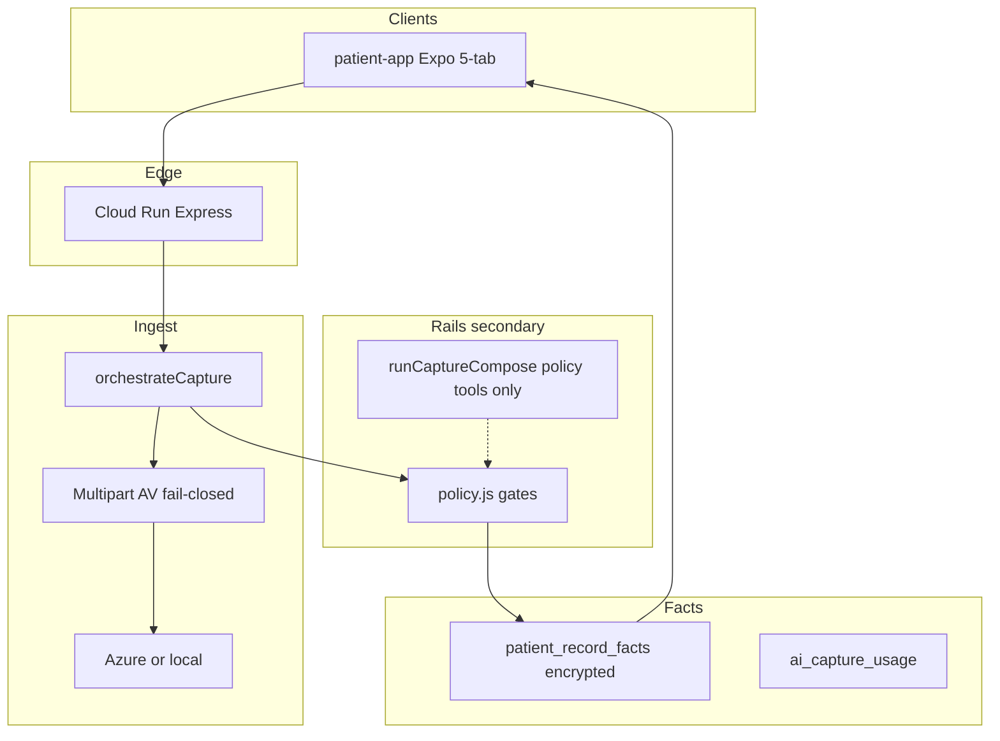

# Touche Agentic Architecture

**Status:** living **product + medical-tracker SSOT** (information architecture, capture, facts, trust)  
**Last updated:** 2026-07-17  
**Mock contract:** `/Users/ojrichard/Downloads/touche_v10.html`  
**Plan todos:** `docs/product/agentic-tracker-plan-todos.yaml`  
**App Store train:** Phase A–E build plan below (this section is the execution SSOT for screen work)

This document is the **single source of truth** for what the consumer medical-tracker product is **as of 2026-07-17**. It is not aspirational. Older camera-first “Check sole home / no tabs” docs are **superseded** — see [`TOUCHE_CAMERA_FIRST.md`](./TOUCHE_CAMERA_FIRST.md) (historical).

Shopify commerce, `patientapp://` deep links, and `app.trytouche.com` hosting remain true; only the **in-app shell IA** and **facts/capture backend** claims below supersede camera-first nav language.

---

## Locked product decisions (current)

| Decision | Value |
|----------|--------|
| In-app shell | **Visible 5-tab:** Calendar · Shelf · Track · Progress · Profile (P7.01) |
| Lander | **Progress** (`(tabs)/progress` — Proof); Check is the capture/check surface, not sole home |
| Journal tab | Hidden (`_journal`, `href: null`) — **retirement candidate** (redundant with Calendar/facts) |
| Tags | `skin \| bill \| prescription \| mark \| lab \| other` |
| Facts store | `patient_record_facts` (one store for Calendar + Progress + marks list) |
| Capture HTTP | **`orchestrateCapture`** is canonical; `runCaptureCompose` is not the primary path |
| Monetization | Manual free; AI vision/OCR metered |
| Auth | OTP + name (no password in this train) |
| Media v1 | `photo \| pdf` only |
| Clinic | Kelly / perception / coding graphs stay out of consumer capture |
| Progress honesty | Counts only; never invent improvement % |

---

## Information architecture (current)

```
Cold / try → OTP → auth shell
                    ├── Calendar   ← GET /api/patient/records/calendar  (facts)
                    ├── Shelf      ← evaluate + alerts feed
                    ├── Track      ← capture entry; marks list GET /api/patient/marks
                    ├── Progress   ← GET /api/patient/progress/aggregates (+ facts calendar)
                    └── Profile
Check / capture / severity / mark-compare = stacked screens, not “sole home”
_journal = addressable but not in tab bar → retire in UI screen-review
```

**Do not** describe the product as “Check sole home, no tab bar.” That was the camera-first interim SSOT and is obsolete.

---

## Capture path (current)

### Canonical orchestrator

| Path | Role |
|------|------|
| **`orchestrateCapture`** (`services/capture-orchestration/`) | **Canonical** for `POST /api/patient/records/capture` (and multi-tag orchestration). Quality → meter (AI) → perceive → `structureByTag` → **policy** → `insertFact`. |
| **`runCaptureCompose`** (`medical-tracker-rails/capture-compose.js`) | **Not** the HTTP primary path. Kept for LangGraph/tool/policy reuse and future multi-turn only. HTTP routes must not call it for create. |

**Why:** One HTTP orchestrator avoids dual write semantics and keeps policy/AV/meter on a single path. Compose remains available as rails infrastructure without being the product create entrypoint.

### Policy gate

After `structureByTag`, before `insertFact`:

`assertOrchestrationPersistPolicy(tag, structured)` in `services/medical-tracker-rails/policy.js`

- Diagnosis vocabulary / forbidden clinical keys → fail closed (`vision_fail` / retake)
- Rx commerce keys rejected (schema + policy)
- Fail closed — never silent strip of diagnosis-shaped content

### Client capture + idempotency

- `captureRecordFact` always sends `request_id` (stable across retries of the same user action)
- Call sites: `manual-entry`, `track/capture`, etc.
- Server: owner-scoped unique `(owner_key, request_id)` + orchestrator idempotent replay

### Confirmed facts

Calendar / Progress aggregates / marks list only include rows with `confirmed_at` set. Capture creates drafts; confirm advances them.

---

## Facts store & Progress / Calendar

| Surface | Reads | Store |
|---------|-------|--------|
| Calendar | `GET /api/patient/records/calendar` | `patient_record_facts` |
| Progress | `GET /api/patient/progress/aggregates` + facts calendar + `GET /api/patient/marks` | same |
| Track (list / compare) | `GET /api/patient/marks`, compare-group timeline | same |
| Mark picker | same marks API | same |

**One fact store** for medical history views. Dual-write (journal→skin, spots→mark, billing→bill) remains **write-side** bridging for legacy writers.

### Still legacy (not closed)

| Area | Status |
|------|--------|
| Track **write** (`track/capture` + `spot-store`) | Still dual-writes `/api/patient/spots` alongside facts capture |
| `track/[spotId].tsx` | Still reads legacy spots detail (growth bars / change_tag) |
| Journal tab `_journal` | Still reads `/journal/calendar-range` — **retirement candidate** |
| Check → `severity.tsx` | Still **writes** journal severity (separate from Journal tab UI) |
| Billing portal | Dual-writes to facts; left as-is (not Calendar/Progress consolidation) |

---

## Encryption at rest

- `structured_json` + `raw_extract_text` encrypted AES-256-GCM (`enc:v1:…`) via `patient-record-field-crypto.js`
- Plaintext `entry_date` denorm for range/ORDER BY (migration `072_…`)
- Key resolution: `PATIENT_RECORD_FACTS_ENCRYPTION_KEY` → `BILLING_DATA_ENCRYPTION_KEY` → `SESSION_SECRET` → `'dev-billing-key'`
- **Named limitation:** no key rotation / KMS. Rotating keys requires a migration tool that does not exist yet.

Bill money is canonical **`amount_cents`** (integer). Migration `073_bill_amount_cents_canonical` converts recoverable major-unit rows; ambiguous conflation is `needs_review`.

---

## Trust / security (current)

### AV (medical uploads)

- Fail-closed via `scanPatientRecordBuffer`
- Requires ClamAV (`CLAMAV_SOCKET` and/or `CLAMAV_BIN`)
- Missing config → `403 AV_NOT_CONFIGURED`
- Heuristics alone are insufficient
- **Dev tradeoff:** `PATIENT_RECORD_AV_DEV_BYPASS=1` (non-production only) → loud warn + heuristic-only  
  Details: [`docs/security/UPLOAD_AND_AV.md`](../security/UPLOAD_AND_AV.md)

### Retention purge (P8.03)

- Purges media + `raw_extract_text` after retention windows (90d confirmed / 30d draft defaults)
- Deletes **`local://` and `azure://`** (`deleteBuffer` / `deleteBlob`)
- DB pointers cleared only after successful delete (or already-gone); failures → `media_deferred` retry
- Does **not** delete fact rows or `structured_json`

### Physician share links

- Bearer token, short TTL, **reusable until expiry or revoke** (intentional: clinician may reopen mid-visit)
- `POST …/physician-share/:token/revoke` + list endpoint
- Every public GET audited (`patient_physician_share_access_log`: time, IP, UA, outcome)
- PDF rebuilt on each access (live facts)

### Anonymous `capture_token`

- **Blast radius if leaked before OTP:** previously claimable by any account that completed OTP with the token (possession only)
- **Mitigation:** bind at `verify/send` → `bound_otp_session_id`; claim requires matching OTP session (`otp_session_unbound` / `otp_session_mismatch`)
- Client sends `capture_token` on send + confirm
- **Residual gap:** attacker who calls `verify/send` *first* with a stolen token can bind it to their session (race). Possession alone no longer claims.

---

## Target layers (still accurate)



### Kelly / perception / coding exclusion

Medical-tracker code must not `require()` Kelly / perception / coding / consumer-analysis graphs. Guard: `scripts/verify-medical-tracker-isolation.cjs`.

---

## Phase history (shipped floor — do not re-open as “next”)

| Phase | State |
|-------|--------|
| P0–P2 | Facts floor, dual-write, binding, media tokens — **shipped** |
| P3 | Single-tag **and** multi-tag orchestration APIs — **shipped** (`orchestrateCapture`) |
| P4 | Rails + policy — **shipped**; compose demoted off HTTP create |
| P5 | Progress aggregates, Calendar, marks, physician export/share, alerts — **shipped** |
| P6–P8 | Monetization, UI shell, AV, retention, a11y floor — largely **shipped**; P8.12 device VoiceOver still pending |

Internal contradiction resolved: earlier drafts said single-tag was “next” while also claiming Phase 3 present — **Phase 3 orchestration is present; primary path is `orchestrateCapture`.**

### Pre-auth binding (updated)

| Piece | Contract |
|-------|----------|
| Migration | `069_pending_captures` + `074_pending_captures_otp_bind` (`bound_otp_session_id`) |
| Anonymous persist | `POST /api/patient/records/anonymous` |
| Bind | `POST /api/patient/verify/send` with `capture_token` → bind once to OTP `session_id` |
| Claim | `POST /api/patient/verify/confirm` with `capture_token` — requires bound session match |
| Meter merge | Inside claim (`session:anon` → `patient:id`) |

### Media URL rule (P2.29)

Store opaque `azure://` / `local://` refs; issue short-TTL signed/token URLs for clients. Permanent HTTPS blob URLs are not the v1 contract.

---

## Migration pattern

Numbered JS `up(db)` in `middleware-platform/migrations/`, invoked from owning services/repos (same as `056_`, `059_`, `067_`–`074_`).

---

## Out of scope (this train)

- Video ingest
- Password auth
- Clinic Kelly / RCM in consumer capture
- Fabricated Progress %
- KMS / encryption key rotation (named limitation; stays open until a migration tool exists)

---

## App Store screen train — Phases A–E (execution SSOT)

**Mock:** `/Users/ojrichard/Downloads/touche_v10.html` (45 `.tlabel` frames)  
**Goal:** App Store readiness. Shell routes largely exist; work is wire + prove, not greenfield rebuild.

### Done rule (every screen in every phase)

For every screen wired in this plan, **done** requires **both**:

1. **Visual/CTA match** against the corresponding `touche_v10.html` mock frame.
2. **Backend-integration proof** — a test that would fail if the implementation were faked: the screen (or its client API module used by that screen) calls the **real** endpoint and a **real effect** happens (fact row in `patient_record_facts`, confirm updates a real row, meter actually decrements). **Not** a test that only asserts navigation or that the right copy renders.

**Historical failure mode (do not repeat):** `capture/loading.tsx` was a `setTimeout`; confirm screens rendered placeholder route params; Playwright “PASS” proved a shell, not a fact.

If the backend piece is not wired yet: **STOP and report the gap** before building further screens on top of it. Do not stack five more screens on a facts pipeline that screen #1 never calls.

Per-phase report vocabulary: **built** / **blocked — name it** / **needs a product decision — name it**.

### Mock → route matrix (canonical)

| Mock | Route |
|------|-------|
| 0 Welcome | `welcome.tsx` / try entry |
| 1 Consent | onboarding consent / capture gate |
| 2a Capture | `capture/index.tsx` (shared with Track shutter) |
| 2b Denied | `capture/camera-denied.tsx` |
| 2c Vision fail | `capture/vision-fail.tsx` |
| 2m Manual | `capture/manual-entry.tsx` |
| 3 Tag | `capture/tag.tsx` |
| 4 Loading | `capture/loading.tsx` → **must** call `orchestrateCapture` |
| 5-* Confirm | `capture/confirm/{skin,bill,rx,mark,lab,other}.tsx` ← fact draft, not route params |
| 5b Reveal | `capture/reveal/*` ← policy-gated `ai_suggestion` |
| 6 Thesis | `capture/thesis/*` |
| 7 / 7b / 7c | sign-in + `auth/otp-entry` + `auth/otp-error` |
| 8 Get the app | `get-the-app.tsx` → Progress lander |
| 9 / 10 | `capture/opqrst-lite.tsx`, `capture/routine-nudge.tsx` (skin-only) |
| T1–T2b | `(tabs)/calendar.tsx` |
| T3–T4b | `(tabs)/shelf.tsx` + shelf detail / `shelf/rx-refill-info` |
| T5 / T5b | Track → `/capture` + `capture/daily-ai-suggests.tsx` |
| T6–T8 | `capture/ai-cap.tsx`, `welcome-bonus.tsx`, `unlock-ai.tsx` |
| T9 / billonly / empty | `(tabs)/progress.tsx` |
| T10–T12 | `(tabs)/account.tsx` + `profile/*` |

### Phase A — Shell fidelity (Progress / Calendar / Profile)

Build per matrix. Additions:

- **Progress:** Adversarial test asserts aggregate numbers on screen came from `GET /api/patient/progress/aggregates` with a real response body — not locally computed or stale-cached. Assert skin module is **absent** (not empty) when zero skin facts exist — **at the screen level**, not only the API (P5.09 covers API; this covers the screen respecting it).
- **Calendar:** Adversarial test creates a fact via the **real capture path**, then asserts it appears via the actual `GET /api/patient/records/calendar` call — not a fixture/mock harness response that would pass if the real call were broken.
- **Profile:** Language stub, Share-with-doctor, allergens, notifications, consent — each gets a test confirming navigation to a real screen backed by a real endpoint **where one exists** (share → physician-share API). Not a route that renders and dead-ends.

**Gate before Phase B:** Report per-screen whether the backend-integration test passes. A failing screen blocks Phase B **for that screen**; other Phase A screens proceed independently.

### Phase B — Capture machine (highest priority — core fix)

1. Wire `capture/loading.tsx` to **`orchestrateCapture`** — replace `setTimeout` entirely. Loading steps advance only when real async work resolves (quality → meter → perceive → structure).
2. Wire `capture/confirm/{…}.tsx` to hydrate from the **actual fact draft** returned by orchestration — not route params. Field sets match `structured_json` per tag (v10 fidelity).
3. Wire “Looks right” / edit to real confirm-persist (`POST /records/:id/confirm`) with **`request_id`** (no double-tap duplicates).
4. Wire reveal screens from real policy-gated `ai_suggestion` — skin pending-confirm framing reflects a real suggestion object, not a hardcoded string.
5. Track shutter + cold onboarding both enter the same `/capture` machine — test both entry points hit the same `orchestrateCapture` call (not two parallel implementations).
6. Monetization T6/T7/T8: wire to real `GET /api/patient/ai/usage`. Adversarial: exhaust meter via real AI captures → cap screen appears organically; manual remains available and unmetered.
7. Vision-fail (2c) / camera-denied (2b): fire from **real** failure conditions (AV rejection, quality-gate rejection, diagnosis-vocabulary fail-closed) — not only a forced test flag.

**Definitive Phase B test:** cold start → real photo/document → real AI extraction → confirm → assert DB row exists with correct tag, `ai_or_manual='ai'`, and `structured_json` matching extraction. If this single test does not exist and pass, Phase B is **not done**.

### Phase C — Shelf

Per matrix. Adversarial: Rx detail reached via **barcode scan** (P8.08 gap) still cannot reach a Buy CTA. Test barcode entry and manual Shelf browse **independently**.

### Phase D — Legacy retirement

- Redirect `check.tsx` / `severity.tsx` entry into `/capture` or Track.
- `_journal`: make the call — remove from product paths for real, **or** document explicitly why it stays. No permanent limbo.
- `track/[spotId]` spots UI: wrap behind facts/marks compare; close `track/capture.tsx` spots dual-write **or** name it as an explicit follow-up (do not silently drop).

### Phase E — App Store Readiness Report (submission gate)

Produce a single written **App Store Readiness Report** covering:

1. Screenshot/CTA parity — every v10 `.tlabel` vs real app (web + one device); frames with no screen named + why.
2. Backend-integration proof table — screen | endpoint | proving test | pass/fail — for every screen touched in A–D.
3. **p8-12** real-device VoiceOver through onboarding + five tabs — device session only; report specific navigability issues, not “passed.”
4. Permissions audit — camera / library / notifications only at point of use; rationale copy matches actual data use.
5. No dead functionality sweep — every CTA leads to a working destination; full list even if empty.
6. Crash/error-path check — network/500/timeout handled on every backend-calling screen.
7. Data-practice consistency — in-app consent/privacy + HIPAA consumer doc match actual AI / encryption (incl. no-rotation if disclosed) / retention / AV behavior; fix copy if over/underclaim.
8. Known open items stated plainly — KMS/rotation, `capture_token` residual race, Journal decision, Track spots dual-write, whatever remains. Honest list; no “everything is done.”

The Phase E report is reviewed line-by-line before App Store submission.
