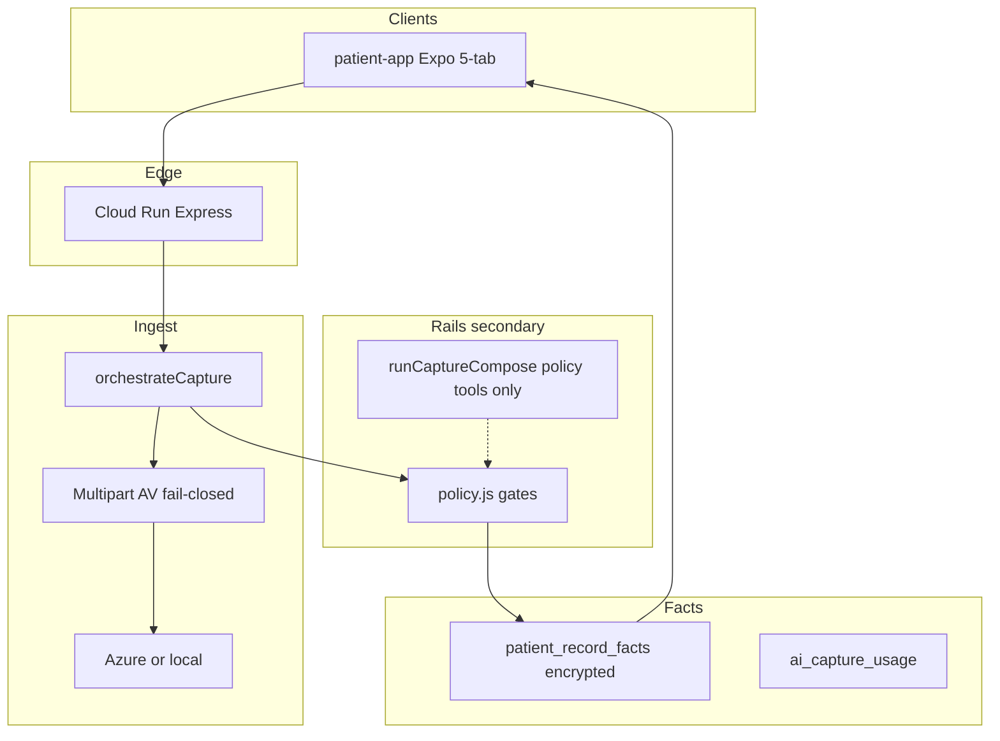

# Touche Agentic Architecture

**Status:** living **product + medical-tracker SSOT** (information architecture, capture, facts, trust)  
**Last updated:** 2026-07-17  
**Mock contract:** `/Users/ojrichard/Downloads/touche_v10.html`  
**Plan todos:** `docs/product/agentic-tracker-plan-todos.yaml`

This document is the **single source of truth** for what the consumer medical-tracker product is **as of 2026-07-16**. It is not aspirational. Older camera-first “Check sole home / no tabs” docs are **superseded** — see [`TOUCHE_CAMERA_FIRST.md`](./TOUCHE_CAMERA_FIRST.md) (historical).

Shopify commerce, `patientapp://` deep links, and `app.trytouche.com` hosting remain true; only the **in-app shell IA** and **facts/capture backend** claims below supersede camera-first nav language.

---

## Locked product decisions (current)

| Decision | Value |
|----------|--------|
| In-app shell | **Visible 5-tab:** Calendar · Shelf · Track · Progress · Profile (P7.01) |
| Lander | **Progress** (`(tabs)/progress` — Proof); Check/severity are Redirect stubs → `/capture` (Phase D) |
| Journal tab | **Retired** — `_journal` Redirect → Calendar; deep links only (`href: null`) |
| Tags | `skin \| bill \| prescription \| mark \| lab \| other` |
| Facts store | `patient_record_facts` (one store for Calendar + Progress + marks list) |
| Capture HTTP | **`orchestrateCapture`** is canonical; `runCaptureCompose` is not the primary path |
| Monetization | Manual free; AI vision/OCR metered |
| Auth | OTP + name (no password in this train) |
| Media v1 | `photo \| pdf` only — **no video, no DICOM** ingestion/rendering |
| Clinic | Kelly / perception / coding graphs stay out of consumer capture |
| Progress honesty | Counts only; never invent improvement % |
| Document vs AI prose | Verbatim PDF/OCR fields (`findings`, `conclusion`, document-sourced `free_text`) may contain physician diagnostic language; **touche-generated** `ai_suggestion` / interpretive notes still fail closed on diagnosis vocabulary |
| Field templates | Tag/subtype field lists are data (`record-field-templates` catalog) — confirm + manual entry render from the same SSOT; optical/medication/lab/imaging subtypes included |
| Denorm queryables | **Deliberate plaintext exception** (072/075): `entry_date`, `fact_subtype`, `expiry_date`, `provider`, `issue_date` are low-sensitivity query keys only. Clinical content (SPH/CYL/AXIS, Findings, Conclusion, notes, full OCR) stays in encrypted `structured_json` / `raw_extract_text`. See Encryption section. |

---

## Information architecture (current)

```
Cold / try → OTP → auth shell
                    ├── Calendar   ← GET /api/patient/records/calendar  (facts)
                    ├── Shelf      ← evaluate + alerts feed
                    ├── Track      ← capture entry; marks list GET /api/patient/marks
                    ├── Progress   ← GET /api/patient/progress/aggregates (+ facts calendar)
                    └── Profile
Check / severity = Redirect → `/capture` (Phase D); mark-compare = stacked marks UI
_journal = Redirect → Calendar (retired; not a live product surface)
```

**Do not** describe the product as “Check sole home, no tab bar.” That was the camera-first interim SSOT and is obsolete.

---

## Capture path (current)

### Canonical orchestrator

| Path | Role |
|------|------|
| **`orchestrateCapture`** (`services/capture-orchestration/`) | **Canonical** for `POST /api/patient/records/capture` (and multi-tag orchestration). Quality → meter (AI) → perceive → `structureByTag` → **policy** → `insertFact`. |
| **`runCaptureCompose`** (`medical-tracker-rails/capture-compose.js`) | **Not** the HTTP primary path. Kept for LangGraph/tool/policy reuse and future multi-turn only. HTTP routes must not call it for create. |

**Why:** One HTTP orchestrator avoids dual write semantics and keeps policy/AV/meter on a single path. Compose remains available as rails infrastructure without being the product create entrypoint.

### Policy gate

After `structureByTag`, before `insertFact`:

`assertOrchestrationPersistPolicy(tag, structured)` in `services/medical-tracker-rails/policy.js`

- **Touche-generated** diagnosis vocabulary / forbidden clinical keys → fail closed (`vision_fail` / retake)
- **Document-sourced** verbatim fields (imaging `findings` / `conclusion`, OCR `free_text` with `field_provenance: document`) → **allowed** (quoting the user's report, not touche asserting a diagnosis)
- Rx commerce keys rejected (schema + policy)
- Fail closed on AI prose — never silent strip of diagnosis-shaped content in touche output

### Media types (explicit non-goals)

Consumer medical-tracker facts accept **`media_type`: `photo | pdf` only** (DB check + validators).

| Media | Status |
|-------|--------|
| Photo (JPEG/PNG/…) | In scope |
| PDF (text-layer or scanned→vision) | In scope |
| **Video** | **Out of scope** — rejected at upload (same as quality-gate) |
| **DICOM / PACS series** | **Out of scope** — do not ingest, render, or store imaging voxels. If a PDF references external images (QR / “click to view”), store `images_available_externally` + `external_images_note` only |

### PDF extraction routing

1. Detect embedded text layer (`pdf-parse` + usability heuristic) → method `pdf-text-layer`, **does not consume AI meter**
2. Empty/weak text layer → attempt vision OCR on embedded JPEG streams (`pdf-scan-vision`, metered)
3. User is never asked to pick the route — automatic per upload

**APP-02 provenance tradeoff (locked):** Text-layer captures stamp `ai_or_manual: manual` so the billing enum stays binary (`ai` \| `manual` only — no `automated_unmetered`). That makes automated text-layer extraction **permanently indistinguishable** from true manual entry in facts/analytics keyed on `ai_or_manual`. Prefer `perceive_method`, `used_ai`, and `metered` for extraction-source honesty. Full note: `todos/pending/APP02_PDF_TEXT_LAYER_PROVENANCE_TRADEOFF_2026-07-18.md`.

### Lab subtype: imaging report

`lab_kind: imaging_report` on the lab tag: study type / body region / physician / facility / **Findings** / **Conclusion** (separate) / external-images note. Spanish (and other) source language via language stub; content kept as written.

### Client capture + idempotency

- `captureRecordFact` always sends `request_id` (stable across retries of the same user action)
- Call sites: `manual-entry`, `track/capture`, etc.
- Server: owner-scoped unique `(owner_key, request_id)` + orchestrator idempotent replay

### Confirmed facts

Calendar / Progress aggregates / marks list only include rows with `confirmed_at` set. Capture creates drafts; confirm advances them.

---

## Facts store & Progress / Calendar

| Surface | Reads | Store |
|---------|-------|--------|
| Calendar | `GET /api/patient/records/calendar` | `patient_record_facts` |
| Progress | `GET /api/patient/progress/aggregates` + facts calendar + `GET /api/patient/marks` | same |
| Track (list / compare) | `GET /api/patient/marks`, compare-group timeline | same |
| Mark picker | same marks API | same |

**One fact store** for medical history views. Dual-write (journal→skin, spots→mark, billing→bill) remains **write-side** bridging for legacy writers.

### Still legacy (not closed)

| Area | Status |
|------|--------|
| Track **write** (`track/capture`) | **Facts/marks only** (Phase D) — client dual-write to spots removed |
| `track/[spotId].tsx` | **Redirect** → mark-compare (`compareGroupId`) |
| Journal tab `_journal` | **Retired** — Redirect → Calendar |
| Check → `severity.tsx` | **Retired** — Redirect → `/capture` (no journal severity writes) |
| Billing portal | Dual-writes to facts; left as-is (not Calendar/Progress consolidation) |
| Spots / journal HTTP APIs | Still served by middleware; no primary patient-app writers after Phase D |
| `routine-capture-overlay` | **Facts calendar** (`/records/calendar`) — journal/calendar-range removed (Phase D) |

---

## Encryption at rest

- `structured_json` + `raw_extract_text` encrypted AES-256-GCM (`enc:v1:…`) via `patient-record-field-crypto.js`
- Key resolution: `PATIENT_RECORD_FACTS_ENCRYPTION_KEY` → `BILLING_DATA_ENCRYPTION_KEY` → `SESSION_SECRET` → `'dev-billing-key'`
- **Named limitation:** no key rotation / KMS. Rotating keys requires a migration tool that does not exist yet.

### Deliberate plaintext denorm exception (072 / 075)

Touche encrypts clinical content at rest. A small set of **query/filter keys** is denormalized as plaintext columns so reminders, Progress aggregates, and date-range calendar queries do not decrypt every row on every request.

**This is a deliberate, scoped exception — not an accidental hole in encryption.**

| Column | Migration | Why plaintext is acceptable |
|--------|-----------|------------------------------|
| `entry_date` | 072 | Same pattern as below — calendar range / ORDER BY |
| `fact_subtype` | 075 | Enum-ish subtype (`optical`, `imaging_report`, …) for filters — not findings text |
| `expiry_date` | 075 | Date only — Rx reminder jobs need it without JSON reach-in |
| `provider` | 075 | Clinic / practice / facility **name** for sort/filter — lower sensitivity than diagnosis |
| `issue_date` | 075 | Document date parallel to `entry_date` |

**What stays encrypted (always):** the full `structured_json` payload and `raw_extract_text`. That includes optical SPH/CYL/AXIS/PD, imaging Findings and Conclusion, free-text notes, medication names beyond the display title when stored only in JSON, OCR verbatim extract, and any other clinical narrative. Denormalizing the four 075 keys does **not** copy clinical content into plaintext columns.

Confirm/update must be able to **clear** denorm columns (e.g. wipe `expiry_date` when the user clears expiry) — writers set extracted values including `NULL`, not `COALESCE`-sticky retention of stale plaintext.

**One-time backfill (076):** confirmed facts with null denorm columns are decrypted once and populated; `denorm_backfilled_at` marks completion so re-runs skip without re-decrypt. If the encryption key is missing in a prod-like environment, migration reports `blocked_no_key` with environment name + pending row count (does not soft-close as “next confirm”). Reminder hot path prefers SQL on `expiry_date`, decrypting for expiry only when that column is still null.

Bill money is canonical **`amount_cents`** (integer). Migration `073_bill_amount_cents_canonical` converts recoverable major-unit rows; ambiguous conflation is `needs_review`.

---

## Trust / security (current)

### AV (medical uploads)

- Fail-closed via `scanPatientRecordBuffer`
- Requires ClamAV (`CLAMAV_SOCKET` and/or `CLAMAV_BIN`)
- Missing config → `403 AV_NOT_CONFIGURED`
- Heuristics alone are insufficient
- **Dev tradeoff:** `PATIENT_RECORD_AV_DEV_BYPASS=1` (non-production only) → loud warn + heuristic-only  
  Details: [`docs/security/UPLOAD_AND_AV.md`](../security/UPLOAD_AND_AV.md)

### Retention purge (P8.03)

- Purges media + `raw_extract_text` after retention windows (90d confirmed / 30d draft defaults)
- Deletes **`local://` and `azure://`** (`deleteBuffer` / `deleteBlob`)
- DB pointers cleared only after successful delete (or already-gone); failures → `media_deferred` retry
- Does **not** delete fact rows or `structured_json`

### Physician share links

- Bearer token, short TTL, **reusable until expiry or revoke** (intentional: clinician may reopen mid-visit)
- `POST …/physician-share/:token/revoke` + list endpoint
- Every public GET audited (`patient_physician_share_access_log`: time, IP, UA, outcome)
- PDF rebuilt on each access (live facts)

### Anonymous `capture_token`

- **Blast radius if leaked before OTP:** previously claimable by any account that completed OTP with the token (possession only)
- **Mitigation:** bind at `verify/send` → `bound_otp_session_id`; claim requires matching OTP session (`otp_session_unbound` / `otp_session_mismatch`)
- Client sends `capture_token` on send + confirm
- **Residual gap:** attacker who calls `verify/send` *first* with a stolen token can bind it to their session (race). Possession alone no longer claims.

---

## Target layers (still accurate)



### Kelly / perception / coding exclusion

Medical-tracker code must not `require()` Kelly / perception / coding / consumer-analysis graphs. Guard: `scripts/verify-medical-tracker-isolation.cjs`.

---

## Phase history (shipped floor — do not re-open as “next”)

| Phase | State |
|-------|--------|
| P0–P2 | Facts floor, dual-write, binding, media tokens — **shipped** |
| P3 | Single-tag **and** multi-tag orchestration APIs — **shipped** (`orchestrateCapture`) |
| P4 | Rails + policy — **shipped**; compose demoted off HTTP create |
| P5 | Progress aggregates, Calendar, marks, physician export/share, alerts — **shipped** |
| P6–P8 | Monetization, UI shell, AV, retention, a11y floor — largely **shipped**; P8.12 device VoiceOver still pending |

Internal contradiction resolved: earlier drafts said single-tag was “next” while also claiming Phase 3 present — **Phase 3 orchestration is present; primary path is `orchestrateCapture`.**

### Pre-auth binding (updated)

| Piece | Contract |
|-------|----------|
| Migration | `069_pending_captures` + `074_pending_captures_otp_bind` (`bound_otp_session_id`) |
| Anonymous persist | `POST /api/patient/records/anonymous` |
| Bind | `POST /api/patient/verify/send` with `capture_token` → bind once to OTP `session_id` |
| Claim | `POST /api/patient/verify/confirm` with `capture_token` — requires bound session match |
| Meter merge | Inside claim (`session:anon` → `patient:id`) |

### Media URL rule (P2.29)

Store opaque `azure://` / `local://` refs; issue short-TTL signed/token URLs for clients. Permanent HTTPS blob URLs are not the v1 contract.

---

## Migration pattern

Numbered JS `up(db)` in `middleware-platform/migrations/`, invoked from owning services/repos (same as `056_`, `059_`, `067_`–`074_`).

---

## Out of scope (this train)

- Video ingest
- Password auth
- Clinic Kelly / RCM in consumer capture
- Fabricated Progress %
- Deleting orphaned `components/journal/*` / spots API sunset (Phase D Redirects in place)
- KMS / encryption key rotation (design only: [`../security/FACTS_KMS_ROTATION_DESIGN.md`](../security/FACTS_KMS_ROTATION_DESIGN.md))
- **Cloud Run service split** — explicit non-goal this horizon ([`MODULE_OWNERS.md`](./MODULE_OWNERS.md) ARCH-05)

---

## Pending plans index

Operational / remediation plans that sit beside this SSOT (do not duplicate IA here):

| Plan | Path |
|------|------|
| Touche remediation architecture (approved mirror) | [`../../todos/pending/TOUCHE_REMEDIATION_ARCHITECTURE_PLAN_2026-07-17.md`](../../todos/pending/TOUCHE_REMEDIATION_ARCHITECTURE_PLAN_2026-07-17.md) |
| Pipeline hardening | [`../../todos/pending/PIPELINE_HARDENING_PLAN_2026-07-17.md`](../../todos/pending/PIPELINE_HARDENING_PLAN_2026-07-17.md) |
| Body-skin face-only architecture | [`../../todos/pending/BODY_SKIN_FACE_ONLY_ARCHITECTURE_2026-07-17.md`](../../todos/pending/BODY_SKIN_FACE_ONLY_ARCHITECTURE_2026-07-17.md) |
| Skin body-region generalization | [`../../todos/pending/SKIN_BODY_REGION_GENERALIZATION_PLAN_2026-07-17.md`](../../todos/pending/SKIN_BODY_REGION_GENERALIZATION_PLAN_2026-07-17.md) |
| Field templates architecture | [`../../todos/pending/FIELD_TEMPLATES_ARCHITECTURE_2026-07-17.md`](../../todos/pending/FIELD_TEMPLATES_ARCHITECTURE_2026-07-17.md) |
| APP-02 PDF text-layer provenance tradeoff | [`../../todos/pending/APP02_PDF_TEXT_LAYER_PROVENANCE_TRADEOFF_2026-07-18.md`](../../todos/pending/APP02_PDF_TEXT_LAYER_PROVENANCE_TRADEOFF_2026-07-18.md) |
| APP-05R Maestro cloud credentials | [`../../todos/pending/APP05R_MAESTRO_CLOUD_CREDENTIALS_2026-07-18.md`](../../todos/pending/APP05R_MAESTRO_CLOUD_CREDENTIALS_2026-07-18.md) |
| APP-08 meter refund matrix | [`../../todos/pending/APP08_METER_REFUND_MATRIX_2026-07-18.md`](../../todos/pending/APP08_METER_REFUND_MATRIX_2026-07-18.md) |
| SEC-12R / SEC-14R follow-up | [`../../todos/pending/SEC12R_SEC14R_FOLLOWUP_2026-07-18.md`](../../todos/pending/SEC12R_SEC14R_FOLLOWUP_2026-07-18.md) |
| Module owners | [`MODULE_OWNERS.md`](./MODULE_OWNERS.md) |
| RAG design (no build yet) | [`TOUCHE_RAG_DESIGN.md`](./TOUCHE_RAG_DESIGN.md) |
