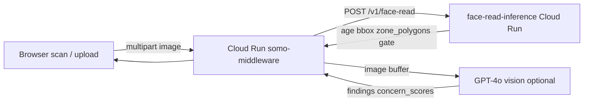

# Face-read inference (skin age)

**Last updated:** 2026-06-10

Live skin age requires inference behind `POST /api/public/face-read`. The browser does face **alignment** (MediaPipe live) and optional **upload gate** (MediaPipe IMAGE); the **number** and **zone geometry** come from the inference service; **findings** come from GPT vision when enabled.

## Architecture



| Layer | Where | Catches |
|-------|--------|---------|
| Upload gate (client) | `faceDetectUpload.js` | No face / low confidence before API call |
| BlazeFace gate (inference) | `face_age.py` | No face, face too small (<4% area) |
| GPT `wrong_subject` | `face-read-vision.js` | Hand/neck false positives |
| Skin age number | OpenCV DNN on face crop | Apparent age estimate |
| Skin findings | GPT vision (when enabled) | Concern scores, findings[], scan_summary |

## Pipeline v2 contract

**Request:** `POST /api/public/face-read` — multipart field `image`

**Success (200):**

```json
{
  "success": true,
  "face_read": {
    "apparent_age_estimate": 32,
    "model_id": "opencv-dnn-age-gender-v1",
    "model_version": "2.0.0",
    "zone_polygons": { "forehead": [[0.1, 0.2], ...] },
    "concern_scores": { "hyperpigmentation": 2, ... },
    "findings": [{ "id": "...", "label": "...", "plain_language": "...", "severity": 2, "zones": ["left_cheek"], "confidence": 0.9 }],
    "scan_summary": "...",
    "vision_enabled": true
  }
}
```

**Gate reject (200, no age):**

```json
{
  "success": true,
  "face_read": {
    "reject_reason": "not_a_face",
    "user_message": "We could not find a face...",
    "quality_flags": ["no_face"]
  }
}
```

**Decode failure only:** HTTP 422

## Env vars

| Where | Variable | Example |
|-------|----------|---------|
| Middleware / Cloud Run | `FACE_READ_INFERENCE_BASE_URL` | `https://face-read-inference-….run.app` |
| Middleware / Cloud Run | `FACE_READ_VISION_ENABLED` | `1` (requires `OPENAI_API_KEY`) |
| Local middleware | `middleware-platform/.env` | `http://127.0.0.1:8765` |

**No client mocks.** Web and mobile reject `model_id` of `mock`, `fallback_mock`, or missing age.

## Face age vs skin age (reveal)

| Field | Source | Meaning |
|-------|--------|---------|
| `apparent_age_estimate` | OpenCV DNN | How old you **look** |
| Skin age (computed client-side) | `computeSkinAge.js` | Face age + weighted concern penalty (0–15 yrs) |
| `fitzpatrick_estimate` | GPT vision | Shown in Fitzpatrick score card when present |

**Reveal UI (`RevealPage.jsx`) — two states:**

| State | When | UI |
|-------|------|-----|
| **A — findings loaded** | `findings[]`, `scan_summary`, or concern scores present | Score row (face age / skin age gap / Fitzpatrick), finding cards with `plain_language`, zone dots, **Build my routine →** |
| **B — vision failed** | Vision on but no findings, no summary, all scores zero | Dimmed photo, lighting retry tips (incl. deep skin tones), **no age numbers**, Scan again + skip to concerns |

## Vision — dark skin + low light

GPT prompt in `face-read-vision.js` requires:

- Never empty `findings[]` when face is clearly visible
- Emit `poor_lighting` finding when lighting is poor (`zones: []`, confidence 0.95)
- Lower confidence floor (0.4) for Fitzpatrick V–VI in `normalizeVisionPayload()`

Missing `confidence` on findings defaults to `1.0` before filter. JSON parse failures return `vision_parse_failed` on merged `face_read`.

## Image retention (privacy)

| Stage | Image bytes persisted? |
|-------|-------------------------|
| Browser scan | Optional preview in `sessionStorage` (`sc_onboarding_face_photo_url`) until tab close |
| `POST /api/public/face-read` (middleware) | **No** — `multer.memoryStorage()` only; proxied to inference and discarded |
| Inference service (`inference/face-read`) | **No** — analyzed in RAM; JSON returned |
| After signup (daily progress photo) | **Yes** — GCS via `POST /api/patient/routine/daily/:id/photo` |

Synthetic zone ages (`base±1/2`) are **disabled by default**. Set `FACE_READ_SYNTHETIC_ZONES=1` on middleware only for legacy demos.

## Deploy (prod)

```bash
# 1. Inference (MediaPipe gate + zone polygons)
npm run deploy:face-read-inference
FACE_READ_INFERENCE_BASE_URL=https://YOUR-INFERENCE-URL npm run configure:face-read-inference

# 2. Middleware — enable vision (requires gcloud auth + billing)
# Set on somo-middleware Cloud Run:
#   FACE_READ_VISION_ENABLED=1
#   OPENAI_API_KEY=sk-...
./scripts/deploy-to-gcp-production.sh

# 3. Consumer hosting (reveal findings UI)
npm run deploy:consumer-hosting

# 4. Verify
API_BASE_URL=https://api.callsomo.com npm run smoke:face-read
npm run smoke:face-read-reveal   # vision env audit + E2E-05/06/16/17 + unit tests
bash scripts/audit-cloudrun-face-read-config.sh
cd middleware-platform && npm run test:e2e-skin-age-journey
```

Live inference URL (2026-06-09): `https://face-read-inference-xrrr4znsoa-uc.a.run.app`

Consumer web currently uses `https://api.callsomo.com` until `api.myskinandcare.com` domain verify completes (`gcloud domains verify myskinandcare.com`).

## Local dev

```bash
npm run start:face-read-inference    # :8765
cd middleware-platform && echo 'FACE_READ_INFERENCE_BASE_URL=http://127.0.0.1:8765' >> .env
# Optional: FACE_READ_VISION_ENABLED=1 + OPENAI_API_KEY for findings
npm start
cd unified-dashboard/skin-care-landing && npm run dev
```

## Troubleshooting

| Symptom | Cause | Fix |
|---------|--------|-----|
| Scan error "not available yet" | `FACE_READ_INFERENCE_BASE_URL` unset | `configure:face-read-inference` |
| Reveal shows age only, no findings | Vision off in prod | Set `FACE_READ_VISION_ENABLED=1` on middleware |
| Reveal State B (retry tips, no age) | Vision on but empty findings after filter | Retake in better light; check `vision_error` / GPT response |
| Dark skin scan returns no findings | Low confidence filtered out | `poor_lighting` finding + dark-skin prompt (2026-06-10) |
| 502 / fetch failed | localhost URL on Cloud Run | Use reachable HTTPS URL, not `localhost:8765` |
| 200 + `reject_reason` on bad photo | BlazeFace gate working | User retakes; check lighting/centering |
| 422 on tiny test image | Decode fail (legacy) | Smoke uses `inference/face-read/fixtures/sample1.jpg` when present |
| myskinandcare API 503 | `api.myskinandcare.com` not mapped | Use `api.callsomo.com` or complete domain verify |
| gcloud deploy blocked | Auth expired / billing limit | `gcloud auth login` + check GCP billing |

## Related

- Inference service: [`inference/face-read/README.md`](../../inference/face-read/README.md)
- Merge service: [`middleware-platform/services/face-read-merge.js`](../../middleware-platform/services/face-read-merge.js)
- Proxy route: [`middleware-platform/routes/public-face-read.js`](../../middleware-platform/routes/public-face-read.js)
- Reveal UI: [`unified-dashboard/skin-care-landing/src/pages/RevealPage.jsx`](../../unified-dashboard/skin-care-landing/src/pages/RevealPage.jsx)
- Cloud deploy: [`docs/CLOUD.md`](../CLOUD.md)
