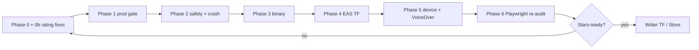

# Senior Engineer Architecture Review — Pre-TestFlight

**Role frame:** Senior AI / iOS / full-stack engineer, interview-style deep review  
**Product:** Touche (bundle `com.skinandcare.app`, ASC `6778105762`)  
**Date:** 2026-07-17 (rev 2 — Playwright full-screen + gaps closed)  
**Scope:** Architecture · Agentic orchestration · Backend · Deployment · LLMOps · Frontend/UX · App Store ratings · Value · TestFlight E2E plan · **Live + local Playwright**

**Companion docs:**  
- Product SSOT: [`docs/product/TOUCHE_AGENTIC_ARCHITECTURE.md`](../product/TOUCHE_AGENTIC_ARCHITECTURE.md)  
- Submission gate: [`APP_STORE_READINESS_REPORT.md`](./APP_STORE_READINESS_REPORT.md)  
- Build guide: [`TESTFLIGHT.md`](./TESTFLIGHT.md)  
- Cloud topology: [`docs/CLOUD.md`](../CLOUD.md)  
- Playwright audit artifact: [`todos/pending/touche-full-screen-audit-2026-07-17/`](../../todos/pending/touche-full-screen-audit-2026-07-17/)  
- Audit script: [`scripts/playwright-touche-full-screen-audit.cjs`](../../scripts/playwright-touche-full-screen-audit.cjs)  
- Named engineering patterns (retro): [`todos/pending/ENGINEERING_RETRO_PATTERNS_2026-07-17.md`](../../todos/pending/ENGINEERING_RETRO_PATTERNS_2026-07-17.md)

---

## 0. Interview verdict (30 seconds)

Touche is a **credible medical-journal product machine** (`orchestrateCapture` + facts SSOT + six-tag capture). It is **not** ready for high App Store ratings, and a typical user will **not** leave satisfied yet unless they only deep-link a few happy-path screens and ignore polish/trust failures.

| Dimension | Grade | One-line |
|-----------|-------|----------|
| Product IA / capture machine | **B+** | Six-tag confirm→reveal→thesis is intentional |
| Agentic orchestration honesty | **C+** | Live path is imperative; LangGraph medical “agents” are thin wrappers |
| Backend reliability | **C** | Monolith + SQLite + dual-write + confirm policy gap |
| Deployment / ops | **C−** | Shared Cloud Run; AV/Azure/email/encryption must be proven live |
| LLMOps | **D+** | Metering exists; evals/prompt pins/traces for medical capture are thin |
| iOS / TestFlight readiness | **C** | EAS exists; VoiceOver + device smoke + ASC materials open |
| UX trust / App Store ratings | **D+** | Debug strings in UI, empty-as-error, brand drift, hydration #418 on web |
| Value proposition clarity | **B−** | Strong “log + prove + share”; weak if sold as AI dermatologist |

**Ship decision:** Internal TestFlight **only after** prod env gate. **Do not** expect 4–5★ reviews until §12 review-killers are fixed. Architecture “done” requires confirm-time policy, media durability, meter fairness, crash reporting, and Apple IAP decision for AI credits.

---

## 0b. Can a user use this and be satisfied?

**Short answer: No — not for a high App Store rating today.**

| User type | Satisfied? | Why |
|-----------|------------|-----|
| Curious first-timer (web try) | **Maybe briefly** | Welcome → capture → tag → confirm/reveal routes render (live P8.10 passed). Then OTP, empty tabs, brand confusion. |
| Daily journaler (iOS TF) | **Unlikely** | Camera/OTP/prod AV must work; Calendar/Progress often look empty; debug chrome visible; errors look like “no data.” |
| “AI will explain my skin” buyer | **No** | Product correctly refuses diagnosis — but marketing/AI copy can overpromise; Unlock AI → Stripe web is App Review risk. |
| Patient prepping a doctor visit | **Closest to yes** | Share-with-doctor + confirm facts is the real value — if capture→confirm→PDF works on device with durable media. |
| Shelf / Buy shopper | **Partial** | Rx never-Buy is good; commerce is secondary and can distract from journal trust. |

**Satisfaction bar for “yes”:** First capture confirms into Calendar **and** Progress within 3 minutes, no debug strings, clear error vs empty, brand says Touche everywhere, AI optional with honest meter, physician share works once.

---

## 1. What this system actually is

### 1.1 Product in one sentence

**Touche is a camera-first personal medical tracker** — six tags (skin, bill, Rx, mark, lab, other) → draft facts → user confirm → Calendar / Track / Progress / physician export — with optional metered AI and a skincare shelf side door.

### 1.2 Runtime topology

```
patient-app (Expo iOS + static web /app)
    → https://api.callsomo.com  (Cloud Run somo-middleware)
         → SQLite (+ optional Postgres)
         → Azure Blob / local:// media
         → ClamAV
         → OpenAI / face-read vision (skin|mark)
         → OCR / billing parsers
         → Stripe (AI credits + legacy care program)
         → Shopify (shelf)

Marketing: app.trytouche.com, myskinandcare.com
Shared monolith also: Kelly voice, RCM, provider portals, FHIR…
```

### 1.3 Scale reality

| Artifact | Approx size | Risk |
|----------|-------------|------|
| `server.js` | ~10.2k lines | Shared process blast radius |
| `database.js` | ~20.7k lines | Schema + helpers intertwined |
| `services/` | ~419 modules | Domain bleed |
| `patient-app` routes | ~92 static web routes (Expo export) | Deep machine; retired Redirect stubs |
| Migrations | 76 (065–074 medical) | Must run in prod |

---

## 2. Architecture map (current truth)

### 2.1 Canonical capture path

```
Upload → AV → request_id replay
  → [manual] structure → policy → insertFact(draft)
  → [AI] quality → meter → perceive → media → structureByTag
       → assertOrchestrationPersistPolicy → insertFact(draft)
  → confirm UI → validateTagStructured only ← POLICY GAP
       → updateFactConfirm → optional queue / Rx→shelf
```

**Canonical:** `services/capture-orchestration/index.js`  
**Demoted:** `medical-tracker-rails/capture-compose.js` (not HTTP create)

### 2.2 “Agentic” honesty

| Layer | Reality |
|-------|---------|
| Capture | Imperative pipeline (correct for medical journaling) |
| Medical LangGraph | Single-node wrappers + allowlists — not production brain |
| Consumer evaluate | Separate graph; must stay disjoint from facts |
| Kelly/coding | Forbidden in medical-tracker (isolation script) |

---

## 3. Playwright evidence (2026-07-17)

### 3.1 What ran

| Suite | Target | Result |
|-------|--------|--------|
| `scripts/playwright-touche-full-screen-audit.cjs` | Local Expo web export @ `127.0.0.1:5299` | **70 routes** crawled; session + API stubs (OTP bypass) |
| Tab bar click pass | Same | URLs change Calendar→Shelf→Track→Progress→Profile |
| `playwright.medical-tracker-ia.config.cjs` | **Live** `https://app.trytouche.com` | **4/4 passed** (contracts + skin/bill/multi-tag deep links) |

Auth bypass method (local audit only): `bootstrapMobileSession` sets `patient_session_id` in localStorage + `stubMobileAppApis` / medical-tracker stubs for `/api/patient/*` (OTP verify mocked). No production secrets used.

Artifacts: `todos/pending/touche-full-screen-audit-2026-07-17/` (screenshots + `audit-report.json` + `AUDIT_SUMMARY.md`).

### 3.2 Route crawl scoreboard (local-stub)

| Metric | Value |
|--------|-------|
| Routes visited | 70 |
| Unmatched routes | **0** |
| Blank screens | **0** |
| Route-level OK (no critical content issues) | 66 / 70 |
| Explicit content FAILs | `/calendar` empty-vs-stub, `/progress` empty-vs-stub, `/onboarding/signup` brand drift, `/compare` legacy still live |
| React hydration **#418** | **~70/70 screens** (pageerror on every navigation) |
| Tab bar | All five tab URLs reachable |

Live P8.10 proves **deep-linked** capture/tag/confirm/reveal/Rx-no-Buy surfaces exist on production hosting. It does **not** prove full authenticated tab data, camera, OTP email, or AV.

### 3.3 Concrete UI failures found in crawl

| # | Finding | Severity | Why users / reviewers hate it |
|---|---------|----------|-------------------------------|
| 1 | **React #418 hydration mismatch** on essentially every web screen | High (web) | Console errors, possible flicker/wrong first paint; signals unfinished web quality |
| 2 | **Calendar shows empty** (“Nothing logged yet”) even with calendar stub | High | Stub shape ≠ client expectations **or** catch→[]; user thinks product is broken |
| 3 | **Progress empty + stale copy** (“Start your photo streak… on Home”) | High | Home tab retired; Progress honesty story fails; empty despite aggregates stub |
| 4 | **Debug string in Progress Alerts:** `empty_redirect_to_check_retired` | **Critical for ratings** | Visible test lock text in production UI (`ProgressAlertsModule.tsx`) |
| 5 | **Debug string on Track:** `/api/patient/marks` | **Critical for ratings** | API path shown as subtitle (`track.tsx`) |
| 6 | **Calendar shows `patient_record_facts` source** | High | Internal store name as footer (`calendar.tsx` `calendar-api-source`) |
| 7 | **Onboarding signup still “Skin & Care”** | High | Brand split vs Touche ASC listing |
| 8 | **`/compare` legacy journal compare still reachable** | High | Progress “day 1 vs today” can land off facts SSOT |
| 9 | **Capture copy mentions PDF; pickers are images-only** | High | Misleading feature claim |
| 10 | **Tab click body still read as Calendar chrome** in one pass | Medium–High | Investigate web tab mounting / a11y; deep-link to `/progress` works |

### 3.4 What passed (important)

- All six confirm / reveal / thesis tag surfaces render (no Unmatched Route).  
- Rx confirm/reveal had **no Buy** CTA in crawl.  
- Capture machine side paths (camera-denied, vision-fail, manual, AI cap/burst/unlock, mark-picker/compare) render.  
- Profile surfaces (language, share-with-doctor, notifications, consent, allergens) render.  
- Live host deep-link journeys for skin, bill, multi-tag skin+Rx **pass**.

---

## 4. Every reason this fails at the top level (App Store reviews)

### 4.1 Functionality — why stars drop

1. **Capture works on a screen; history doesn’t feel real** — Calendar/Progress empty or stub-mismatched → “app doesn’t save anything.”  
2. **Errors look like empty** — `catch { setDays([]) }` on Calendar/Shelf/Progress/Track → outage = “I have no data.”  
3. **OTP / email dependency** — no code → cannot enter; TF testers bounce.  
4. **Prod AV / media / encryption** — missing ClamAV or ephemeral `local://` → capture fails or photos vanish after restart.  
5. **Confirm policy gap** — safety at capture, not confirm → trust/compliance hole.  
6. **Meter unfairness** — charged after AI work if structure/persist fails.  
7. **Progress compare miswired** — legacy `/compare` vs facts mark-compare.  
8. **PDF advertised, not offered** — feature lie.  
9. **Apple IAP risk** — Unlock AI opens **Stripe URL** (`unlock-ai.tsx` → `Linking.openURL`). Digital AI credits in-app often require StoreKit (3.1.1) or a carefully framed external-purchase path — **rejection or 1★ “paywall broken.”**  
10. **No crash reporter** — no Sentry/Crashlytics in patient-app → TF bugs invisible.  
11. **Multi-tag burns N AI units** — surprise meter drain.  
12. **VoiceOver never device-passed** — a11y 1★ risk + App Review.  
13. **`capture_token` race residual** — rare but brutal “my photos went to someone else” support nightmare.  
14. **Shared monolith outages** — voice/RCM incident takes down journaling API.

### 4.2 Design / polish — why stars drop

1. **Debug / test strings in shipping UI** — `empty_redirect_to_check_retired`, `/api/patient/marks`, `patient_record_facts`. Instant “amateur” rating.  
2. **Brand salad** — Touche / Skin & Care / Skin Journal / callsomo / trytouche / myskinandcare.  
3. **Stale Progress copy** referencing Home / photo streak language from retired IA.  
4. **Hydration #418** on web export — feels broken even when content shows.  
5. **Orphan OTP frames** vs primary `OtpForm` on sign-in — inconsistent auth UX.  
6. **Weak loading recovery** — no clear cancel/retry on capture loading hang.  
7. **Support URL interim** on welcome — Reviewer support path weak.  
8. **Cards/chrome density on Track** — action stack is fine; API hint ruins it.  
9. **English-only language stub** — honest but unfinished.  
10. **Screenshot / mock lag** (45 vs 51 frames) — ops pain → wrong ASC screenshots.

### 4.3 Review-killer priority (fix before asking for stars)

| Priority | Fix | Effort |
|----------|-----|--------|
| P0 | Remove all visible test/debug strings from Progress/Track/Calendar | Hours |
| P0 | Prod gate: ClamAV + durable media + encryption key + OTP email | Ops day |
| P0 | Empty vs error vs offline on all tabs | 1–2 days |
| P0 | Decide IAP vs Stripe for AI credits; implement or hide Unlock AI on iOS | 2–5 days |
| P1 | Align brand to Touche everywhere | Hours–1 day |
| P1 | Wire Progress compare → mark-compare; kill or redirect `/compare` | Hours |
| P1 | PDF: implement or rewrite copy | Hours–1 day |
| P1 | Confirm-time medical policy + meter refund completeness | 1–2 days |
| P1 | Add crash reporting | 0.5–1 day |
| P2 | Fix web hydration #418 | 1–3 days |
| P2 | VoiceOver device pass | 0.5 day + hardware |
| P2 | Medical vision eval gate | Ongoing |

---

## 5. Architecture failure modes (systems)

### 5.1 P0 — TestFlight / trust

| # | Failure | Why |
|---|---------|-----|
| 1 | ClamAV missing | Fail-closed AV blocks all buffered captures |
| 2 | Ephemeral media (`local://` on Cloud Run) | Photos lost on restart |
| 3 | OTP email down | Auth dead |
| 4 | Encryption falls through to `dev-billing-key` | Catastrophic if prod unset |
| 5 | Vision flag off | Skin/mark AI unavailable |
| 6 | Migrations 065–074 missing | Facts/meters break |
| 7 | Empty-as-error tabs | Fake “no data” |
| 8 | Brand drift | Support + ASC confusion |

### 5.2 P1 — Safety / money

| # | Failure | Why |
|---|---------|-----|
| 9 | Confirm skips `assertOrchestrationPersistPolicy` | Clinical prose can persist post-edit |
| 10 | `capture_token` bind race | Stolen token bound by attacker first |
| 11 | Meter refund gaps | Quota lost on failed saves |
| 12 | Concurrent over-consume | Check-then-act meter |
| 13 | Multi-tag N meters | Surprise billing |
| 14 | No KMS/rotation | Disclosed but no exit ramp |
| 15 | Physician share reusable until expiry | Leaked link = live PDF |
| 16 | Progress → legacy compare | SSOT lie |
| 17 | Stripe AI credits on iOS without IAP strategy | App Review / chargebacks |
| 18 | OBF Rx mis-tag residual | Catalog quality |

### 5.3 P2 — Platform / LLMOps

| # | Failure | Why |
|---|---------|-----|
| 19 | Shared monolith | Blast radius |
| 20 | SQLite primary + multi-instance | Corruption / single-writer |
| 21 | Dual-write best-effort | Facts lag legacy |
| 22 | LangGraph looks agentic | Engineers re-wire dual create paths |
| 23 | Denylist policy gameable | Novel clinical phrasing |
| 24 | Heuristic Rx/delta as “AI” | Wrong drug / worse-calmer |
| 25 | Weak medical LLMOps | No golden eval gate for vision |
| 26 | AV CI bypass fragility | Green CI ≠ green prod |
| 27 | `verify-prod-consumer-env` incomplete | Misses ClamAV/Azure/crypto/OTP |
| 28 | No crash/APM on client | Blind TF |
| 29 | No backup/DR story for SQLite | Data loss |
| 30 | Deploy doc historical Azure/Render | Wrong runbook |

---

## 6. What is well designed (keep)

1. One HTTP orchestrator (`orchestrateCapture`) vs demoted compose.  
2. Quality before meter; manual always allowed.  
3. Draft → confirm before Calendar/Progress.  
4. Persist-time policy on capture path (vocab, forbidden keys, Rx commerce ban, closed delta templates).  
5. Medical isolation from Kelly.  
6. Owner-scoped `request_id` idempotency.  
7. OTP bind for anonymous captures (improved).  
8. Credits ledger + Stripe event idempotency.  
9. Rx never-Buy client SSOT (fail-closed).  
10. Unusually honest consent (AI optional, AV, no KMS, retention).  
11. Strong unit/HTTP phase tests (with named gaps).  
12. 5-tab Progress lander clearer than camera-only interim.

---

## 7. What I would do better (time-boxed)

### Now (before / during first internal TF)

- Strip debug UI strings; brand → Touche; PDF honesty; Progress compare → facts.  
- Empty vs error states.  
- Prod env verify script that **fails** without ClamAV/Azure/encryption/OTP/vision.  
- Confirm-time policy + always-refund after meter until draft persists.  
- Hide or StoreKit-wrap Unlock AI on iOS.  
- Add Sentry (or equivalent) before TF invites.

### Next (TF → App Store)

- VoiceOver device pass; crash triage loop.  
- Capture loading cancel/retry; meter preview.  
- Harden `capture_token`; shorten share-link default TTL UX.  
- Medical vision golden set in CI.  
- Fix web hydration #418 if web remains a storefront.

### Later (scale)

- Extract patient-records service; Postgres primary; KMS; kill dual-write; rename “agentic” in eng docs to pipeline+rails.

**Better agent loop (if agency grows):** Perceive (schema-locked) → Critique → Propose draft → Human confirm → Persist + audit. Never `insertFact` without policy. No checkpoint of DB handles.

---

## 8. Domain deep-dives

### 8.1 Agentic orchestration

**Strength:** Pipeline + policy + isolation.  
**Weakness:** Confirm bypass; LangGraph theater; delta heuristics metered as AI.  
**Score:** Good systems thinking; incomplete last-mile safety.

### 8.2 Backend

**Strength:** Facts repo, app-layer crypto, migrations, idempotency, credits, export, retention design.  
**Weakness:** Monolith, SQLite, dual-write, env gaps, meter fairness.  
**Score:** Feature velocity > production reliability.

### 8.3 Deployment / iOS

**Strength:** EAS testflight profile, ASC IDs, documented TF steps.  
**Weakness:** Shared API, brand/host matrix, missing prod capture gate, no client crash pipeline, IAP unresolved.  
**Score:** Can build IPA; cannot guarantee backend/UX behind it.

### 8.4 LLMOps

**Strength:** Meter + credits + burst.  
**Weakness:** No deploy gate on vision quality; denylist-first; weak prompt versioning; cost dashboards thin.  
**Score:** Monetization ops > model ops.

### 8.5 Frontend / UX (Playwright-backed)

**Strength:** Route coverage; Rx no-Buy; capture machine complete; consent honesty.  
**Weakness:** Debug strings, empty states, brand drift, hydration, stale copy, PDF lie, legacy compare.  
**Score:** Structure B+; shipping polish D+.

### 8.6 Previously missing review areas (now covered)

| Topic | Assessment |
|-------|------------|
| Apple IAP vs Stripe AI credits | **Blocker for Store** until decided |
| Crash reporting | **Missing** on patient-app |
| Push | Registration exists; liability/quiet hours under-specified |
| Deep links / `patientapp://` | Present; error UX weak |
| Offline | No durable retry queue called out |
| Image pipeline | HEIC/EXIF/size not gated in this review’s code pass |
| Backup/DR | Not evidenced for SQLite Cloud Run |
| Abuse (OTP flood, anon capture cost) | Rate limits exist elsewhere; medical anon path needs explicit budget |
| Observability | Platform Insights heritage; no Touche-specific alert pack |
| North-star metrics | Should be: confirmed facts/week, physician shares, D7 return — not AI calls |
| SaMD / medical claims | Position as wellness journal; keep screenshots free of diagnosis language |

---

## 9. Value proposition

### 9.1 Real value

| Job | Delivery |
|-----|----------|
| Remember skin journey | Dated skin/mark photos |
| Keep paperwork together | Bill / Rx / lab / other |
| Show a doctor proof | Physician PDF + share link |
| Optional AI assist | Metered; manual always |
| Avoid product conflicts | Shelf evaluate (secondary) |

### 9.2 Do not oversell

Not a diagnostic device · Not clinic HIPAA SaaS · Not Kelly care coordinator · Not unlimited AI.

### 9.3 Sharpen value

1. Protect **counts-only Progress** (no invented %).  
2. Make **visit pack** the hero.  
3. Fix mark compare as the wow.  
4. Keep Shopify out of App Store screenshot story.  
5. Trust UX (empty vs error) *is* the product.

---

## 10. Plan — start to finish until TestFlight E2E

### Phase 0 — Claim freeze (0.5 day)

- [ ] Ship claim: personal medical tracker + optional AI (not diagnosis).  
- [ ] Brand → Touche (ASC, expo.name, onboarding, signup).  
- [ ] Waive or fix: KMS, capture_token race, IAP strategy.

### Phase 0b — Rating blockers from Playwright (0.5–1 day) — **do before TF marketing**

- [ ] Remove `empty_redirect_to_check_retired` from user-visible Progress UI.  
- [ ] Remove `/api/patient/marks` hint from Track.  
- [ ] Remove `patient_record_facts` / raw API source footers from Calendar (or hide behind `__DEV__`).  
- [ ] Fix Progress empty copy (no “Home” streak language).  
- [ ] Redirect `/compare` → mark-compare or retire Progress CTA.

### Phase 1 — Production backend gate (1–2 days) — **blocker**

- [ ] ClamAV healthy on `api.callsomo.com`  
- [ ] Durable Azure/GCS media — ban `local://` in prod  
- [ ] `PATIENT_RECORD_FACTS_ENCRYPTION_KEY` set  
- [ ] OTP email E2E to real inbox  
- [ ] Vision enabled + OpenAI live  
- [ ] Migrations 065–074 applied  
- [ ] Stripe AI path: either StoreKit-ready or feature-flagged off on iOS  
- [x] Scripted `verify:touche-prod-capture` (`middleware-platform/scripts/verify-touche-prod-capture.cjs`; live run 2026-07-17 **GATE FAILED** — medical routes 404 / vision 502; see `todos/pending/touche-prod-gate-2026-07-17/`)  
- [ ] Smoke: capture → confirm → calendar → progress → physician PDF

### Phase 2 — Safety / honesty code (1–3 days)

- [ ] Confirm-time `assertOrchestrationPersistPolicy`  
- [ ] Meter refund on any post-consume failure before durable draft  
- [ ] Tab empty vs error vs offline  
- [ ] PDF picker or copy fix  
- [ ] Capture loading timeout + retry + cancel  
- [ ] Client crash reporting

### Phase 3 — Binary prep (0.5–1 day)

- [ ] `npm run verify:testflight` + typecheck  
- [ ] Confirm `eas.json` API base  
- [ ] Privacy/Terms + consent parity  
- [ ] ASC screenshots from **current** build (not stale mock)

### Phase 4 — Build & submit TF

```bash
cd patient-app
npm run doctor:testflight
npm run build:testflight
npm run submit:testflight
```

### Phase 5 — Device E2E matrix (blocker for “ready”)

Physical iPhone: Welcome→consent→capture→confirm→OTP→Progress→Calendar→Shelf→Track→Profile→Share PDF; camera deny; AI cap; Rx no Buy; airplane mode shows **error not empty**; VoiceOver pass.

### Phase 6 — Re-run Playwright full audit

```bash
node scripts/playwright-touche-full-screen-audit.cjs
BASE_URL=https://app.trytouche.com npx playwright test -c middleware-platform/playwright.medical-tracker-ia.config.cjs
```

Exit criteria: no user-visible debug strings; Calendar/Progress show stubbed/live data when APIs return data; critical=0.



---

## 11. Interview closing

> “The capture machine is the right shape — imperative, metered, policy-gated, human-confirmed. Playwright shows the **screens exist**; it also shows the app still ships **test locks and API paths in the UI**, Progress/Calendar that feel empty, and web hydration errors everywhere.  
>  
> A user can *try* Touche. They will not yet *trust* it enough for high ratings. Fix the visible amateur signals and the prod capture gate first; then argue about Postgres and KMS.  
>  
> Value is **proof for the visit**, not AI diagnosis. Protect that — and resolve Apple’s rules for selling AI credits — before you ask the App Store for love.”

---

## 12. Appendix — key files

### Orchestration / safety
- `middleware-platform/services/capture-orchestration/index.js`
- `middleware-platform/services/medical-tracker-rails/policy.js`
- `middleware-platform/routes/patient-records.js`
- `middleware-platform/services/ai-capture-meter.js`
- `middleware-platform/services/patient-record-field-crypto.js`
- `middleware-platform/services/antivirus-service.js`

### UI review killers (fix)
- `patient-app/components/progress/ProgressAlertsModule.tsx` — `empty_redirect_to_check_retired`
- `patient-app/app/(tabs)/track.tsx` — `/api/patient/marks` hint
- `patient-app/app/(tabs)/calendar.tsx` — source footer
- `patient-app/app/(tabs)/progress.tsx` — COMPARE_HREF / empty copy
- `patient-app/app/onboarding/signup.tsx` — Skin & Care
- `patient-app/app/capture/unlock-ai.tsx` — Stripe `openURL`

### Playwright
- `scripts/playwright-touche-full-screen-audit.cjs`
- `middleware-platform/e2e/medical-tracker-ia.spec.cjs`
- `middleware-platform/e2e/helpers/mobile-app-mocks.cjs`

---

## 13. Document control

| Field | Value |
|-------|-------|
| Rev | 2 — 2026-07-17 |
| Method | Architecture review + local full-screen Playwright (70 routes, session/API stub bypass) + live P8.10 medical-tracker-ia (4/4) + prior readiness report |
| Not claimed | Physical VoiceOver; prod ClamAV probe from this session; every line of monolith |
| Satisfaction verdict | **Not yet** for high App Store ratings |
| Next update | After Phase 0b string purge + Phase 1 prod gate + Playwright re-run |

**End of report.**
