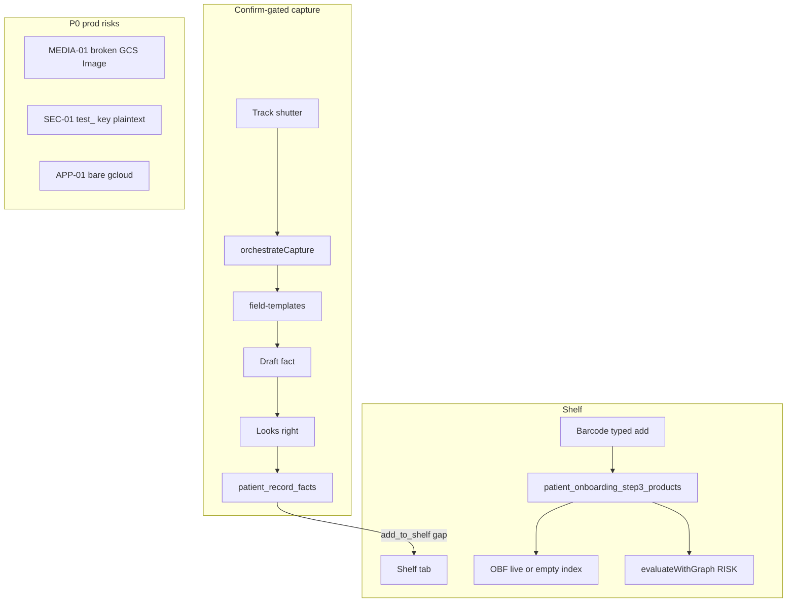

# Touche — V1 App Store Plan (Phased)

**Status:** living SSOT — do not execute without sign-off  
**Last updated:** 2026-07-18/19 (Phase 1 live adversarial SEC-04/05/06 + STOR-RACE PASS; DEPS/ENV ship-gate **executed FAIL** (SEC-01 `test_` + missing pipeline flags); **DEV-01/DEV-02 device still OPEN**; Phase 4 smoke PASS; serving **`00205-fvx`**)  
**Serving (prod):** `somo-middleware-00205-fvx` @ `sha256:63f3367c10f6baac3133fb20c79afe181c1b83e1e45c82f5383f627a4bee197b` (4Gi, STAGING=0)  
**Live adversarial evidence:** [`LIVE_ADVERSARIAL_SEC_DEPS_STOR_2026-07-18.md`](./LIVE_ADVERSARIAL_SEC_DEPS_STOR_2026-07-18.md) · `/tmp/touche-adversarial-2026-07-18/`  

**Canonical path:** [`todos/pending/TOUCHE_APP_STORE_V1_PLAN.md`](./TOUCHE_APP_STORE_V1_PLAN.md)  
**Supersedes phase ordering in:**
- Cursor remediation `touche_remediation_architecture_66f04fa5` *(security IDs still valid; App Store phase order does not)*
- Prior in-repo draft that put product backend ahead of P0 security/media gates
- Downloads draft `TOUCHE_V1_PHASED_PLAN.md` *(merged here with evidence corrections below)*
- Remedia catalog [`TOUCHE_REMEDIATION_ARCHITECTURE_PLAN_2026-07-17.md`](./TOUCHE_REMEDIATION_ARCHITECTURE_PLAN_2026-07-17.md) — **ID catalog only; do not use its Section order for submit**

**Also see:** [`REMEDIATION_OPEN_PUNCHLIST_2026-07-18.md`](./REMEDIATION_OPEN_PUNCHLIST_2026-07-18.md) · [`PHASE3_BACKEND_EVIDENCE_2026-07-18.md`](./PHASE3_BACKEND_EVIDENCE_2026-07-18.md) · [`DUP_LOGGED_ON_CALENDAR_DATE_2026-07-18.md`](./DUP_LOGGED_ON_CALENDAR_DATE_2026-07-18.md) · prod-gate folder [`touche-prod-gate-2026-07-17/`](./touche-prod-gate-2026-07-17/)

**Claim we ship:** the only app that shows you what you're actually using and whether it's working — with the receipts. Meaning: user-confirmed Shelf entries + dated captures + arithmetic spend. No AI health inference, no interaction claims, no composite scores in v1.

**Phase discipline:** No phase mixes backend/schema/API work with UI-rendering work, except Phase 1/2 gate verification which may include device UX proof without building new product screens.

**What changed from earlier drafts:** Stedi rotation, Cloud Run digest, OTP auth, media GET, and related P0 items are **not** product build — they are Phase 1 release gates. Product backend is Phase 3. UI is Phase 5. Branding is Phase 6. Submission is Phase 7.

### Evidence corrections (vs Downloads draft / punchlist)

| Claim in some docs | Reality (2026-07-18) |
|--------------------|----------------------|
| Punchlist “SEC-01 closed” | **Code** fail-closed + no hardcoded fallback in [`insurance-service.js`](../../middleware-platform/services/insurance-service.js). **Ops OPEN:** prod still binds leaked `test_` key as plaintext (`SEC01_STEDI_PROD_BINDING_EVIDENCE_2026-07-18.json`, `rotation_status: NOT_DONE`). |
| SEC-02…06 “must rebuild from scratch” | Treat as **re-verify live / adversarial smoke** — Wave code landed; do not skip if env regresses. |
| “Be Bold = zero live occurrences” | **False** — `WELCOME_TAGLINE = 'Be Bold'` in [`welcome.tsx`](../../patient-app/app/welcome.tsx). Phase 6 = ASC/landing parity + residual Skin & Care sweep. |
| STOR-01…04 “closed” | **STOR-RACE live PASS** (concurrent bind: one winner) — see `LIVE_ADVERSARIAL_*`. Broader STOR-01…04 catalog items may still differ. |
| APP-01 “closed” | Wrapper exists; **bare `gcloud` still unsafe** — discipline forever. |

---

## Phase 0 — SSOT & claim-safe flags (no code)

Lock docs so engineering and App Store copy cannot drift.

- [ ] Update product SSOT ([`TOUCHE_AGENTIC_ARCHITECTURE.md`](../../docs/product/TOUCHE_AGENTIC_ARCHITECTURE.md)) with v1 claim-safe feature list: Shelf (barcode + typed add), OBF ingredient display (list only), Progress before/after + shelf-in-window, spend tracking, Rx-confirm → Shelf one-tap.
- [ ] Explicitly list **not** shipping: interaction/compatibility scores, “Hard no / Looking good”, BFI, `FEATURE_V3_INSIGHTS` rendering, NDC, reverse Shelf→Calendar, dosage/refill inference.
- [ ] Decide and document: feature-flag gate vs UI removal for conflict/verdict/insight in the store build. Keep graph code — don't delete, don't render.
- [ ] Document that [`verify-prod-consumer-env.cjs`](../../middleware-platform/scripts/verify-prod-consumer-env.cjs) must flip to claim-safe expectations (today asserts insights/eval **ON**). *Script edit = Phase 1 gate work, not Phase 0.*
- [ ] Bundle ID decision memo: keep `com.skinandcare.app` (**default**) vs new listing. Written decision.
- [ ] Align [`APP_STORE_SUBMISSION.md`](../../docs/runbooks/APP_STORE_SUBMISSION.md) copy source-of-truth (photo-only; no Unlock AI purchase on iOS; no Safe/Caution/Hard-no screenshots). Screenshots themselves = Phase 7.

---

## Phase 1 — Security & infra gates (P0 — blocking, start immediately)

Zero product-feature UI. Live-risk or release-blocking. Priority over Phases 3–7.

| ID | Task | Status / evidence | Why P0 |
|----|------|-------------------|--------|
| **SEC-01** | Rotate Stedi in Secret Manager; remove plaintext `test_` from Cloud Run; re-issue evidence JSON | **OPS OPEN** — code fail-closed landed (no hardcoded fallback). Live `00194-2lf` still plaintext `test_` (`SEC01_*` `rotation_status: NOT_DONE`). Awaiting your Stedi console rotation confirm. | Live leaked key on shared `api.callsomo.com` |
| **SEC-02** | Test-route gate (`/api/test/*`, `simulate-stedi`) | **LIVE PASS 2026-07-18** — after deploy+`--to-latest`: `POST/GET https://api.callsomo.com/api/test/simulate-stedi-approval` + `…/uhc-fhir/connection` → **404** `NOT_FOUND`. (Pre-deploy on `00193` still returned 400/200 — code had never been serving.) | Misconfig / regression |
| **SEC-03** | Google auth requires real ID token | **LIVE PASS** — forged base64 email + email-only body → **401** `GOOGLE_TOKEN_INVALID` / `GOOGLE_CREDENTIAL_REQUIRED`. Unit: `sec03-google-id-token.test.js` | Forgeable sessions |
| **SEC-04** | Upload HMAC no default | **LIVE PASS** — forged token w/ `change-me-in-production` → prod `GET /upload` + `POST /api/patient/upload` **410** “Upload window closed”. SecretRef + unit still hold. Evidence: `LIVE_ADVERSARIAL_*` | Forgeable upload tokens |
| **SEC-05** | Facts crypto fail-closed | **LIVE PASS** — prod `enc:v1` ciphertext: no key / `dev-billing-key` → `FACTS_ENCRYPTION_KEY_REQUIRED`; wrong key → GCM fail; real SM key decrypts. SecretRef binding confirmed. | Mass PHI decrypt |
| **SEC-06** | Local media read path traversal | **LIVE PASS (URL read-path)** — prod `GET …/media/../../etc/passwd` → **404** (no leak); encoded `..` → **410**. `assertSafeLocalKey` still **UNIT PASS** (prod media is GCS; local:// plant needs reload). | Local file exfil |
| **APP-01** | Serving-digest on every Cloud Run mutate | **HARDENED** — wrapper + deploy `--to-latest` + digest assert. Live: `00199-ph2` MATCH `sha256:0d5894ce…`. Bare `gcloud run jobs` paths remain non-service. | Silent old-revision traffic |
| **MEDIA-01** | Media GET GCS stream; absolute URLs; no burn on list thumbs | **API/CODE PASS** — stream/absolute/peek + Progress `SessionImage` shipped. **Device Progress photo round-trip:** not re-certified on a final device pass in this window — do not treat adjacent API PASS as device PASS. | Photos look unsaved |
| **AUTH-01** | Real OTP → capture → confirm E2E | **PASS** — real OTP to `richard@callsomo.com` (IMAP), smoke green: `/tmp/touche-phase1-evidence/item9-smoke-rerun.txt`. | Core loop |
| **DEV-01** | Authenticated Allerton “Looks right” on device | **OPEN / BLOCKED — parked for final device pass** — API capture+confirm Allerton PASS (`PHASE1_ITEMS_8_11_EVIDENCE.json`); **Item 10 post–Looks right frame not harvested** under the no-tap-automation rule. Earlier “device PASS” was incorrect (watcher/adjacent evidence ≠ verified tap). Memory **4Gi**. | Device confirm open |
| **DEV-02** | Body-skin / hands confirm + overlay on device | **OPEN / BLOCKED — parked for final device pass** — API body-skin confirm PASS; **Item 11 hands (or skin) post–Looks right frame not verified** since last FAIL/BLOCKED. Do not mark PASS from API or Playwright Phase 2. Overlay on-device unproven. | In-app confirm unproven |
| **STOR-RACE** | `capture_token` claim atomicity | **LIVE PASS** — concurrent `verify/send` same `capture_token`: exactly one `bound`, other `already_bound_other_session`. Unit still holds for claim path. | Pre-auth PHI bind race |
| **DEPS-01** | ClamAV / GCS / email-OTP hard deps in verify script | **LIVE SHIP-GATE EXECUTED — FAIL** — GCS/ClamAV/SMTP present; **fails** on `STEDI_API_KEY` `test_` (SEC-01). | Capture/auth look “up” while broken |
| **ENV-01** | Claim-safe flags in verify script | **LIVE SHIP-GATE — PARTIAL + SCRIPT DRIFT** — insight flags off OK. Failures on `NEXT_GEN_PIPELINE` / `JOURNAL_MODE_STANDALONE` / `STRIPE_PRICE_CARE_PROGRAM` are **not required for Shelf spend / Progress / capture v1** (journey-LLM / journal-diary / Care Program checkout only). Detail: [`DEPS_ENV_MEDIA01_YESTERDAY_ROOTCAUSE_2026-07-18.md`](./DEPS_ENV_MEDIA01_YESTERDAY_ROOTCAUSE_2026-07-18.md). Demote in verify script for claim-safe ship. | Deploy gate fights v1 thesis |

**Exit criteria:** every row has passing adversarial test **or** live-production evidence — not a checkbox. Nothing is done without a test that fails on revert, or live evidence.

---

## Phase 2 — Trust & App Review gates (P1 — blocking submission, no new product APIs)

Still no Shelf/Progress feature build. Truth to user and Apple.

| ID | Task | Status / notes |
|----|------|----------------|
| **G-VO** | VoiceOver device pass + write-up | **OPEN** — source findings listed in foundation report; device VO pass still needs human VoiceOver session |
| **G-EMPTY** | Empty-state honesty: outage ≠ “no data” on Shelf / Calendar / Progress / mark-compare | **PASS** — `LoadFailedState`; Playwright forced 429 ×4 (`/tmp/touche-phase2-pw/`) |
| **G-CLAIM** | Suppress conflict / Hard-no / verdict / V3 insight **rendering** in store binary (code stays) | **CODE PASS** — `claim-safe-ui` default OFF; eas `EXPO_PUBLIC_CONFLICT_VERDICT_UI=0`; ClaimSafeRedirect on verdict/bottle/try-reveal; shelf/scan/try-verdict gated. Tests: `g-claim-g-cancel.test.ts` |
| **SEC-32** | Remove OTP from nav params | **PASS** — `otp-flow-session`; Playwright wrong-code + resend; no code in URL |
| **G-ASC-ID** | App Store ID → `6778105762` | **PASS** — Playwright opens `id6778105762` |
| **G-IAP** | Unlock AI purchase OFF on iOS | **CODE/PW PASS** — iOS locked OFF; **native device frame still OPEN** (needs device pass) |
| **G-PDF** | PDF failure copy matches photo-only | **PASS** — OCR/AV bodies photo-only; Playwright vision-fail |
| **G-CANCEL** | Cancel/dropout for capture loading + confirm | **CODE PASS** — `cancelCapture` + Cancel on loading + all six confirms; clears draft/uri → `/capture`. Tests: `g-claim-g-cancel.test.ts`. Device verify OPEN. |

---

## Phase 3 — Backend / data build (product features, no UI)

Every item ships with its own test. No screens.

**Status (2026-07-18):** CODE + UNIT TESTS PASS — see `__tests__/phase3-shelf-backend.test.js`, extended `rx-shelf-reveal-gate.test.js`, `patient-record-capture.test.ts`. Deploy/smoke is Phase 4.

- [x] **Rx → Shelf link (backend):** wire `add_to_shelf: true` through [`patient-record-capture.ts`](../../patient-app/lib/patient-record-capture.ts) / [`use-capture-confirm.ts`](../../patient-app/lib/use-capture-confirm.ts) to existing [`maybeAddRxToShelf`](../../middleware-platform/services/capture-orchestration/index.js). Extend [`rx-shelf-reveal-gate.test.js`](../../middleware-platform/__tests__/rx-shelf-reveal-gate.test.js). One direction only. Default remains off until Phase 5 Yes/No UI.
- [x] **Shelf API — ingredients:** return `ingredients_text` from [`patient-shelf-api.js`](../../middleware-platform/lib/patient-shelf-api.js) (SELECT/format).
- [x] **OBF display service:** live-API fallback when `products_obf_index` empty (prod/local = 0). Display-only shape — no interaction/score fields. ([`open-beauty-facts-service.js`](../../middleware-platform/services/open-beauty-facts-service.js) `getObfIngredientsDisplay` + `GET /api/patient/shelf/obf-display`).
- [x] **Spend summary API:** `GET /api/patient/shelf/spend-summary` — arithmetic on `price_usd` only.
- [x] **Progress aggregates — shelf-in-window:** extend [`progress-aggregates.js`](../../middleware-platform/services/medical-tracker-domain/progress-aggregates.js) — dated media + Shelf items active in window. Timestamps only — no causation fields.
- [x] **Content-hash on Shelf inserts:** store + warn-not-block `possible_duplicate` on typed/scan add (`contentHashForShelfProduct` / `findShelfExactDuplicate`).
- [x] **Barcode/typed-add:** keep current exact/LIKE/custom-on-miss. Do **not** build fuzzy Shelf identity matching (INCI fuzzy stays in `inci-resolve.js`).

---

## Phase 4 — Deploy & smoke (pre-final-UI)

Confirms Phase 3 APIs before UI.

**Status (2026-07-19):** Staging + prod HTTP smoke **PASS**. Evidence: [`PHASE4_DEPLOY_SMOKE_EVIDENCE_2026-07-18.md`](./PHASE4_DEPLOY_SMOKE_EVIDENCE_2026-07-18.md). **Current serving:** `somo-middleware-00205-fvx` @ `sha256:63f3367c…` (`STAGING=0`, 4Gi) — Phase 4 smoke ran on prior `00203-7vx`; date-resolver + later work advanced traffic to `00205-fvx`.

- [x] Staging Cloud Run (`STAGING=1`) + digest assert; smoke Shelf / `add_to_shelf` / Progress / spend via curl (not UI).
- [x] Prod Cloud Run: Phase 3 APIs live + digest assert + same smoke suite green.
- [ ] EAS `testflight`/`production` pipeline validation (`eas.json` → `https://api.callsomo.com`) — not ASC submit yet.

*Tradeoff:* a second deploy after Phase 6 branding is expected before Phase 7. Collapsing to one post-branding deploy delays discovering API bugs until UI work.

---

## Phase 5 — UI build

Render Phase 3. No new schema/API.

- [x] Rx-confirm: “Add [drug name] to Shelf? Yes / No” — one tap, no auto-write ([`confirm/rx.tsx`](../../patient-app/app/capture/confirm/rx.tsx) / reveal).
- [x] Shelf detail: ingredient panel from OBF service — no interaction/allergen verdict copy.
- [x] Shelf no-match: “not in our catalog yet” — never “not safe” / safety framing ([`shelf.tsx`](../../patient-app/app/(tabs)/shelf.tsx) empty copy today promises “safety check” — fix).
- [x] Progress: before/after + shelf-in-window ([`progress.tsx`](../../patient-app/app/(tabs)/progress.tsx)).
- [x] Spend display on Progress and/or Shelf header.
- [x] Capture cancel/dropout at loading + every confirm step (from Phase 2 G-CANCEL) — **code landed early** in Foundation; device verify still open.
- [x] Conflict/verdict/insight UI fully hidden in store build ([`verdict/`](../../patient-app/app/verdict/), try-reveal, ShelfConflictHardNoSurface) — scan must not primary-route to verdict. (**G-CLAIM code PASS**; rebuild for device.)
- [x] Empty-as-error UI (Phase 2 G-EMPTY implementation).

---

## Phase 6 — Branding & design (last before screenshots)

Start only after Phase 5 functionally complete.

**Design SSOT (2026-07-19):** [`docs/patient-app/design/touche_redesign_v4_complete.html`](../../docs/patient-app/design/touche_redesign_v4_complete.html) (**34 frames** v4.1 + template-shared). Evidence-gated build: [`TOUCHE_SCREEN_BUILD_VERIFY_PLAN.md`](./TOUCHE_SCREEN_BUILD_VERIFY_PLAN.md). Legacy 45-frame [`touche_final_all_screens.html`](../../docs/patient-app/design/touche_final_all_screens.html) for state coverage. Gap review: [`TOUCHE_V4_DESIGN_BACKEND_GAP_2026-07-19.md`](./TOUCHE_V4_DESIGN_BACKEND_GAP_2026-07-19.md). Do not mark Phase 6 done until design-parity Playwright gates pass.

- [ ] Color: orange `#F7591F` → `#e31919` / `#E31919` ([`TOUCHE_MARK_ORANGE`](../../patient-app/components/ToucheMarkCompact.tsx) + tokens).
- [ ] Logo: tulip mark per v4 (context-colored), not orange glyph.
- [ ] Visual QA vs **v4** SSOT (not final_all_screens chrome).
- [ ] Consumer-facing Skin & Care sweep only (email/HTML/in-app) — **BRAND-02** HTML+email ~148; full ~485 infra sweep = Phase 8.
- [ ] Be Bold on ASC / landing parity (welcome already has tagline — don't claim “zero occurrences”).

---

## Phase 7 — Release

- [ ] ASC screenshots against Phase 6 UI only.
- [ ] ASC metadata for receipts/Shelf/spend positioning (not camera-first Soft Launch era).
- [ ] TestFlight internal → external.
- [ ] Submit App ID `6778105762`.

---

## Phase 8 — Explicitly deferred

Do not pull into submit train:

| Track | Items |
|-------|--------|
| Product | NDC/openFDA; reverse Shelf→Calendar; interaction scores / “this is working”; full CosIng/`ingredient_biochem`; mandatory OBF 64k re-ingest (live fallback OK for v1) |
| Brand/ops | Full BRAND-02 infra sweep (~1 week); **OPS-DB-01** rename; Azure AZ-03…06; ARCH-04 dual-write; LEG-02; STOR-05 KMS implement; STOR-06 residuals; APP-05R Maestro Cloud |
| Design-only | RAG-01…03 |
| **Parallel security track (own owner this week)** | P1 open-route auth (RCM, video-consult, wallet, prior-auth, etc.) if any residual on shared host — **not** a Monday dependency, **not** safe to ignore indefinitely. Name an owner. |

Remediation inventory (SEC-07…31 waved as code; SEC-36 / MISC-02 platform epics) remains in [`TOUCHE_REMEDIATION_ARCHITECTURE_PLAN_2026-07-17.md`](./TOUCHE_REMEDIATION_ARCHITECTURE_PLAN_2026-07-17.md) Appendix — do not re-open without new evidence except SEC-01 ops.

---

## Architecture snapshot (what exists)

| Layer | Reality |
|-------|---------|
| DB | OBF index **0** in live local/prod; May snapshot has 64k |
| Backend | `maybeAddRxToShelf` exists; client never sends `add_to_shelf` |
| Media | GCS token path does not stream images for native; relative URLs |
| Agentic | Conflict engine still ships in UI — suppress for v1 |
| Deploy | EAS → ASC `6778105762`; digest assert required |

---

## Execution backlog (ordered)

**Phase 0** — SSOT + flag decisions (no code)  
**Phase 1** — SEC-01 rotate → APP-01 discipline → MEDIA-01 → AUTH-01 → DEV-01/02 → STOR-RACE → DEPS-01 → ENV-01 → SEC-02…06 re-smoke  
**Phase 2** — VoiceOver, empty honesty, claim suppress, SEC-32, ASC ID, IAP, PDF copy, cancel spec  
**Phase 3** — add_to_shelf lib, ingredients_text, OBF fallback, spend-summary, progress join  
**Phase 4** — staging/prod API smoke + EAS pipeline  
**Phase 5** — Rx Yes/No, ingredient panel, Progress window, spend UI, hide conflict, cancel UI, empty-error UI  
**Phase 6** — `#e31919`, tulip per v4 SSOT, mock QA, consumer brand sweep  
**Phase 7** — screenshots → TF → submit  
**Phase 8** — deferred + name parallel security owner  

---

## Needs manual split

| Item | Split |
|------|--------|
| Conflict suppression | Phase 0 decision → Phase 1 ENV-01 script → Phase 5 UI |
| Cancel/dropout | Phase 2 spec → Phase 5 UI |
| SEC-01 | Code CLOSED; ops/G1 OPEN until new evidence |
| Be Bold | Welcome done; ASC/landing Phase 6 |
| EAS | Phase 4 pipeline; Phase 7 submit |
| P1 open routes | Phase 8 parallel track with named owner |

---

## One explicit risk carried forward

Phase 8’s parallel security track is a judgment call, not a formality: shared `api.callsomo.com` may still expose platform PHI/payment routes unrelated to the patient App Store binary. They don't block v1 patient submission, but they are live risk regardless. **Name an owner this week** — do not silently absorb into “later.”
