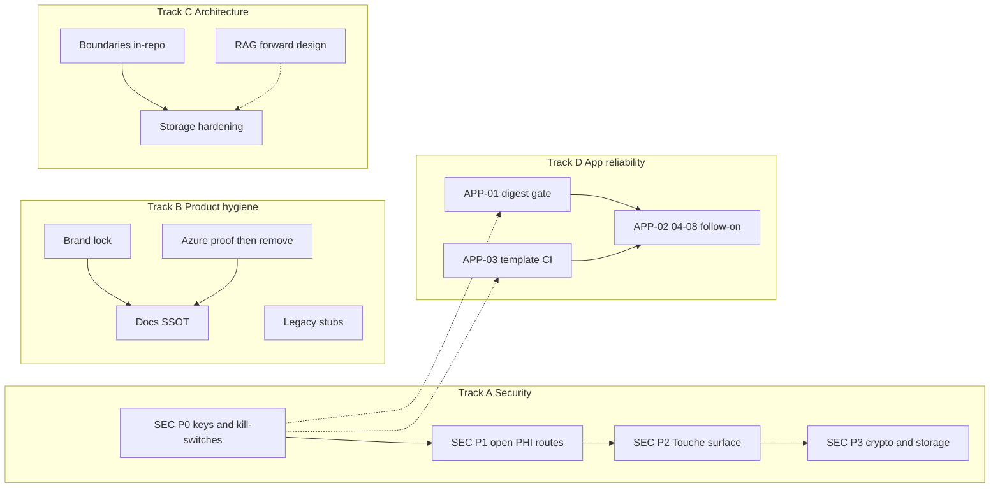

> **Repo mirror** of the Cursor plan `~/.cursor/plans/touche_remediation_architecture_a1542832.plan.md` (approved 2026-07-17). Do not edit the Cursor plan as SSOT after this copy — prefer this path for in-repo links.

---
name: Touche remediation architecture
overview: A review-only remediation and architecture plan covering ranked security triage, Touche brand lock/cleanup, Azure-vs-GCP proof, shared-monolith boundaries, docs SSOT, legacy deletion, RAG design, storage hardening, and Section 10 app architecture/deploy reliability (Cloud Run digest gate, enum honesty, field-template CI, confirm UI migration, device smoke, self-ref copy CI, physician-export catalog, meter-refund audit) — sequenced task IDs, honest effort. No implementation in this pass.
todos:
  - id: sec-p0
    content: "Section 1 P0: Stedi key, test endpoints, crypto fail-closed, HMAC/path traversal, Google auth"
    status: pending
  - id: app-early
    content: "Section 10 early: APP-01 deploy digest gate + APP-03 field-template CI blocker (with SEC P0)"
    status: pending
  - id: sec-p1
    content: "Section 1 P1: Admin auth order + open PHI/money/telehealth routers"
    status: pending
  - id: sec-12r-14r
    content: "Follow-up SEC-12R video-consult PHI residual + SEC-14R livekit provider auth (after Wave 2; not Wave 3 blocker)"
    status: pending
  - id: sec-p2-touche
    content: "Section 1 P2: lab-translate IDOR, capture-session ownership, /upload AV+policy"
    status: pending
  - id: brand
    content: "Section 2: Be Bold intro + Skin & Care consumer sweep; keep bundle/GCP names"
    status: pending
  - id: azure
    content: "Section 3: Prove azure:// refs then GCS-first; no premature Blob delete"
    status: pending
  - id: arch-docs
    content: "Sections 4–5: in-repo boundaries + docs SSOT (agentic = Touche; ARCHITECTURE = platform)"
    status: pending
  - id: legacy-storage
    content: "Sections 6+8: safe legacy deletes + storage hardening / KMS / capture_token"
    status: pending
  - id: app-followon
    content: "Section 10 follow-on: enum audit, template UI migration, device smoke, self-ref CI, export catalog, meter refunds"
    status: pending
  - id: forward-misc
    content: "Sections 7+9: RAG design-only + leftover platform/script epics indexed"
    status: pending
isProject: false
---

# Touche remediation and architecture plan

**Status:** plan for review — **APPROVED FINAL for Sections 1–10** (2026-07-17 close)  
**Execution:** start with Section 1 P0 + Section 10 Early (**APP-01**, **APP-03**), then follow the sequenced tracks already laid out.  
**Date:** 2026-07-17  
**Locked brand (do not reinterpret):** Name = **Touche** · Tagline = **Be Bold** · Subtitle = **Skincare & medical journal** · Logo = tulip/rose motif  
**Subtitle collision check:** exact string `Skin & Care Diary` = **0 hits** (safe; do not reintroduce). Alternate diary phrasing still exists (“daily skin diary”, “Sensitive Skin Diary App”) and must be cleaned under brand work, not preserved.  
**Tagline gap:** `Be Bold` = **0 hits** in scoped tree — must be introduced in App Store / landing / onboarding, not assumed live.  
**Locked APP decisions:** APP-02 never-meter PDF text-layer (provenance tradeoff stated in §10); APP-08 restore `welcome_bonus` on refund.  
**Eventual SSOT path (when writing into repo):** [`todos/pending/TOUCHE_REMEDIATION_ARCHITECTURE_PLAN_2026-07-17.md`](todos/pending/TOUCHE_REMEDIATION_ARCHITECTURE_PLAN_2026-07-17.md) (same discipline as today’s other pending plans).

Independence rule: **Section 1 security** and **Sections 2–6 brand/architecture/docs/legacy** can run in parallel tracks where they do not share files. **Section 10** (app deploy/reliability) Early items (**APP-01**, **APP-03**) run alongside Section 1 P0; follow-on APP tasks wait on P0 + those Early items. Touche medical-tracker items in Section 1 are reconciled with today’s fail-loud/fail-closed capture discipline, not treated as unrelated debt.



---

## SECTION 1 — Security triage (independent track)

### Ranking method

| Rank | Meaning |
|------|---------|
| **P0** | Internet-reachable today with no/trivial auth; credential theft or mass PHI; fix in hours |
| **P1** | Internet-reachable PHI/money/telehealth; needs route/auth wiring (days) |
| **P2** | Touche medical-tracker surface; must match fail-closed discipline already shipping |
| **P3** | Precondition / fail-open / weak crypto; exploit needs misconfig or stolen token |

### Ranked findings (exploitability × blast × speed)

| Rank | ID | Finding | Internet-reachable today? | Evidence | Effort |
|------|-----|---------|---------------------------|----------|--------|
| P0 | SEC-01 | Hardcoded Stedi API key fallback | **Yes if env unset** — any Stedi call uses source default | [`insurance-service.js`](middleware-platform/services/insurance-service.js) L17 `STEDI_API_KEY \|\| 'test_1rRzTb0…'` | 0.5d (remove + rotate + verify) |
| P0 | SEC-02 | Always-on `/api/test/*` + simulate-stedi | **Yes** — mounted in [`server.js`](middleware-platform/server.js) ~6667, ~9197+ with no env gate | Mutates claims / FHIR pulls | 0.5d |
| P0 | SEC-03 | Google auth accepts email only | **Yes** — `POST /api/auth/google` | [`server.js`](middleware-platform/server.js) ~4240–4310; token = base64(email) | 0.5–1d |
| P0 | SEC-04 | Upload-token default HMAC secret | **Yes if secret unset** | [`utils/upload-token.js`](middleware-platform/utils/upload-token.js) `'change-me-in-production'` | 0.5d |
| P0 | SEC-05 | Crypto facts fallback `dev-billing-key` | **Misconfig = all facts decryptable** | [`patient-record-field-crypto.js`](middleware-platform/services/patient-record-field-crypto.js) L45–57; **Touche facts** | 0.5d fail-closed + prod assert |
| P0 | SEC-06 | `local-media-store` read path traversal | **Yes if attacker controls `local://` ref** | Write rejects `..`; **read does not** ([`local-media-store.js`](middleware-platform/services/local-media-store.js)) | 0.25d |
| P1 | SEC-07 | Admin routes before `requireAdminAuth` | **Yes** on public API host | `registerAdminPlatformRoutes` then later `app.use('/api/admin', requireAdminAuth)` ([`server.js`](middleware-platform/server.js) ~4701–4708); only ~4 routes self-auth | 1–2d |
| P1 | SEC-08 | `GET /api/provider/case-report` open | **Yes** | [`server.js`](middleware-platform/server.js) ~7429; no `requireProviderAuth` | 0.5d |
| P1 | SEC-09 | `/api/rcm` entire router unauthenticated | **Yes** | `app.use('/api/rcm', rcmRoutes)` L2773 | 1–2d |
| P1 | SEC-10 | `/api/usage/:customer_id` IDOR | **Yes** | `app.use('/api/usage', usageRoutes)` L2976 | 0.5d |
| P1 | SEC-11 | `/api/pdf-coding` unauth | **Yes** | L2969–2970 | 0.5d |
| P1 | SEC-12 | `/api/video-consult` PHI by roomId; empty agent secret bypass | **Yes** | Mounted via [`register-api-routes.js`](middleware-platform/bootstrap/register-api-routes.js) L61–63 | 1–2d |
| P1 | SEC-13 | `/api/auth` JWT mint from email alone | **Yes** | `app.use('/api/auth', authTokenRoutes)` L7595 | 1d |
| P1 | SEC-14 | `/api/livekit` token no auth | **Yes** | L7598 | 0.5–1d |
| P1 | SEC-15 | `/api/invoices` clinic invoices unauth | **Yes** | [`register-api-routes.js`](middleware-platform/bootstrap/register-api-routes.js) L19–20 | 0.5–1d |
| P1 | SEC-16 | `/api/admin/tenants` before admin auth | **Yes** | Core register L50–52 before admin middleware | 0.5d |
| P1 | SEC-17 | Prior-auth approve/deny unauth | **Yes** | `registerPriorAuthRoutes` in [`register-patient-routes.js`](middleware-platform/bootstrap/register-patient-routes.js) L151 | 0.5–1d |
| P1 | SEC-18 | Patient insurance GET + booking benefits IDOR | **Yes** (session not required on those handlers) | Insurance + booking registered L129–150 | 0.5–1d |
| P1 | SEC-19 | Case-report GET by patientId open | **Yes** | `app.use(caseReportRoutes)` L5942–5943 | 0.5d |
| P1 | SEC-20 | Merchant `POST /register` returns api_key | **Yes** | Core merchant mount | 0.5d |
| P1 | SEC-21 | Patient documents `send-upload-link` unauth | **Yes** | Patient portal register L147 | 0.5d |
| P1 | SEC-22 | Wallet `:patientId` HSA/cards IDOR | **Yes when wallet routes live** (feature flag may soft-block some paths) | `registerPatientWalletRoutes` L148; IDOR handlers lack session | 1d |
| P1 | SEC-23 | Legacy appointments + Retell webhooks without secret | **Yes** unless kill-switch / secret set | `server.js` appointments ~4889+; Retell events | 1d |
| P1 | SEC-24 | Fraud detector fail-open; Mastercard mandate always valid; AP2 sig stub | **Conditional** (payment/fraud path must be hit) | Services/adapters | 1–2d |
| P1 | SEC-25 | Weak OTP (`Math.random`) + return/log code | **Yes** on verification flows | email-verification + patient-portal-service | 1d |
| P1-follow | **SEC-12R** | Video-consult PHI routes still ungated after Wave 2 partial (SSE, vision/*, review-tasks, transcript, assistant, vitals POST, summary, client-transcript, thread-event, end-session; agent-events already secret-gated) | **Yes** when those paths are hit | [`video-consult.js`](middleware-platform/routes/video-consult.js) | **~1–1.5d** (classify agent vs staff vs patient; gate + adversarial tests per class) |
| P1-follow | **SEC-14R** | LiveKit `POST /token` still accepts bare `x-provider-id` / `x-clinic-id` as auth | **Yes** | [`livekit.js`](middleware-platform/routes/livekit.js) `requireLivekitTokenAuth` | **~0.5–1d** (require real provider/customer session or signed JWT; keep patient `x-session-id` path) |
| P2 | SEC-26 | Lab-translate IDOR | **Yes for any patient session** | [`patient-records.js`](middleware-platform/routes/patient-records.js) ~1183–1214 — **no ownership** | 0.25d |
| P2 | SEC-27 | Capture-session GET/confirm no ownership | **Yes for any patient session** | ~1128–1136; advance by id only | 0.5d |
| P2 | SEC-28 | `/records/upload` skips AV + persist policy | **Yes** (legacy HTTP; app uses `/capture`) | ~155–194 vs orchestrate AV | 0.5–1d |
| P2 | SEC-29 | Anonymous `confirm=true` / dual-write skip full policy | **Partial** — confirm paths now wire `prepareConfirmStructuredForPersist`; residual on upload/dual-write | Reconcile with pipeline step 1 (already shipped on confirm) | 0.5–1d |
| P2 | SEC-30 | Media tokens multi-use capability URL | **By design** if token leaked | No burn; no session on GET media | 0.5–1d (burn or bind) |
| P2 | SEC-31 | Meter races / multi-capture 201 / orphan blobs | **Authenticated/anon AI path** | Meter + orchestration | 1–2d |
| P3 | SEC-32 | Patient-app OTP in nav params | Client | [`otp-entry.tsx`](patient-app/app/auth/otp-entry.tsx) pushes `{ email, code }` | 0.25d |
| P3 | SEC-33 | Web session in localStorage | Client XSS | [`patient-session.ts`](patient-app/lib/patient-session.ts) | 1–2d |
| P3 | SEC-34 | ASC key IDs / AuthKey path in eas.json | Repo leak | [`eas.json`](patient-app/eas.json), `asc-env.cjs` | 0.5d |
| P3 | SEC-35 | Onboarding “stays on device” while face-read uploads | Trust/privacy | [`onboarding/scan.tsx`](patient-app/app/onboarding/scan.tsx) | 0.25d |
| P3 | SEC-36 | Appointment `LIKE %id%`; `getMerchantByApiKey` bug; dynamic SET columns; PG/SQLite split-brain | Platform data integrity | [`database.js`](middleware-platform/database.js) | Multi-day; separate from P0 |

### Touche surface reconciliation (do not reopen shipped gates)

Already fail-closed / fail-loud (keep): OCR empty reject; orchestrated AV; confirm provenance recompute; body-skin `not_a_face` neutralization with `not_skin` hard reject; medical-tracker isolation script; physician export no invented %.

Still open on Touche (Section 1 P2 + Section 8): SEC-05, SEC-06, SEC-26–31, capture_token residual race, no KMS rotation.

### Section 1 sequenced tasks

1. **SEC-01** Remove Stedi hardcoded key; rotate key in GCP Secret Manager; fail-closed if unset in prod.  
2. **SEC-02** Gate `/api/test/*` behind `NODE_ENV!=='production'` + kill-switch; remove simulate-stedi from prod image.  
3. **SEC-05** Fail-closed facts crypto if no real key; prod boot assert (extend verify-prod-consumer-env).  
4. **SEC-04 / SEC-06** Prod-fail HMAC secret; reject `..` on `readLocalMedia`.  
5. **SEC-03** Disable or require real Google ID token verify; kill base64(email) session.  
6. **SEC-07 / SEC-16** Mount `requireAdminAuth` **before** `registerAdminPlatformRoutes` (or wrap every route); smoke unauth `GET /api/admin/clients` → 401.  
7. **SEC-08–SEC-23** Auth wrappers per open router (RCM, usage, pdf-coding, video-consult, livekit, invoices, prior-auth, insurance GET, benefits, case-report, merchant register, documents send-link, wallet IDOR, legacy appointments kill-switch default ON, Retell secret required).  
7b. **SEC-12R / SEC-14R** (scheduled follow-up — **not** a Wave 3 Touche blocker; run after Wave 2 close, before or parallel with Wave 5 platform leftovers): finish video-consult PHI route audit; replace LiveKit header-only provider auth with real session/JWT. Effort: **~1.5–2.5d combined**.  
8. **SEC-26–SEC-28** Touche: ownership on lab-translate + capture-session; AV+policy on `/upload` or delete route.  
9. **SEC-25 / SEC-32** `crypto.randomInt` OTP; never return OTP to client; never put OTP in route params.  
10. **SEC-24 / SEC-30 / SEC-31** Fail-closed fraud/Mastercard/AP2; media token burn/bind; meter atomicity.  
11. **SEC-33–SEC-35** Client session/storage/copy + ASC secrets hygiene.  
12. **SEC-36** Tracked under Section 9 / database thinning — not blocking P0–P2.

**Section 1 effort:** P0 ~2–3d · P1 ~8–12d · P2 Touche ~2–4d · P3 client ~2–3d · **Track A total ~3–5 engineer-weeks** (can parallelize after P0).

---

## SECTION 2 — Brand lock and cleanup

**Locked identity confirmed.** Plan builds against Touche / Be Bold / Skincare & medical journal / tulip-rose. Do not readopt Skin & Care.

### Audit volume (scoped, excl node_modules/vendored)

| Pattern | Approx matches | Notes |
|---------|---------------:|-------|
| Somo | ~1816 | Mostly platform/infra |
| callsomo | ~979 | API/email domains |
| Skin & Care | ~467 | Consumer-facing leftovers |
| skinandcare / myskinandcare | ~484 / ~434 | Domains + bundle |
| trytouche / Touche | live | Mid-cutover |
| Skin & Care Diary | **0** | Good |
| Be Bold | **0** | Must introduce |

### Categories and disposition

**(a) Safe to rename now (copy/code)**  
Email From/signatures ([`email-service.js`](middleware-platform/services/email-service.js), [`trial-alerts.js`](middleware-platform/services/trial-alerts.js), [`skin-care-email-layout.js`](middleware-platform/lib/skin-care-email-layout.js)); patient/provider HTML titles (`unified-dashboard/**`, payment-page); Kelly greeting “from Skin & Care”; Brand docs still saying product = Skin & Care; TESTFLIGHT ASC name mismatch vs APP_STORE_SUBMISSION; diary near-miss copy; introduce **Be Bold** on welcome/landing/App Store.

**(b) External migration (do not “rename in git” alone)**  
| Asset | Current | Plan |
|-------|---------|------|
| Bundle ID | `com.skinandcare.app` | Keep for App Store continuity **or** new ID = new listing; document decision, do not silent-change |
| Domains | myskinandcare / callsomo / trytouche | DNS cutover plan; API may stay `api.callsomo.com` as shared infra host while consumer face is Touche |
| GCP | `somo-callsomo`, `somo-middleware`, buckets `somo-*` | Keep infra names (Section 4); document as platform IDs |
| Stripe `care_program` | Product metadata | Keep ID; change display name only if Dashboard allows |
| EAS slug `skin-care` | Project slug | Keep or migrate via Expo support — not a string replace |
| ASC App ID / Team | committed in eas | Move to EAS secrets (also SEC-34) |

**(c) Shared platform internal (may keep)**  
`SOMO_*` env, FHIR “Somo Telehealth Platform”, Kelly/RCM/provider demos, `created_by: 'somo-platform'`, repo folder `skin-and-care` — **keep** if Section 4 keeps shared platform; document “infra brand ≠ consumer brand”.

### Section 2 tasks

1. **BRAND-01** Introduce Be Bold + lock subtitle in App Store / landing / welcome; regression test (extend phase-e).  
2. **BRAND-02** Sweep renameable Skin & Care consumer strings (email, HTML, Kelly greeting, waitlist).  
3. **BRAND-03** Align Brand SSOT docs + TESTFLIGHT with Touche (mark Skin & Care product naming historical).  
4. **BRAND-04** Domain map doc: which hosts are consumer vs shared API (no DNS change in this task).  
5. **BRAND-05** Bundle ID decision memo (keep `com.skinandcare.app` for continuity — **default recommendation**).  
6. **BRAND-06** Ban “Skin & Care Diary” / soft diary collisions in CI string check.

**Effort:** ~1–2 weeks copy/docs; external DNS/bundle **out of band**.

---

## SECTION 3 — Azure vs GCP (prove before delete)

**Verdict:** Prod API is **GCP Cloud Run**; Azure is mostly **env-gated dormant code**, not live Blob/App Service.

| Reference | Status | Action |
|-----------|--------|--------|
| [`patient-record-media.js`](middleware-platform/services/patient-record-media.js) Azure-prefer → GCS | Azure **DEAD on prod** (no AZURE_*); GCS **LIVE** | Invert to GCS-first |
| [`blob-storage.js`](middleware-platform/services/blob-storage.js) | LIVE code, DEAD runtime | Keep until no `azure://` rows; then remove |
| [`gcs-billing-storage.js`](middleware-platform/services/gcs-billing-storage.js) | Misnamed; Azure/local only | Migrate to real GCS or fold into patient-record-media |
| [`patient-upload-blob.js`](middleware-platform/services/patient-upload-blob.js) + upload-portal | DEAD without conn string | Migrate or retire with telemed upload |
| App Insights module | DEAD without key | Remove; use Cloud Logging |
| Azure ACS email | DEAD (SMTP live; SDK missing) | Remove branch + secret binding |
| `infra/bicep/*`, `startup.sh`, empty `query-azure-*` | DEAD | Archive/remove after guardrail stays |
| [`guardrail-no-azure-deploy.cjs`](scripts/guardrail-no-azure-deploy.cjs) | LIVE good | Keep |
| Perception `AZURE_OPENAI_*` | UNKNOWN/unlikely | Confirm env; remove branch if unused |

### Section 3 tasks

1. **AZ-01** Inventory DB for remaining `azure://` / `blob.core.windows.net` media refs (read-only query).  
2. **AZ-02** Invert medical media to GCS-first; keep Azure parse for legacy refs only.  
3. **AZ-03** Fix or rename `gcs-billing-storage` to real GCS.  
4. **AZ-04** Remove App Insights + Azure email code paths + secret bindings.  
5. **AZ-05** Archive Bicep/startup/dead Azure docs; keep guardrail.  
6. **AZ-06** Drop `@azure/storage-blob` only after AZ-01 empty.

**Effort:** ~1–2 weeks. **Do not delete Azure Blob helpers until AZ-01 proves zero refs.**

---

## SECTION 4 — Architecture: shared monolith root cause?

### Assessment

| Layer | Entanglement |
|-------|----------------|
| Medical-tracker rails | **Already separable** — isolation script green; Kelly/perception/coding forbidden imports |
| Capture HTTP | Touche-owned routes/services; dual-write to legacy journal/spots is data debt |
| Process / deploy | **Shared** Cloud Run `somo-middleware`; README: do not deploy middleware from this repo (somo-platform) |
| database.js / server.js | God-objects shared across Kelly/RCM/Touche |

**Uniformity problem** is mostly **missing boundaries + god files + brand mid-cutover**, not “Kelly code inside capture.” Service extraction is **not** warranted as first move.

### Recommendation: **(a) one repo, hard internal boundaries**

Extend today’s isolation model:

- Own trees: `services/medical-tracker-*`, `routes/patient-records|medical-progress|ai-monetization`, `patient-app/`  
- CI: expand `verify-medical-tracker-isolation` + forbid new Kelly imports  
- Naming: Touche vs platform prefixes in docs/modules  
- Deploy remains shared API until a later RFC; no big-bang extract  

Reject (b) full service extraction as default (months, dual DB, CORS, auth rewrite) unless a future RFC after boundaries still fail.

### Section 4 tasks

1. **ARCH-01** Write MODULE_OWNERS map (Touche vs platform) in product SSOT.  
2. **ARCH-02** CI-wire isolation script + expand forbidden list to routes that must not call Kelly.  
3. **ARCH-03** Stop new features in `database.js`/`server.js` for Touche — repos/services only.  
4. **ARCH-04** Dual-write sunset plan (journal/spots → facts only) — after legacy deletion Section 6.  
5. **ARCH-05** Explicit non-goal: no Cloud Run split in this plan’s horizon.

**Effort:** ~1 week docs/CI; dual-write sunset separate (~2–4 weeks).

---

## SECTION 5 — Documentation consolidation

| Doc | Status |
|-----|--------|
| [`TOUCHE_AGENTIC_ARCHITECTURE.md`](docs/product/TOUCHE_AGENTIC_ARCHITECTURE.md) | **Current Touche product SSOT** |
| [`TOUCHE_CAMERA_FIRST.md`](docs/product/TOUCHE_CAMERA_FIRST.md) | Correctly **superseded** |
| [`README.md`](README.md) | Current pointer; minor drift (“Check” / AsyncStorage) |
| [`ARCHITECTURE.md`](ARCHITECTURE.md) | Platform overview; partially stale vs Phase D |
| Brand docs | Still Skin & Care product naming — stale for consumer |
| Azure deploy docs | Historical / dead guidance |
| Pipeline / body-skin / field-templates pending plans | Current operational plans — keep |

### Target structure

1. **Touche product SSOT:** `docs/product/TOUCHE_AGENTIC_ARCHITECTURE.md` (only one)  
2. **Shared platform SSOT:** slim `ARCHITECTURE.md` (or `docs/architecture/PLATFORM.md`) — Cloud Run, Kelly/RCM, domains  
3. **Security SSOT:** `docs/security/*` + this plan’s Section 1 tracker  
4. Everything else: merge or **mark superseded** (don’t delete)

### Section 5 tasks

1. **DOC-01** Patch README drift; point brand to Touche.  
2. **DOC-02** Split/refresh ARCHITECTURE.md as platform SSOT; defer product IA to agentic doc.  
3. **DOC-03** Supersede banners on stale Brand / Azure / camera-first leftovers.  
4. **DOC-04** Index pending plans (pipeline, body-skin, this remediation) from product SSOT.  
5. **DOC-05** Write this plan to `todos/pending/…` when approved.

**Effort:** ~3–5 days.

---

## SECTION 6 — Legacy deletion candidates

| Item | Safe to delete now? | Plan |
|------|---------------------|------|
| `check.tsx` / `severity.tsx` | **No** — keep Redirect stubs | Keep forever or until analytics show zero hits |
| `_journal.tsx` Redirect | **No** — deep links | Keep; delete orphan `components/journal/*` after import audit |
| try-verdict funnel | **No** — live product | Keep |
| spots client writers | Soft-deprecate | App no longer writes; keep API until dual-write/migrate unused |
| spots API + repo | **Not yet** | After dual-write sunset + migrate unused |
| Orphan routes `admin.js`/`fraud.js`/`acp.js`/`ap2.js` if unmounted | Confirm with mount grep | Delete only if zero `require` |

### Section 6 tasks

1. **LEG-01** Import-graph audit `components/journal/*` → delete orphans.  
2. **LEG-02** Confirm unmounted route files; delete or mount-behind-auth.  
3. **LEG-03** Spots write deprecation notice + metrics; no physical API delete yet.  
4. **LEG-04** Keep Redirect stubs; document in product SSOT.

**Effort:** ~2–4 days for safe deletes; spots API removal later.

---

## SECTION 7 — Agentic / vector RAG (forward-looking only)

**Not a build task.** Design sketch only:

- Sit **beside** medical-tracker-rails, never inside capture persist path.  
- Ingest only **policy-approved** extracts (encrypted at rest; provenance stamped like imaging quotes).  
- Namespace: `touche-derm-edu-v1` (or similar) — **explicitly avoid** prior Pinecone namespace collision class of incident.  
- Tools: allowlist-only via medical-tool-executor; no diagnosis vocabulary in model output; retrieval for education ≠ clinical decision.  
- PHI: patient-specific RAG corpora require same ownership + encryption as facts; prefer non-PHI derm corpus first.

### Section 7 tasks (design only)

1. **RAG-01** One-pager: namespace, index schema, non-goals.  
2. **RAG-02** Threat model vs policy.js / isolation.  
3. **RAG-03** Explicit “do not schedule build” until Sections 1–6 P0/P1 done.

**Effort:** ~1–2 days design; **0** build.

---

## SECTION 8 — Data storage security hardening

Merge Section 1 storage items + known open items:

| Item | Sequence |
|------|----------|
| Fail-closed encryption key (SEC-05) | First |
| Path traversal fix (SEC-06) | First |
| Default HMAC / upload tokens (SEC-04) | First |
| Media token burn/bind (SEC-30) | Next |
| capture_token claim atomicity (pending-capture-claim race) | Next |
| KMS / key rotation for facts cipher | After fail-closed |
| GCS-first + retire Azure refs (Section 3) | Parallel |
| Orphan blob delete on policy fail | With SEC-31 |
| Denorm plaintext minimization | After encryption posture solid |

### Section 8 tasks

1. **STOR-01** Prod key assert + remove hardcoded fallback.  
2. **STOR-02** Harden local-media read + upload HMAC.  
3. **STOR-03** Atomic pending-capture claim + meter merge.  
4. **STOR-04** Media token single-use or patient-bound.  
5. **STOR-05** KMS rotation design + implement.  
6. **STOR-06** Blob orphan GC on rejected captures + pending purge.

**Effort:** ~2–3 weeks.

---

## SECTION 9 — Leftovers (not dropped)

| Theme | Disposition |
|-------|-------------|
| database.js / server.js god-objects | Incremental extract; ARCH-03; not rewrite |
| Kelly monolith / Retell WS auth | Platform security backlog after P1 open routes |
| Dual SQLite/Postgres split-brain | Platform data integrity epic |
| Dangerous scripts (purge/reset-password/cloudrun-db-sync) | Ops runbook: prod guards + dry-run defaults |
| Face-read public cost oracle | Rate-limit / botGuard tighten (Touche funnel needs public path) |
| Physician share multi-use live rebuild | Product decision + TTL/burn |
| Cloud Run serving digest assert | **Promoted to Section 10 APP-01** (was “already tracked” only) |
| Body-region generalization (a) | Already tracked: SKIN_BODY_REGION_GENERALIZATION_PLAN |
| Pipeline hardening remaining steps | PIPELINE_HARDENING_PLAN — continue independently |
| Field-template confirm UI for skin/bill/mark/other | **Promoted to Section 10 APP-04** |

### Section 9 tasks

1. **MISC-01** Script danger inventory → prod guards.  
2. **MISC-02** Platform data-plane epic ticket (PG/SQLite).  
3. **MISC-03** Link existing follow-ons from this plan index (no scope creep).

---

## SECTION 10 — App architecture and deployment reliability

**Scope:** Touche capture/deploy reliability only — not platform-wide auth (Section 1).  
**Evidence sources:** [`FOLLOWUP_CLOUDRUN_SERVING_REVISION_ASSERT.md`](todos/pending/touche-prod-gate-2026-07-17/FOLLOWUP_CLOUDRUN_SERVING_REVISION_ASSERT.md) (recurred in Step 9 + body-skin-c); [`FIELD_TEMPLATES_ARCHITECTURE_2026-07-17.md`](todos/pending/FIELD_TEMPLATES_ARCHITECTURE_2026-07-17.md); [`PIPELINE_HARDENING_PLAN`](todos/pending/PIPELINE_HARDENING_PLAN_2026-07-17.md) step 12; device-day bugs (SPH scroll, CAPTURE_TOKEN, tone/zone, serving digest).

### Ranking

| Rank | Meaning |
|------|---------|
| **Early** | Cheap, high-leverage — run **alongside Section 1 P0** |
| **Follow-on** | After P0 security + Early APP items land |

### Findings (before tasks)

#### 1) Cloud Run serving digest — promote to automated gate

**Not fixed.** `gcloud run deploy` can succeed while traffic stays on prior revision; `/health` still 200. Observed four times in one day (Step 9 + body-skin-c). Manual `update-traffic` was the workaround.

**Required shape:** post-deploy in [`scripts/deploy-to-gcp-production.sh`](scripts/deploy-to-gcp-production.sh) (and staging deploy twin): resolve built image digest → resolve 100%-traffic revision `imageDigest` → **exit non-zero** if mismatch; optionally auto-`update-traffic` then re-assert. Do **not** leave as a human checklist.

#### 2) Binary-state enum audit — not a one-off

| Enum / binary | Current allowed values | Silent third-case risk |
|---------------|------------------------|------------------------|
| `ai_or_manual` | DB CHECK + validators: **`ai` \| `manual` only** ([`067_patient_record_facts.js`](middleware-platform/migrations/067_patient_record_facts.js), [`patient-record-fact-validators.js`](middleware-platform/services/patient-record-fact-validators.js) `AI_OR_MANUAL`) | Pipeline step 12 named **`automated_unmetered`** for PDF text-layer — **not in schema**. Live path still meters then refunds ([`capture-orchestration/index.js`](middleware-platform/services/capture-orchestration/index.js) ~330–332). Progress aggregates only count `manual` vs `ai` ([`progress-aggregates.js`](middleware-platform/services/medical-tracker-domain/progress-aggregates.js) ~93–94) — a third value would be invisible. Client TS unions are `'ai' \| 'manual'` only. |
| `media_type` | `photo` \| `pdf` (CHECK) | Intentional product lock; video/DICOM rejected elsewhere — OK if gates stay fail-closed |
| `field_provenance` values | `document` \| `ai` \| `user` | Third cases OK if stamped server-side; forged client map already stripped |
| `meter_source` | `welcome_bonus` / monthly / `paid_credits` (usage rows) | Refund restores **paid_credits** (and monthly quota where applicable); **welcome_bonus remaining must also be restored** — locked APP-08 decision (was historically not restored; see [`ai-capture-meter.js`](middleware-platform/services/ai-capture-meter.js) ~350–351) |
| Client `quality_meta` sharpness | Trusted if present; omitted skips blur/dark | Not an enum but another “binary present/absent” trap |

**Conclusion:** PDF text-layer was the loud instance of a **broader pattern**: product needs a third semantic, but storage/API enums stay binary → wrong bucket or meter/refund gymnastics.

**APP-02 locked decision — never-meter PDF text-layer (accepted):** Do **not** add `automated_unmetered` to the schema. Text-layer PDF extraction must never call `tryConsume` / meterGuard (delete the meter-then-refund path). Keep `ai_or_manual` as `ai` \| `manual` only for this case by recording text-layer captures as **`manual`** (or equivalent non-AI path already used for unmetered entry).

**Conscious tradeoff (must not be understated):** This means automated PDF text-layer extraction is **permanently indistinguishable from true manual entry** in every `patient_record_facts` row and every analytics/progress query that keys off `ai_or_manual`. There will be no durable DB provenance that “a machine extracted this without billing AI.” That is a deliberate choice: **engineering simplicity and honest metering over complete extraction-source provenance for this one path.** Document-sourced field content can still carry `field_provenance: document` where parsers stamp it; only the ai/manual billing/axis collapses. If product later needs “automated but free” as a first-class analytics dimension, that would be a **new** enum migration — out of scope for APP-02.

#### 3) Field-template catalog drift — recommend CI blocker

| Option | Pros | Cons |
|--------|------|------|
| A. Runtime `GET /field-templates` | Single SSOT; no mirror | Offline/manual confirm needs cache; cold latency; anon path complexity |
| B. Hard CI parity blocker | Test already exists ([`record-field-templates.test.js`](middleware-platform/__tests__/record-field-templates.test.js) “client mirror parity”); works offline | Mirror still hand-maintained |

**Recommendation: B — hard CI blocker (APP-03), early.** Reasoning: parity test already fails on key drift but is **not** a required GitHub check today (CI jest is selective; mobile workflow does not run this file). Wiring it as a required job on PRs touching `record-field-templates/**` or `patient-app/lib/record-field-templates.ts` is ~0.5d and stops silent UI/schema skew. Runtime fetch remains a **later** optional upgrade after APP-04 migration if mirror cost stays high — not the first structural fix.

#### 4) Confirm/manual UI template migration (skin, bill, mark, other)

**Confirmed debt:** Rx + Lab use `TemplateFieldsForm` + catalog ([`confirm/rx.tsx`](patient-app/app/capture/confirm/rx.tsx)); Skin (and similarly bill/mark/other) still **hardcode** fields ([`confirm/skin.tsx`](patient-app/app/capture/confirm/skin.tsx) Date/Area/AI SUGGESTS). Manual entry partially template-aware. Architecture doc: “Still Phase 2… UI not fully migrated.” Pipeline step 10 estimated **~2.5–3.5 eng days** — was missing from Sections 1–9; now **APP-04**.

#### 5) Minimal real-device automated signal

Four production-blocking bugs today were device-only (serving digest was ops; SPH/scroll/CAPTURE_TOKEN/tone-zone were device). Unit/Jest would not catch SPH layout or confirm overlay.

**Honest minimal proposal (not a device farm):**

- One physical iPhone X (or cloud device: BrowserStack/AWS Device Farm)  
- Tooling: Maestro or Detox — prefer **Maestro** for speed to first smoke  
- Nightly job (or post-TestFlight): cold start → sign-in stub/OTP fixture → capture skin photo from gallery fixture → confirm screen asserts (no banned self-ref copy; zone overlay/`center-mark` present; Looks right)  
- Would have caught ≥2 of today’s four (tone/self-ref on confirm; overlay/marker; possibly CAPTURE_TOKEN claim if fixture includes anon→auth)  
- **Would not** replace digest gate (APP-01) or SPH optical field scroll without an optical PDF fixture  

**Size:** ~3–5d to first green nightly; ~0.5d/week maintain. **APP-05.**

#### 6) Self-referential commentary — standing CI

Bug class recurred (tone/race, lighting/retake, static copy). Partial coverage: [`visual-observation-pointer-ui.test.ts`](patient-app/lib/__tests__/visual-observation-pointer-ui.test.ts) banned regexes on reveal/landing; vision prompt scrub in face-read-vision; body-skin tests.

**Gap:** not required on every vision-prompt change; static UI “AI SUGGESTS” surfaces incomplete; BRAND-06 pattern not yet covering this class.

**APP-06:** Expand banned list; run against `face-read-vision.js` + confirm/reveal/track static strings; wire CI path filter on those files + BRAND-06 sibling check.

#### 7) Physician export / share — catalog?

**Confirmed: hardcoded, not catalog-driven.** [`physician-export-pdf.js`](middleware-platform/services/medical-tracker-domain/physician-export-pdf.js) ~86–97 prints `drug | provider | body_area | label | note | amount_cents` — misses optical OD/OS, imaging findings/conclusion, mark fields, etc. Share links call the same builder. Pipeline step 14 already named this; **APP-07** = render via `getTemplate(tag/subtype)` editable/display fields (server-side — no client mirror needed).

#### 8) Meter-refund consistency

| Call site | Consume | Refund on fail? | Gap |
|-----------|---------|-----------------|-----|
| `orchestrateCapture` | meterGuard | Yes on quality/OCR/policy/perceive errors; PDF text-layer refunds after consume | Wrong bucket until APP-02 never-meters text-layer |
| `public-face-read` | tryConsume | Refund on vision null/error | OK pattern; must restore welcome_bonus too |
| `capture-compose` (demoted) | meterGuardNode | Refunds on extract/policy paths | Still callable library — keep consistent |
| Welcome bonus | tryConsume | Status→refunded but **remaining historically not restored** | **Locked fix:** restore welcome_bonus remaining on refund (same as paid_credits / monthly) |
| Multi-tag | N× tryConsume | Per-tag refunds | Cost amp; ensure each failure refunds including welcome_bonus |

**APP-08 locked decisions:**

1. Matrix test — every `tryConsume` / `meterGuard` site has paired refund on all non-success exits.  
2. **`welcome_bonus` remaining is restored on refund**, same as `paid_credits` and monthly quota. Rationale (product): welcome bonus is a promotional grant so the user can try AI capture meaningfully in week one; burning it on AV rejection / empty OCR / quality-gate failure punishes technical failure, not real usage. Implement inside APP-08 refund matrix — **not** a separate follow-up.  
3. Eliminate meter-then-refund for PDF text-layer once APP-02 never-meter lands.

### Section 10 sequenced tasks

**Early (with Section 1 P0):**

1. **APP-01** Automated Cloud Run serving-digest assert in `deploy-to-gcp-production.sh` (+ staging); fail deploy on mismatch; optional auto traffic flip + re-assert. Supersedes “manual follow-up” in FOLLOWUP doc. **~0.5–1d**  
2. **APP-03** Make `record-field-templates` client-mirror parity a **required CI job** on PRs touching server catalog or `patient-app/lib/record-field-templates.ts`. **~0.5d**

**Follow-on (after P0 + APP-01/03):**

3. **APP-02** Enum honesty: **locked — never-meter PDF text-layer** (no `automated_unmetered` schema value). Remove meter-then-refund; record as non-AI/`manual` path. **Tradeoff locked in plan findings:** permanent indistinguishability from manual in DB/analytics for this path — simplicity over extraction-source provenance. Inventory other binaries. **~1–2d**  
4. **APP-04** Confirm + manual UI migration for **skin, bill, mark, other** onto `TemplateFieldsForm` / catalog (rx/lab already done). **~2.5–3.5d**  
5. **APP-07** Physician PDF/share render from template catalog (optical + imaging + mark shapes). **~1–1.5d** (after or parallel with APP-04)  
6. **APP-06** Self-referential commentary CI (vision prompt + static UI + BRAND-06 sibling). **~0.5–1d**  
7. **APP-08** Meter-refund audit matrix; **restore `welcome_bonus` remaining on refund** (same as paid_credits/monthly — locked); kill meter-then-refund for text-layer after APP-02. **~1–2d**  
8. **APP-05** Minimal nightly Maestro (or Detox) capture smoke on one real/cloud device. **~3–5d** setup

### Section 10 relative sequence

```text
Week 0 (with SEC P0):  APP-01, APP-03
After P0:              APP-02 → APP-08 (meter honesty depends on enum)
Then:                  APP-04 ∥ APP-07 ∥ APP-06
Then:                  APP-05 (device smoke; needs stable confirm UI from APP-04)
```

**Section 10 effort:** Early ~1–1.5d · Follow-on ~9–15d · **Track D total ~2–3 eng-weeks** (overlaps Track A).

---

## Honest totals

| Section | Effort | Blocks |
|---------|--------|--------|
| 1 Security | 3–5 eng-weeks | Nothing — start immediately |
| 10 App reliability (early) | 1–1.5d | Parallel with Section 1 P0 |
| 10 App reliability (follow-on) | ~2–3 eng-weeks | After P0 + APP-01/03 |
| 2 Brand | 1–2 weeks (+ external DNS OOB) | Parallel with 1 |
| 3 Azure | 1–2 weeks | After AZ-01 proof |
| 4 Architecture | 1 week (+ dual-write later) | Parallel |
| 5 Docs | 3–5 days | After brand decisions |
| 6 Legacy | 2–4 days | After import audits |
| 7 RAG | 1–2 days design | After 1 P0/P1 |
| 8 Storage | 2–3 weeks | Overlaps 1 P0 + 3 |
| 9 Leftovers | tracked | Non-blocking |

**First week recommendation:** SEC-01…06 + SEC-26…28 (Touche) + **APP-01 + APP-03** + BRAND-01/02 start + AZ-01 inventory — no brand rename of bundle/GCP, no Azure Blob deletion, no service extraction.