# JOURNEYS

Diagnostic walkthrough *(C/P matrices: seeded destination screenshots for each outcome; static `/app` index boot is blank/unmatched — see COVERAGE_GAPS.md)* of Expo web `/app` @ 390×844 with API stubs. Native TestFlight not covered.

## New user (web-first)

1. Landing / scan / reveal / concerns (web discovery shots if present on hosting dist)

2. OTP signup intent → post-auth gates → Home/Scan (see post-auth matrix).

## Returning user

1. Cold `/app` → sign-in (C1) or direct post-auth (C2).
2. Daily loop: Home photo → Track → Scan verdict → Progress compare → Profile.
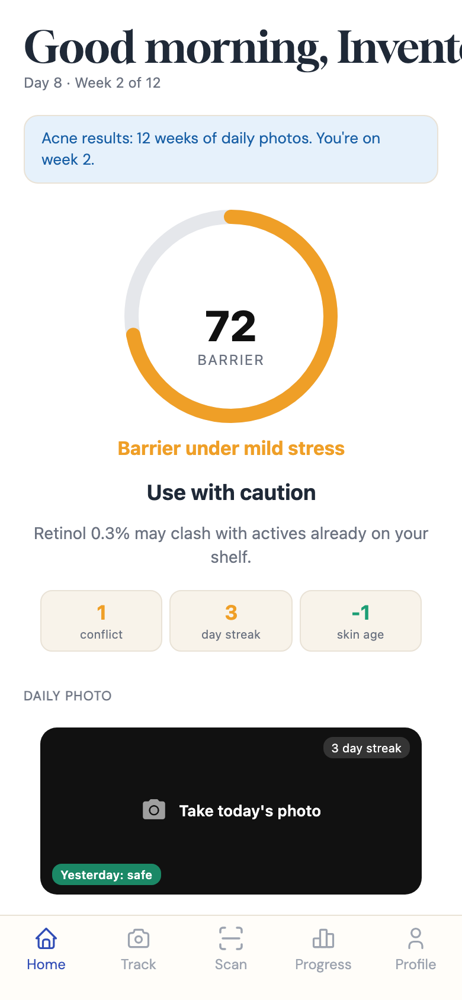

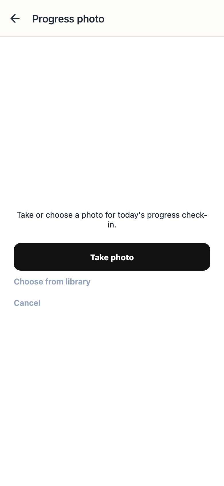

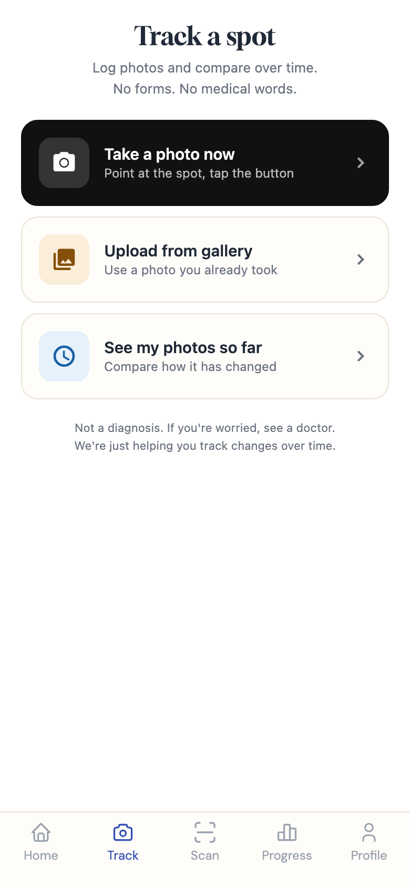

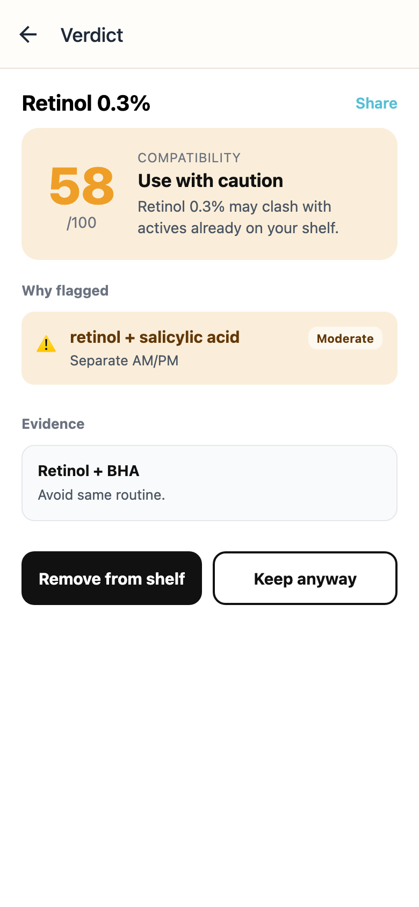

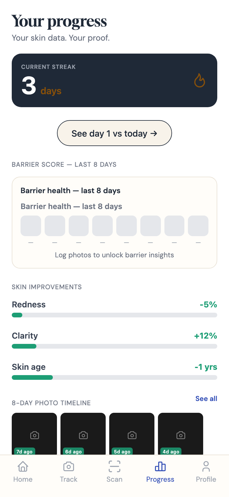

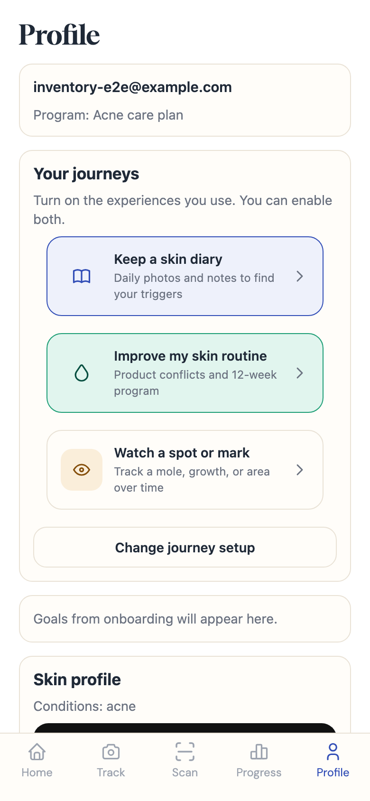

## Cold-start matrix (C1–C5)

### C1 — `cold-no-session-signin`

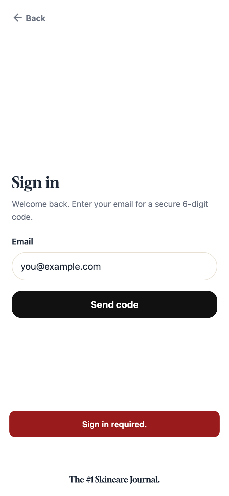

### C2 — `cold-me-ok-postauth`

### C3 — `cold-me-auth-dead-signin`

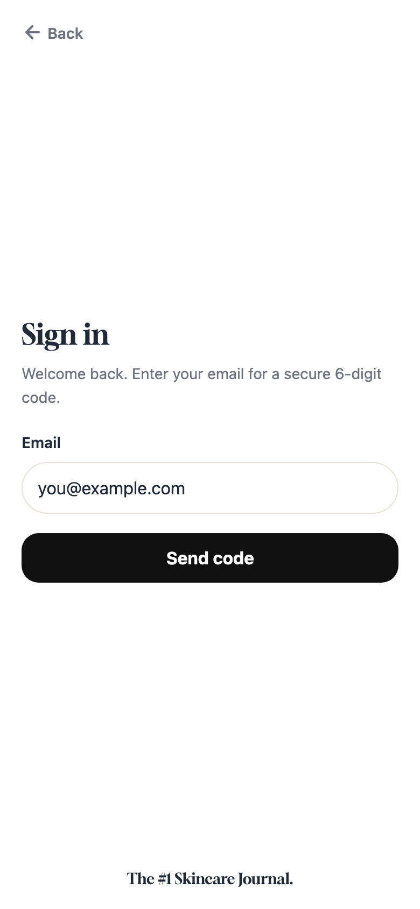

### C4 — `cold-me-flaky-connection`

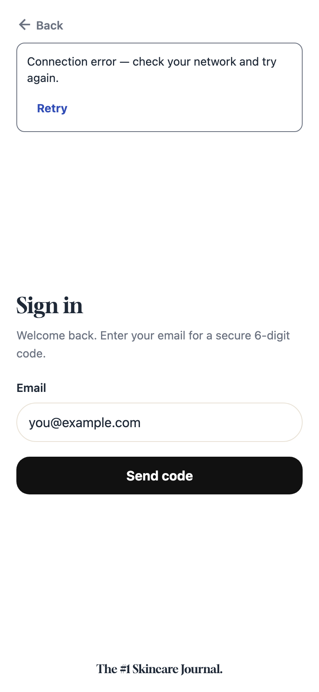

### C5 — `cold-index-timeout-signin`

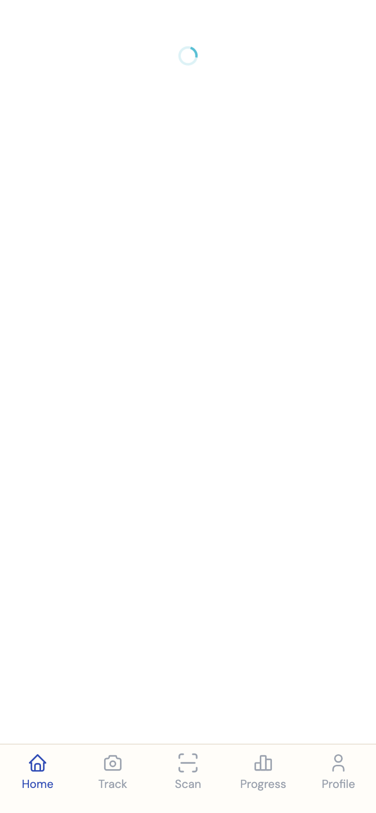

## Post-auth matrix (P1–P7)

### P1 — `postauth-journey-choose`

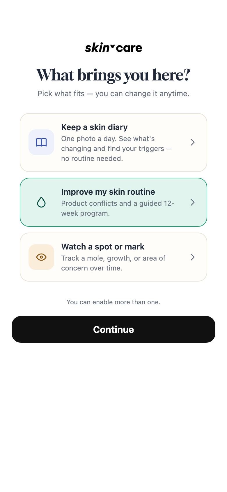

### P2 — `postauth-routine-pick`

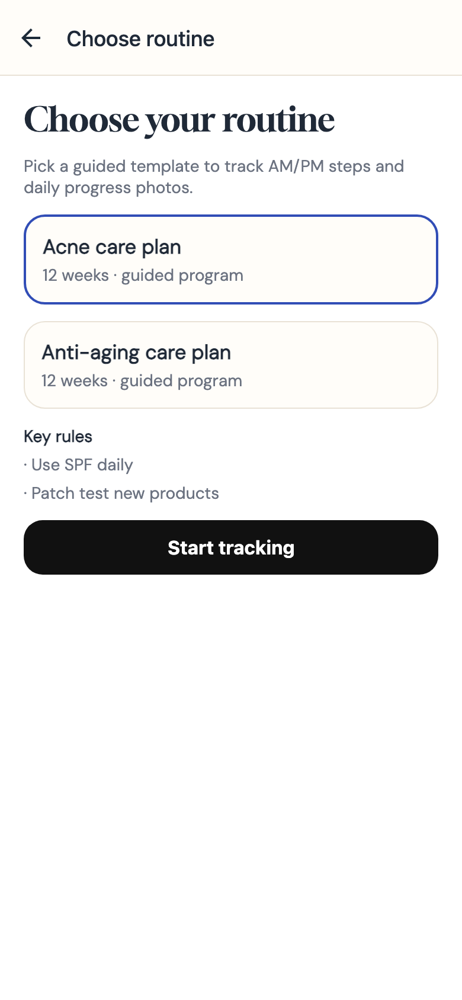

### P3 — `postauth-bio-calibration`

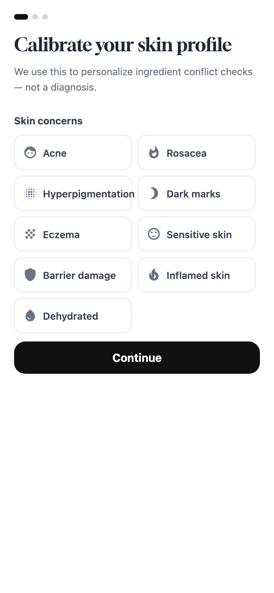

### P4 — `postauth-empty-shelf-scan`

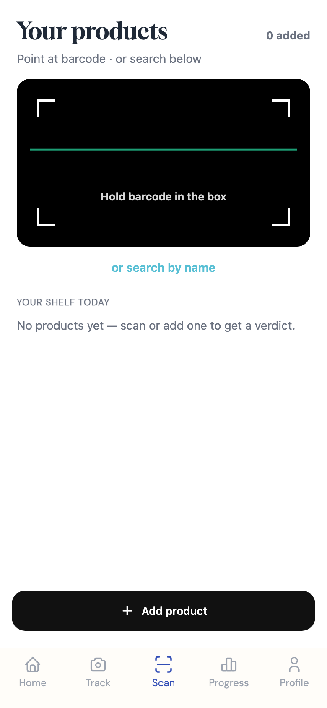

### P5 — `postauth-spot-only-track`

### P6 — `postauth-watch-only-home`

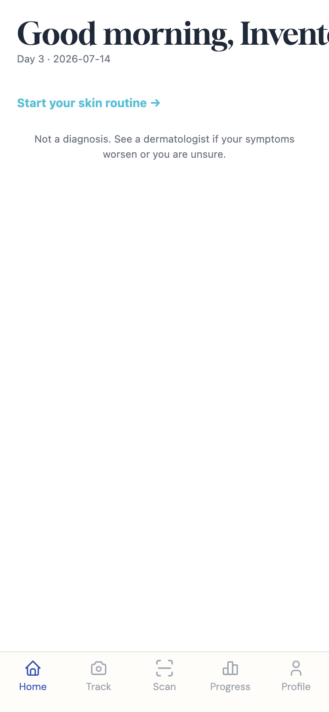

### P7 — `postauth-setup-complete-home`

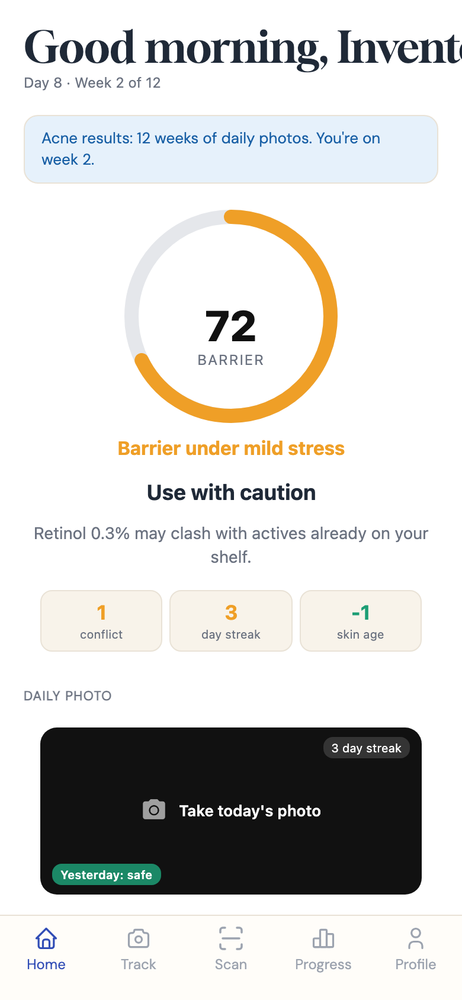

## Journal capture

**Flag-off skip:** `JOURNAL_CAPTURE_ENABLED=false` in `patient-app/constants/feature-flags.ts`. Stubs cannot flip the Metro-bundled constant. Attempted navigation still captured:

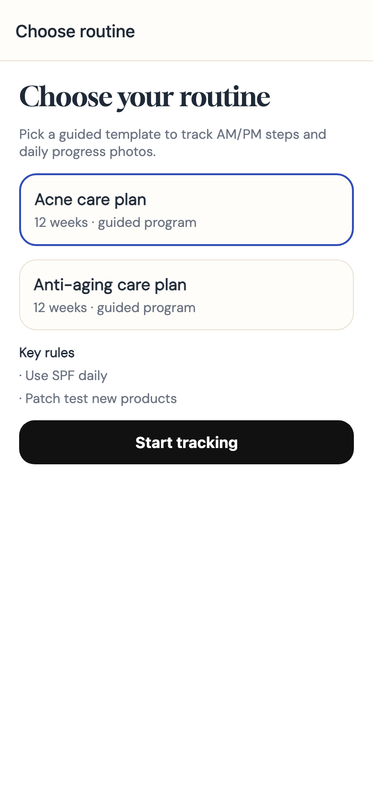

